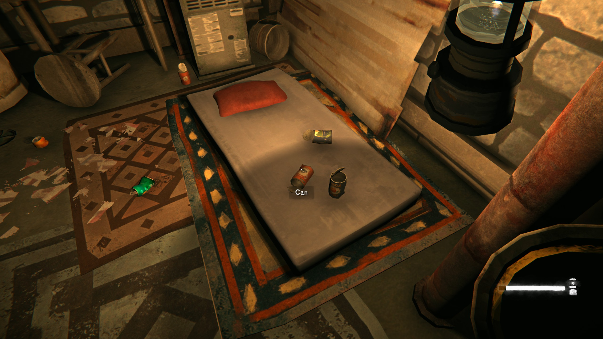

# Can

**Categories:** Interactable Objects, Pages with update history · **Source:** [Fandom](https://thelongdark.fandom.com/wiki/Can)

**Can**

[Can](../assets/Can.jpg)

**Story item:** Yes

A **Can** is a harvestable [Pork and Beans](./Pork%20and%20Beans.md) item found in the [Misty Falls Cave](./Misty%20Falls%20Cave.md) in [Episode 3: Crossroads Elegy](./Episode%203%20-%20Crossroads%20Elegy.md). It is found behind the waterfall as part of the [Tall Tales](./Tall%20Tales.md) The Lost Cave mission. It can be harvested for a [Recycled Can](./Recycled%20Can.md) in 6 minutes.

## Survival Mode

4 Cans can be found in the [Basement (Sundered Pass)](./Basement%20%28Sundered%20Pass%29.md) in [Sundered Pass](./Sundered%20Pass.md), while following the Tale [Last Horizon](./Last%20Horizon.md).

## Game History

- UPDATE **22 October 2019 ([Update](./The%20Long%20Dark%20%E2%80%94%20Changelog%20%E2%80%94%20Archive%202.md#1.60)):**
  - Added to game.
- UPDATE **24 June 2024 ([Update](./The%20Long%20Dark%20%E2%80%94%20Changelog.md#2.28)):**
  - Added to Survival Mode.
