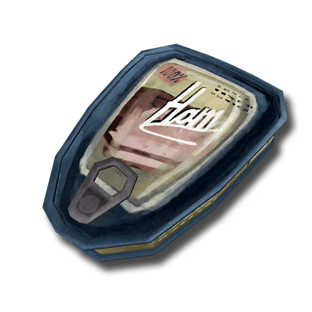

# Canned Ham

<table class="infobox">
<caption>Canned Ham</caption>
<colgroup>
<col style="width: 50%" />
<col style="width: 50%" />
</colgroup>
<tbody>
<tr>
<td colspan="2"><figure>

<figcaption>Canned_Ham_icon.png</figcaption>
</figure></td>
</tr>
<tr>
<td>
Release
</td>
<td>
<a href="./The%20Long%20Dark%20%E2%80%94%20Changelog.md#2.10" class="wikilink" title="30 March 2023">30 March 2023</a>
</td>
</tr>
<tr>
<td>
Wintermute
</td>
<td>
No
</td>
</tr>
<tr>
<td>
Renewable
</td>
<td>
No
</td>
</tr>
<tr>
<td colspan="2" class="section">
<strong>Properties</strong>
</td>
</tr>
<tr>
<td>
Item type
</td>
<td>
<a href="./Food%20And%20Drink.md" class="wikilink" title="Food And Drink">Food And Drink</a>|-
</td>
</tr>
<tr>
<td>
Stackable
</td>
<td>
No
</td>
</tr>
<tr>
<td>
Examine
</td>
<td>
Fully-cooked and ready to eat. An acquired taste, but safe and portable.
</td>
</tr>
<tr>
<td colspan="2" class="section">
<strong>Values</strong>
</td>
</tr>
<tr>
<td>
Calories
</td>
<td>
550 kcal
</td>
</tr>
<tr>
<td>
Hydration
</td>
<td>
-5%
</td>
</tr>
<tr>
<td>
Weight
</td>
<td>
0.40 kg (0.88 lbs)
</td>
</tr>
<tr>
<td colspan="2" class="section">
<strong>Decay Rate</strong>
</td>
</tr>
<tr>
<td>
Inside
</td>
<td>
0.133% per day
</td>
</tr>
<tr>
<td>
Outside
</td>
<td>
0.667% per day
</td>
</tr>
<tr>
<td colspan="2" class="section">
<strong>Advanced data</strong>
</td>
</tr>
<tr>
<td>
Item key
</td>
<td>
GAMEPLAY_CannedHam
</td>
</tr>
</tbody>
</table>

<table>
<colgroup>
<col style="width: 33%" />
<col style="width: 33%" />
<col style="width: 33%" />
</colgroup>
<tbody>
<tr>
<td width="40px"><figure>
[Missing image: Ptarmigan_icon.png]
<figcaption>Ptarmigan_icon.png</figcaption>
</figure></td>
<td>
<strong>DLC-Exclusive content.</strong> 

This content requires the <a href="./Tales%20from%20the%20Far%20Territory.md" class="wikilink" title="Tales from the Far Territory">Tales from the Far Territory</a> addon to be installed before it can be seen or used in regular gameplay.

</td>
<td>
|}<strong>Canned Ham</strong> is a packaged <a href="./Food%20And%20Drink.md" class="wikilink" title="food">food</a> which reduces hydration by 5% and provides 550 calories.

<h2 id="Overview">Overview</h2>

Consuming a Canned Ham provides up to 550 Calories and reduces hydration by 5%. <a href="./Canned%20Corn.md" class="wikilink" title="Canned Corn">Canned Corn</a> and Canned Ham can generally only be found after entering the Far Territory, specifically inside:

<ul>
<li>The 4 <a href="./Signal%20Void.md" class="wikilink" title="Signal Void">Signal Void</a> bunker kitchens.
<ul>
<li><a href="./Bunker%20Alpha.md" class="wikilink" title="Bunker Alpha">Bunker Alpha</a></li>
<li><a href="./Bunker%20Beta.md" class="wikilink" title="Bunker Beta">Bunker Beta</a></li>
<li><a href="./Bunker%20Gamma.md" class="wikilink" title="Bunker Gamma">Bunker Gamma</a></li>
<li><a href="./Bunker%20Omega.md" class="wikilink" title="Bunker Omega">Bunker Omega</a></li>
</ul></li>
<li>The top floor of the <a href="./Concentrator.md" class="wikilink" title="Concentrator">Concentrator</a> of the <a href="./Zone%20of%20Contamination.md" class="wikilink" title="Zone of Contamination">Zone of Contamination</a>.
<ul>
<li>In a <a href="./Locker.md" class="wikilink" title="Locker">Locker</a> in the hidden room with the <a href="./Miner%27s%20Flashlight.md" class="wikilink" title="Miner&#39;s Flashlight">Miner's Flashlight</a>.</li>
</ul></li>
<li>Occasionally in <a href="./Supply%20Cache.md" class="wikilink" title="Supply Cache">Supply Caches</a>.</li>
</ul>

Like <a href="./Tin%20of%20Sardines.md" class="wikilink" title="Tins of Sardines">Tins of Sardines</a>, Canned Ham can be opened without a <a href="./Can%20Opener.md" class="wikilink" title="Can Opener">Can Opener</a> (thanks to their pull-tab), and consuming them yields no <a href="./Recycled%20Can.md" class="wikilink" title="Recycled Can">Recycled Can</a>.

<h2 id="Trivia">Trivia</h2>

The side of the can lists "Ingredients: Ham (Cured With Water, Salt, Sugar, Sodium Phosphate, Carrageenan, Smoke Flavouring.)"

<h2 id="Update_history">Update history</h2>

<ul>
<li>UPDATE <strong>30 March 2023 (<a href="./The%20Long%20Dark%20%E2%80%94%20Changelog.md#2.10" class="wikilink" title="Update">Update</a>):</strong>
<ul>
<li>Added to game.</li>
</ul></li>
</ul>

<strong>Lua execution error in Module:Navbox function navbox</strong> <a href="ru:%D0%9A%D0%BE%D0%BD%D1%81%D0%B5%D1%80%D0%B2%D0%B8%D1%80%D0%BE%D0%B2%D0%B0%D0%BD%D0%BD%D0%B0%D1%8F_%D0%B2%D0%B5%D1%82%D1%87%D0%B8%D0%BD%D0%B0" class="wikilink" title="ru:Консервированная ветчина">ru:Консервированная ветчина</a>
</td>
</tr>
</tbody>
</table>

