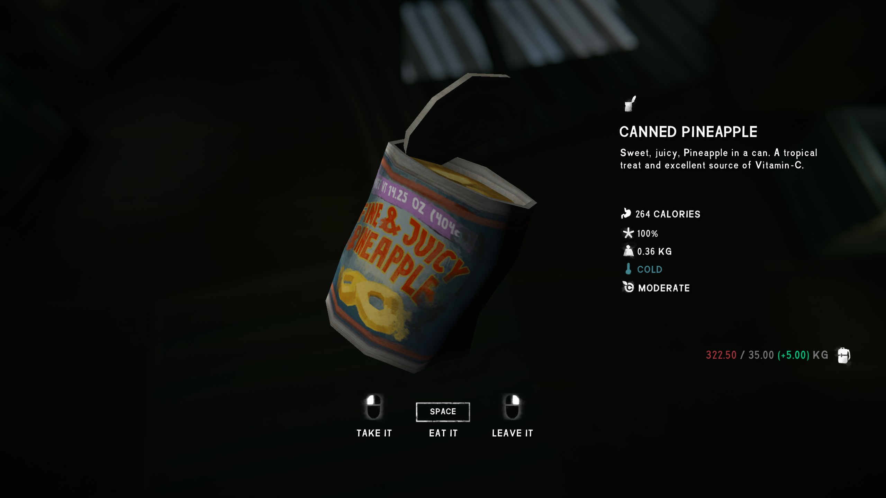

# Canned Pineapple

**Categories:** DLC Content, Food And Drink · **Source:** [Fandom](https://thelongdark.fandom.com/wiki/Canned_Pineapple)

**DLC-Exclusive content.**

This content requires the [Tales from the Far Territory](./Tales%20from%20the%20Far%20Territory.md) addon to be installed before it can be seen or used in regular gameplay.

**Canned Pineapple**

[Canned Pineapple icon](../assets/Canned_Pineapple_icon.png)

**Release:** [2 December 2024](./The%20Long%20Dark%20%E2%80%94%20Changelog.md#2.33)

**Wintermute:** No

**Renewable:** Yes ([Trader](./Trader.md) only)

**Properties**

**Item type:** [Food And Drink](./Food%20And%20Drink.md)

**Stackable:** No

**Examine:** Sweet, juicy, Pineapple in a can. A tropical treat and excellent source of Vitamin-C.

**Values**

**Calories:** 295 kcal

**Hydration:** 5%

**[Vitamin C](./Scurvy.md):** Moderate (56%)

**Weight:** 0.40 kg (0.88 lbs)

**Decay Rate**

**Inside:** 0.333% per day

**Outside:** 1.667% per day

**Advanced data**

**Item key:** GAMEPLAY\_CannedPineapple

**Canned Pineapple** is a canned [food](./Food%20And%20Drink.md) item in _The Long Dark_ found only when trading with the [Trader](./Trader.md).

## Overview

Consuming Canned Pineapple restores a moderate amount of calories and hydration. It may also be warmed by a [Fire](./Fire.md), to make progress in [Cooking](./Cooking.md) [Survival Skill](./Skills.md), and consumed while hot to grant the benefit [Warming Up](./Warming%20Up.md). Canned Pineapple has relatively low energy density (on par with that of cooked meats), making them relatively inefficient as a travel food.

Like other canned foods, Canned Pineapple may be opened with a [Can Opener](./Can%20Opener.md) or [bladed tool](./Tools.md), or smashed open (with no tool) but spilling some of its contents. If opened with a tool a [Recycled Can](./Recycled%20Can.md) is received after consuming the contents.

Canned Pineapple cannot be found as loot and is only acquired from the Trader, making it more difficult to acquire than similar [Pinnacle Peaches](./Pinnacle%20Peaches.md) but unlike other canned goods Pineapples are renewable.

## Trivia

- Canned Pineapple is packaged as "FINE &amp; JUICY PINEAPPLE_"_.
- The side of the can lists "Ingredients: Pineapple, Pineapple Juice, Citric Acid."
- Unlike other canned goods that must be opened with a bladed tool, Canned Pineapples does not have an open can icon in the Backpack after being opened.

