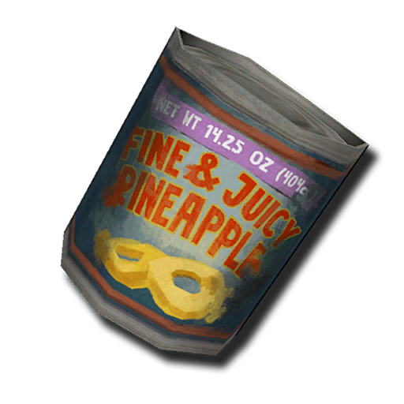

# Canned Pineapple

**Categories:** DLC Content, Food And Drink · **Source:** [Fandom](https://thelongdark.fandom.com/wiki/Canned_Pineapple)

| Column 1 | Column 2 | Column 3 |
| --- | --- | --- |

|  / _Canned\_Pineapple\_icon.png_ |  |  |
| Release | [2 December 2024](./The%20Long%20Dark%20%E2%80%94%20Changelog.md#2.33) |  |
| Wintermute | No |  |
| Renewable | Yes ([Trader](./Trader.md) only) |  |
| **Properties** |  |  |
| Item type | [Food And Drink](./Food%20And%20Drink.md)\|- |  |
| Stackable | No |  |
| Examine | Sweet, juicy, Pineapple in a can. A tropical treat and excellent source of Vitamin-C. |  |
| **Values** |  |  |
| Calories | 295 kcal |  |
| Hydration | 5% |  |
| [Vitamin C](./Scurvy.md) | Moderate (56%) |  |
| Weight | 0.40 kg (0.88 lbs) |  |
| **Decay Rate** |  |  |
| Inside | 0.333% per day |  |
| Outside | 1.667% per day |  |
| **Advanced data** |  |  |
| Item key | GAMEPLAY\_CannedPineapple |  |
