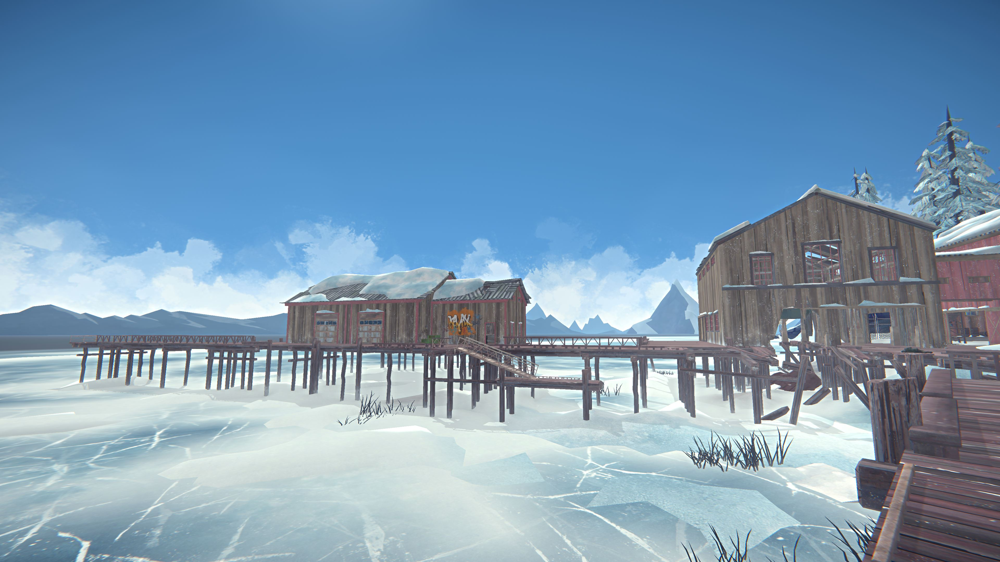
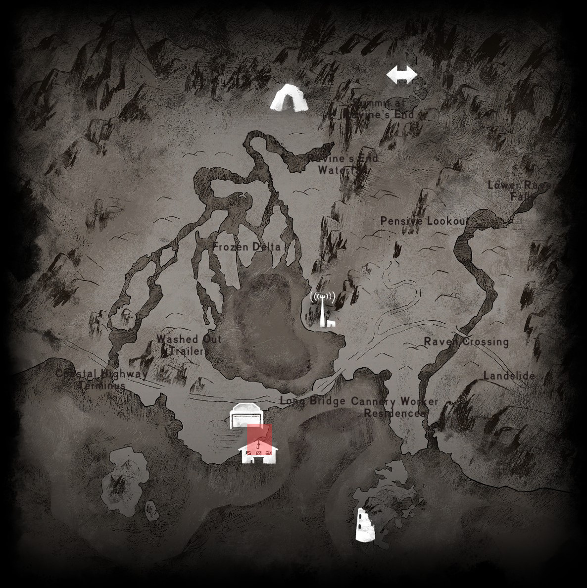
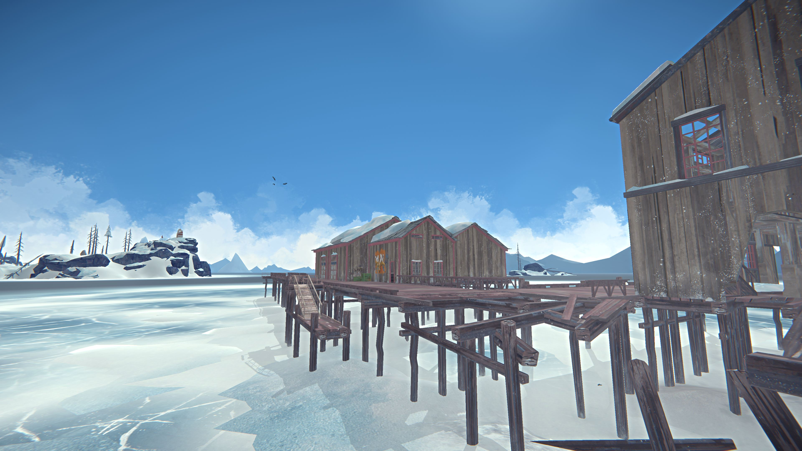

# Cannery Pier

**Cannery Pier**

| Property | Details |
| --- | --- |
|  |  / *SS-BI-CanneryPier02.jpg* |
| **Location** |  |
|  |  / *Cannery\_Pier\_Location.png* |
| Region | [Bleak Inlet](./Bleak%20Inlet.md)\|- |
| Description | A wharf isolated from the rest of the Cannery due to pier deterioration |
| **General** |  |
| Type | Industrial\|- |
|  / *bed\_icon.png* | Has a bed |
|  | Has an interior\|} The **Cannery Pier** is a section of the [Last Resort Cannery](./Last%20Resort%20Cannery.md) in [Bleak Inlet](./Bleak%20Inlet.md), and houses the [Workshop](./Workshop.md). / ## Overview / The pier is inaccessible to the player and [timberwolves](./Timberwolf.md) while following the ground level pier. It can only be accessed by the player by climbing the [Rope Climbing](./Rope%20Climbing.md) section in the warehouse and passing through an obstacle course. The obstacle course will take you over a downed crane, a derelict house and several cargo containers connected by boards in order to reach pier. The pier offers access to the Workshop in which the [Milling Machine](./Milling%20Machine.md) and [Ammunition Work Bench](./Ammunition%20Work%20Bench.md) are found. Additionally, a normal [Work Bench](./Work%20Bench.md), along with two [Fire Barrels](./Fire%20Barrel.md), can be found; one inside the workshop, the other just outside the door. / A [Keypad](./Keypad.md) and [Cannery Memo](./Cannery%20Memo.md) are found inside a warm area with a Fire Barrel, and the code to the keypad is found in the mountains at [Echo One Radio Tower](./Echo%20One%20Radio%20Tower.md). At the end of the Pier is a [Backpack](./Backpack.md) and some supplies, but nothing else aside from some [Pallets](./Pallets.md) is behind the Workshop. / ## Notes / - As the pier is a safe spot from Timberwolves, and it provides a good view of both the ice surrounding and some parts the cannery compound, it can be used as an easy way to snipe wolves before leaving the area. The main issue with this location that prevents it from being a useful place to store items is of course the obstacle course, as it lacks an unlockable shortcut and must be traveled through again to reach the pier. / - A way to bypass this is to place a deployed [Travois](./Travois.md) on the lower pier close to the frozen ocean and simply interacting with it on the ocean. This will teleport the player onto the pier and they can place the Travois down and bypass the obstacle course. / - Rarely after exiting the Workshop, timberwolves can glitch onto the pier and attack the player despite there being no path up from the ice below. [\[1\]](https://i.imgur.com/YrTVkDw.png) [\[2\]](https://i.imgur.com/FDAu161.png) / - The obstacle course can be skipped entirely by placing a deployed [Travois](./Travois.md) with an item inside on the lowest pier at the Cannery Pier, then placing the handles near the edge. Walking on the ocean below will then give the player the option to pick up the Travois, wherein the player will teleport up to the pier. / *The Pier as seen from the Cannery Docks* **Lua execution error in Module:Navbox function navbox** |
