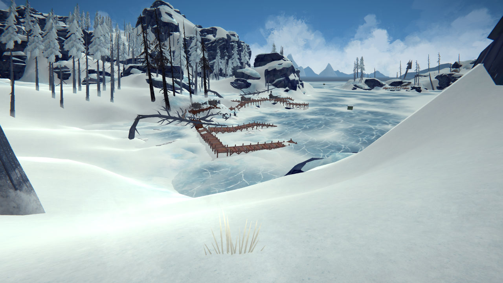

# Cannery Worker Residences

**Categories:** Indoor locations, Industrial locations, Locations, Locations in Bleak Inlet, Military/Sporting locations · **Source:** [Fandom](https://thelongdark.fandom.com/wiki/Cannery_Worker_Residences)

**Cannery Worker Residences**

_screen\_cff25cc7-7169-49a4-81a8-b5e18afd70ae\_hi.jpg_

**Location**

_Cannery\_Worker\_Residences\_Location.png_

**Region:** [Bleak Inlet](./Bleak%20Inlet.md)

**Description:** small cabins in varying states of disrepair

**General**

**Type:** IndustrialMilitary/Sporting

_bed\_icon.png_

Has a bed
