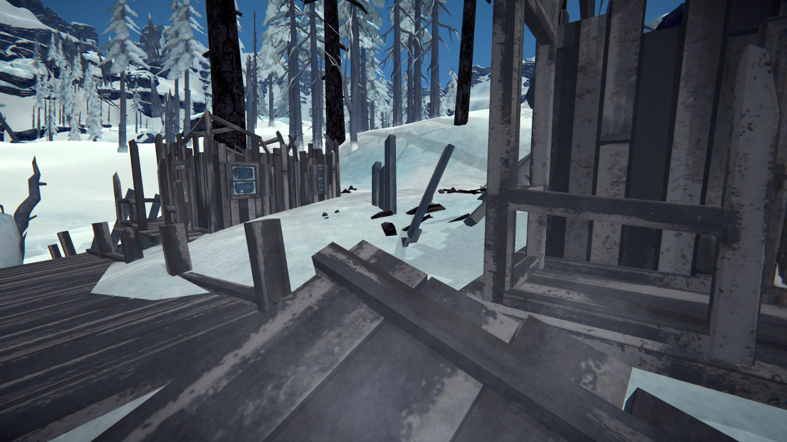
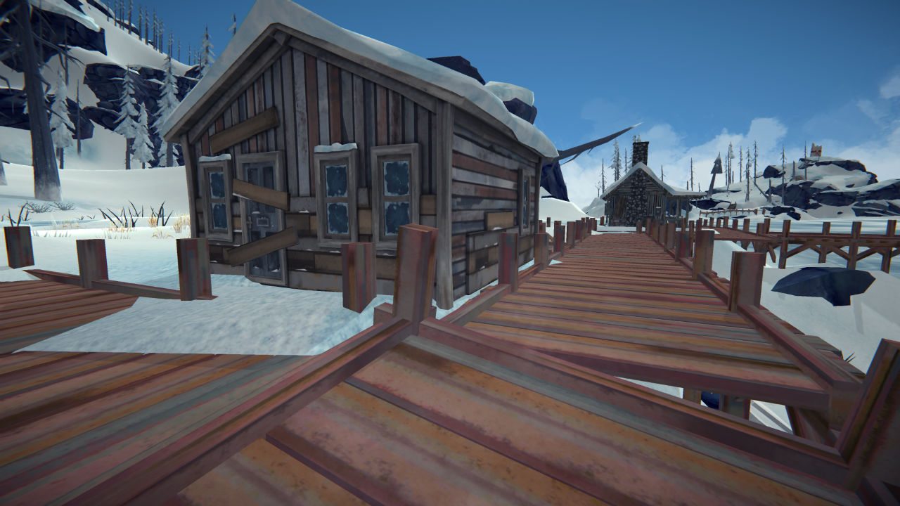
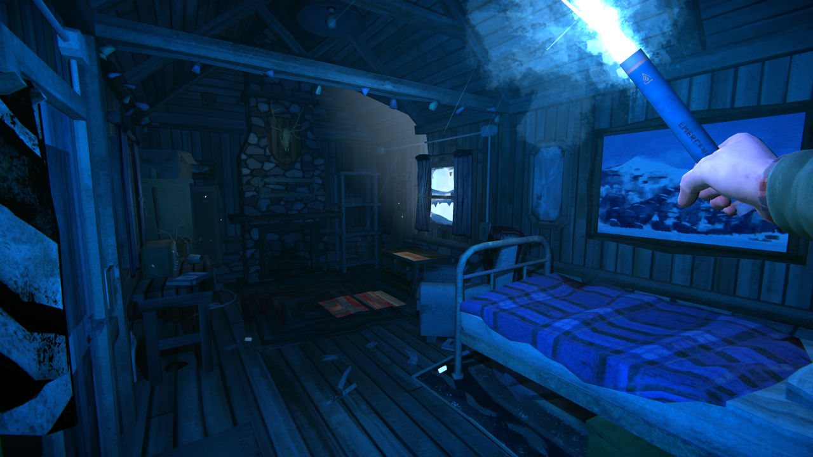
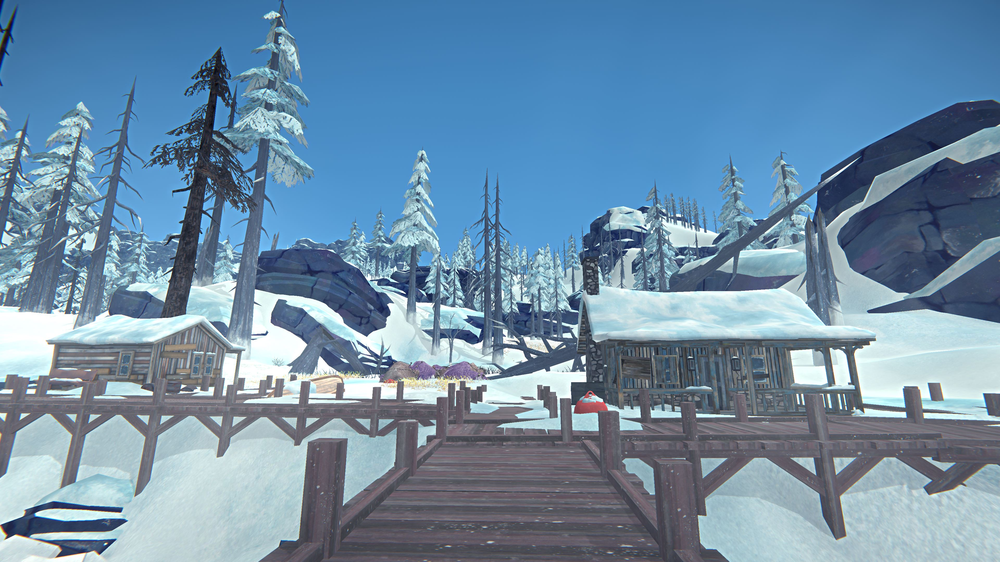
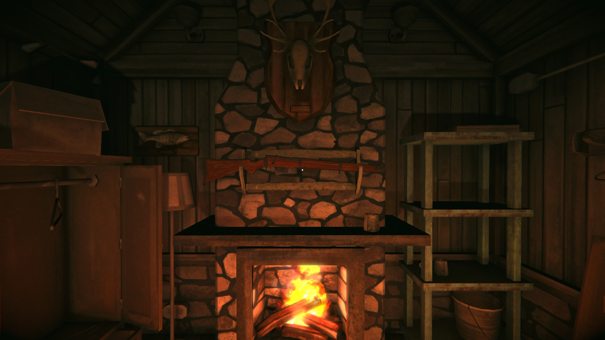

# Cannery Worker Residences

**Cannery Worker Residences**

| Property | Details |
| --- | --- |
|  |  / *screen\_cff25cc7-7169-49a4-81a8-b5e18afd70ae\_hi.jpg* |
| **Location** |  |
|  |  / *Cannery\_Worker\_Residences\_Location.png* |
| Region | [Bleak Inlet](./Bleak%20Inlet.md)\|- |
| Description | small cabins in varying states of disrepair |
| **General** |  |
| Type | IndustrialMilitary/Sporting\|- |
|  / *bed\_icon.png* | Has a bed |
|  | Has an interior\|} The **Cannery Worker Residences** is a collection of houses that once probably housed some of the employees of the [Last Resort Cannery](./Last%20Resort%20Cannery.md). / ## Overview / There are four houses at the location, two of which are burned, and one of which is boarded-up. The last is enterable and contains a fireplace for cooking. Outside on the frozen water is an ice fishing hut; just a little further is a good place for [beachcombing](./Beachcombing.md). South of the site is the [Fallen Lighthouse](./Fallen%20Lighthouse.md), which provides a 6-burner [stove](./Stove.md) (the only one not indoors) for efficient cooking and a [Distress Pistol](./Distress%20Pistol.md) found in an [Emergency Kit](./Emergency%20Kit.md) at the top of the Lighthouse. / ## Safehouse / As mentioned above, the worker residences can serve as a good safehouse in the region. Although a bear and timberwolves may prowl the area, deer and rabbits can also spawn near the lighthouse, and the nearby fishing huts help provide a full range of renewable food sources. The Residences are also centrally located in the region, allowing for easier access to several other notable locations. / The habitable building contains some mid-level loot, as well as a decent amount of storage. However, it is not a base the player should expect to spend much time in, but neither is the region. / \| Column 1 \| Column 2 \| Column 3 \| Column 4 \| / \| --- \| --- \| --- \| --- \| / \|  / *The residences from the east side of [Long Bridge](./Long%20Bridge.md)* \|  / *The two burned houses. The player can also find some [coal](./Coal.md) here.* \|  / *The two spared houses. the closest is boarded up.* \|  / *Inside the enterable cabin* \| / \|  / *SS-BI-CanneryWorkerResidences03.jpg* \|  / *SS-BI-CanneryWorkerResidences02.jpg* \|  / *SS-BI-CanneryWorkerResidences01.jpg* \|  / *20191226022201\_1.jpg* \| / **Lua execution error in Module:Navbox function navbox** |
|  / *The residences from the east side of [Long Bridge](./Long%20Bridge.md)* |  / *The two burned houses. The player can also find some [coal](./Coal.md) here.* /  / *The two spared houses. the closest is boarded up.* /  / *Inside the enterable cabin* |
|  / *SS-BI-CanneryWorkerResidences03.jpg* |  / *SS-BI-CanneryWorkerResidences02.jpg* /  / *SS-BI-CanneryWorkerResidences01.jpg* /  / *20191226022201\_1.jpg* |
