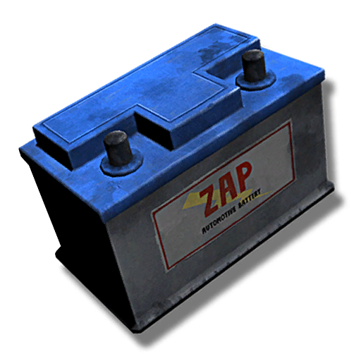

# Car Battery

**Contents**

- [Overview](#Overview)
- [Harvesting](#Harvesting)
- [Transmitters](#Transmitters)
- [Trading](#Trading)
- [Special Locations](#Special_Locations)
- [Products](#Products)
- [Tips](#Tips)
- [Trivia](#Trivia)

<table class="infobox">
<caption>Car Battery</caption>
<colgroup>
<col style="width: 50%" />
<col style="width: 50%" />
</colgroup>
<tbody>
<tr>
<td colspan="2"><figure>

<figcaption>Car_Battery_icon.png</figcaption>
</figure></td>
</tr>
<tr>
<td colspan="2" class="section">
<strong>General</strong>
</td>
</tr>
<tr>
<td>
Item Type
</td>
<td>
Tool|-
</td>
</tr>
<tr>
<td colspan="2" class="section">
<strong>Statistics</strong>
</td>
</tr>
<tr>
<td>
Weight
</td>
<td>
15.00 kg(33 lbs)
</td>
</tr>
<tr>
<td>
Harvest
</td>
<td>
30 min 6 x <a href="./Scrap%20Lead.md" class="wikilink" title="Scrap Lead">Scrap Lead</a> with a <a href="./Hacksaw.md" class="wikilink" title="Hacksaw">Hacksaw</a>
</td>
</tr>
</tbody>
</table>

**Template:quote**

**Car Batteries** are a crafting item in ***The Long Dark***.

## Overview

Car Batteries are the heaviest object in the game, weighing 15kg (33lbs), found under the hoods of a <a href="./Car.md" class="wikilink" title="Car">Car</a> or <a href="./Truck.md" class="wikilink" title="Truck">Truck</a> in any region that has them. Regions such as <a href="./Mountain%20Town.md" class="wikilink" title="Mountain Town">Mountain Town</a>, <a href="./Bleak%20Inlet.md" class="wikilink" title="Bleak Inlet">Bleak Inlet</a>, and <a href="./Coastal%20Highway.md" class="wikilink" title="Coastal Highway">Coastal Highway</a> have the most cars, thus have the most Car Batteries to loot.

### Harvesting

They can be harvested with a <a href="./Hacksaw.md" class="wikilink" title="Hacksaw">Hacksaw</a> for <a href="./Scrap%20Lead.md" class="wikilink" title="Scrap Lead">Scrap Lead</a>, required for crafting ammunition with the <a href="./Gunsmithing.md" class="wikilink" title="Gunsmithing">Gunsmithing</a> skill at the <a href="./Ammunition%20Work%20Bench.md" class="wikilink" title="Ammunition Workbench">Ammunition Workbench</a>. It takes 30 minutes to harvest a Car Battery. One Car Battery will always yield six Scrap Lead; each piece of Scrap Lead may be crafted into six <a href="./Bullet.md" class="wikilink" title="Bullets">Bullets</a> at an <a href="./Ammunition%20Forge.md" class="wikilink" title="Ammunition Forge">Ammunition Forge</a>, so one Car Battery always allows the crafting of 36 Bullets.

### Transmitters

For players that have the <a href="./Tales%20from%20the%20Far%20Territory.md" class="wikilink" title="Tales from the Far Territory">Tales from the Far Territory</a> DLC installed, one car battery will be needed to fix each <a href="./Transmitters.md" class="wikilink" title="Transmitter">Transmitter</a>. These batteries usually spawn near the transmitting stations, but may have to be looted from nearby vehicles:

- A Battery spawns in a <a href="./Supply%20Bin.md" class="wikilink" title="Supply Bin">Supply Bin</a> near the <a href="./Shortwave%20Tower%20East.md" class="wikilink" title="Shortwave Tower East">Shortwave Tower East</a> Transmitter in <a href="./Forlorn%20Muskeg.md" class="wikilink" title="Forlorn Muskeg">Forlorn Muskeg</a>.
- The <a href="./Radio%20Tower.md" class="wikilink" title="Radio Tower">Radio Tower</a> Transmitter does not have a Battery near it in <a href="./Mountain%20Town.md" class="wikilink" title="Mountain Town">Mountain Town</a>. One must be scavenged near the town and brought up to the Transmitter.
- <a href="./Signal%20Hill.md" class="wikilink" title="Signal Hill">Signal Hill</a> has a Battery inside the Radio Control Hut in <a href="./Pleasant%20Valley.md" class="wikilink" title="Pleasant Valley">Pleasant Valley</a>.
- The <a href="./Control%20Tower.md" class="wikilink" title="Control Tower">Control Tower</a> has all the materials needed to repair the Transmitter nearby in <a href="./Forsaken%20Airfield.md" class="wikilink" title="Forsaken Airfield">Forsaken Airfield</a>.
- <a href="./Old%20Substation.md" class="wikilink" title="Old Substation">Old Substation</a> has a battery inside the substation for the Transmitter in <a href="./Blackrock.md" class="wikilink" title="Blackrock">Blackrock</a>.
- <a href="./Hibernia%20Processing.md" class="wikilink" title="Hibernia Processing">Hibernia Processing</a> has multiple inside for the Transmitter in <a href="./Desolation%20Point.md" class="wikilink" title="Desolation Point">Desolation Point</a>.

### Trading

The <a href="./Trader.md" class="wikilink" title="Trader">Trader</a> also requests 1 battery in his trades for <a href="./Recipe%20Cards.md" class="wikilink" title="Recipe Cards">Recipe Cards</a> or Blueprints.

### Special Locations

A select number of special areas contains around 5 Batteries in an indoor space. These batteries are typically not located near a Transmitter, and are useful if the player has run out of Car Batteries to use for trading or Gunsmithing.

- <a href="./Main%20Hangar.md" class="wikilink" title="Main Hangar">Main Hangar</a> in <a href="./Forsaken%20Airfield.md" class="wikilink" title="Forsaken Airfield">Forsaken Airfield</a>
- <a href="./Hibernia%20Processing.md" class="wikilink" title="Hibernia Processing">Hibernia Processing</a> in <a href="./Desolation%20Point.md" class="wikilink" title="Desolation Point">Desolation Point</a>
- <a href="./Blackrock%20Prison.md" class="wikilink" title="Blackrock Prison">Blackrock Prison</a> (inside the prison) in <a href="./Blackrock.md" class="wikilink" title="Blackrock">Blackrock</a>

## Products

## Tips

Eventually all <a href="./Hunting%20Rifle.md" class="wikilink" title="Hunting Rifle">Hunting Rifle</a> and <a href="./Revolver.md" class="wikilink" title="Revolver">Revolver</a> ammunition will become depleted; crafting is the only way to obtain more ammunition outside of trading with the Trader.

- Car Batteries may be found by lifting the hoods of cars and trucks. Not all vehicles have batteries, only ~50% will have one. At least on Interloper mode you should be prepared to haul car batteries from other maps to transmitters you want to repair.
- They weigh 15kg, but can be harvested with a <a href="./Hacksaw.md" class="wikilink" title="Hacksaw">Hacksaw</a> into 6 pieces of Scrap Lead weighing just 1.5kg. A convenient and safe way harvest Car Batteries is inside of their vehicle.
- In prior versions, Car Batteries and Scrap Lead were useless on Interloper difficulty because firearms never spawn. This was changed with the introduction of Transmitters.
  - They are still useless in <a href="./Wintermute.md" class="wikilink" title="Wintermute">Wintermute</a> episodes 1, 2, 3, and 4 because there is no <a href="./Ammunition%20Work%20Bench.md" class="wikilink" title="Ammunition Workbench">Ammunition Workbench</a>.
- Car Batteries and Scrap Lead are finite and non-renewable.
- A <a href="./Travois.md" class="wikilink" title="Travois">Travois</a> is extremely useful for hauling car batteries over longer distances.

## Trivia

- The Errant Pilgrim update introduced <a href="./Gunsmithing.md" class="wikilink" title="Gunsmithing">Gunsmithing</a>.
- 12-Volt Lead-acid car batteries have 6 cells inside (2 volts per cell), which is why a Car Battery can be harvested for 6 pieces of Scrap Lead (one per cell).
- The car battery bears the logo of the in-game company "ZAP." The same logo can be found on the <a href="./Energy%20Bar.md" class="wikilink" title="energy bar">energy bar</a>.

**Lua execution error in Module:Navbox function navbox** <a href="ru:%D0%90%D0%BA%D0%BA%D1%83%D0%BC%D1%83%D0%BB%D1%8F%D1%82%D0%BE%D1%80" class="wikilink" title="ru:Аккумулятор">ru:Аккумулятор</a>

