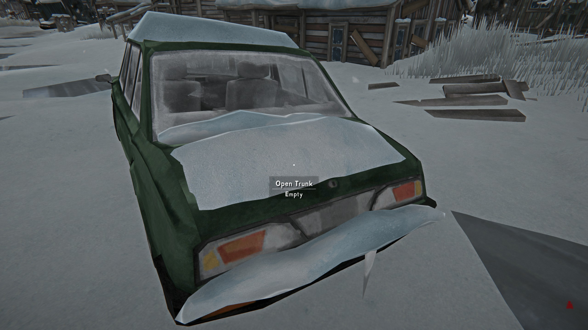

# Car Trunk

**Car Trunk**

| Property | Details |
| --- | --- |
|  |  / *Car\_Trunk.jpg* |
| Release | TBD |
| Update | [0.00](./The%20Long%20Dark%20%E2%80%94%20Changelog.md#0.00) |
| Story item | Yes |
| **Container** |  |
| Capacity | 40.00 kg(88 lbs) |

A **Car Trunk** is a storage container found on the back of a [Car](./Car.md). They are often locked and require a [Prybar](./Prybar.md) to open. They do not appear on any other vehicle. **Lua execution error in Module:Navbox function navbox**
