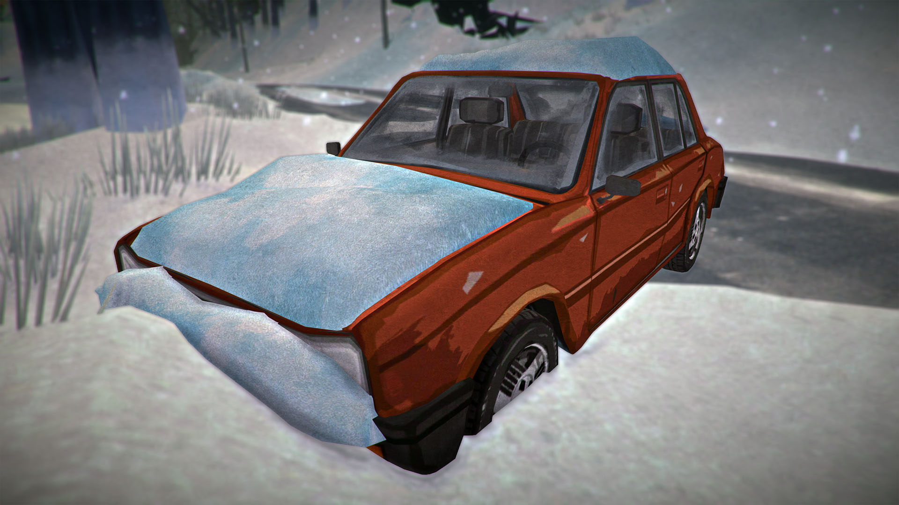
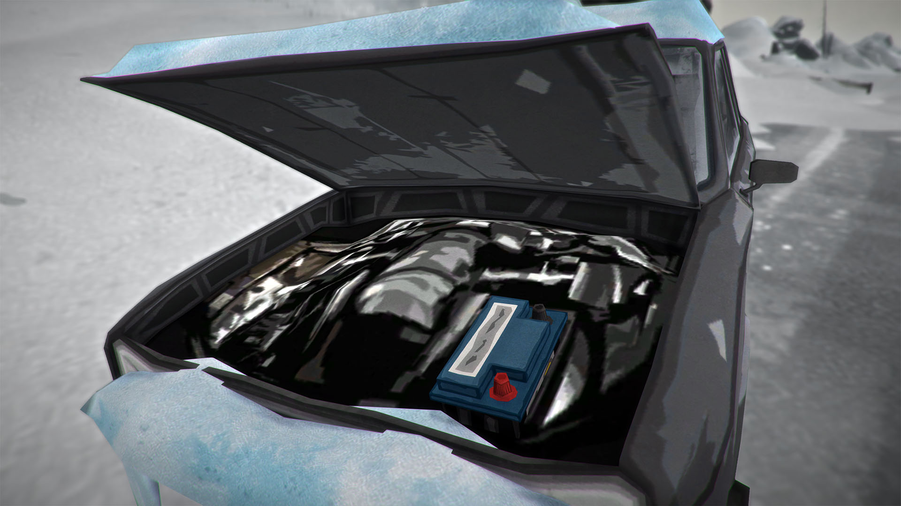

# Car

**Categories:** Interactable objects, Interactable Objects · **Source:** [Fandom](https://thelongdark.fandom.com/wiki/Car)

**Cars** are small 4-door [vehicles](./Vehicle.md) found abandoned by the road in the savage Canadian wilderness. Cars are not the best place to set up a base, but they do provide protection from the wind and predators. It is possible but risky to [sleep](./Sleep.md) in a car by choosing the bedroll icon (even without a [Bedroll](./Bedroll.md) in your inventory) from the radial menu. A car's lights will flicker and its radio will have power during an aurora.

Car [Visors](./Visor.md) can sometimes hold [Mementos](./Mementos.md).

## Overview

Cars are remnants of former human society before the apocalypse. They have been rendered useless hunks of metal due to the [aurora](./Aurora.md). Cars are suitable as temporary sanctuaries from predators and the cold, and may even hold some basic supplies like food and water. All cars have searchable glove compartments in the passenger side and visors on both sides. A [prybar](./Prybar.md) will allow the player to force open the trunk, if it is locked. It is not possible to drop items inside a car. Under the hood, many cars contain a [battery](./Car%20Battery.md), which can be harvested into [scrap lead](./Scrap%20Lead.md) using a [hacksaw](./Hacksaw.md); since lead is needed for [making ammunition](./Ammunition%20Work%20Bench.md), car batteries can be a critical, limited resource.

Entering a car will add a windproof protection as well as a bonus ambient temperature of +5o C. If there is no bedroll, the car will offer a bed warmth bonus of 3o C, but if there is a bedroll, the bedroll value will be used instead. Therefore, it is recommended to use a [bedroll](./Bedroll.md) of higher condition than 60%.

## Gallery

_A car with its hood open. old version_

## Trivia

- Attempting to relocate an item in a car will eject you.
- Cars appear in grey, blue, green, red, and purple.
- Cars also have different Alloy wheels depending on the body color.
- There is a chance that a [rifle](./Hunting%20Rifle.md) or [revolver](./Revolver.md) may spawn in some cars
- Trunks, hoods, doors and gas caps are all able to be opened on cars. Hoods and gas caps can be left open.
- Not all cars have [car batteries](./Car%20Battery.md) under their hoods.
- Sun visors are moveable, and can sometimes reward the player with [Mementos](./Mementos.md).
- Car radios can be turned on and off, however they only function during an aurora, and only play classical music.
