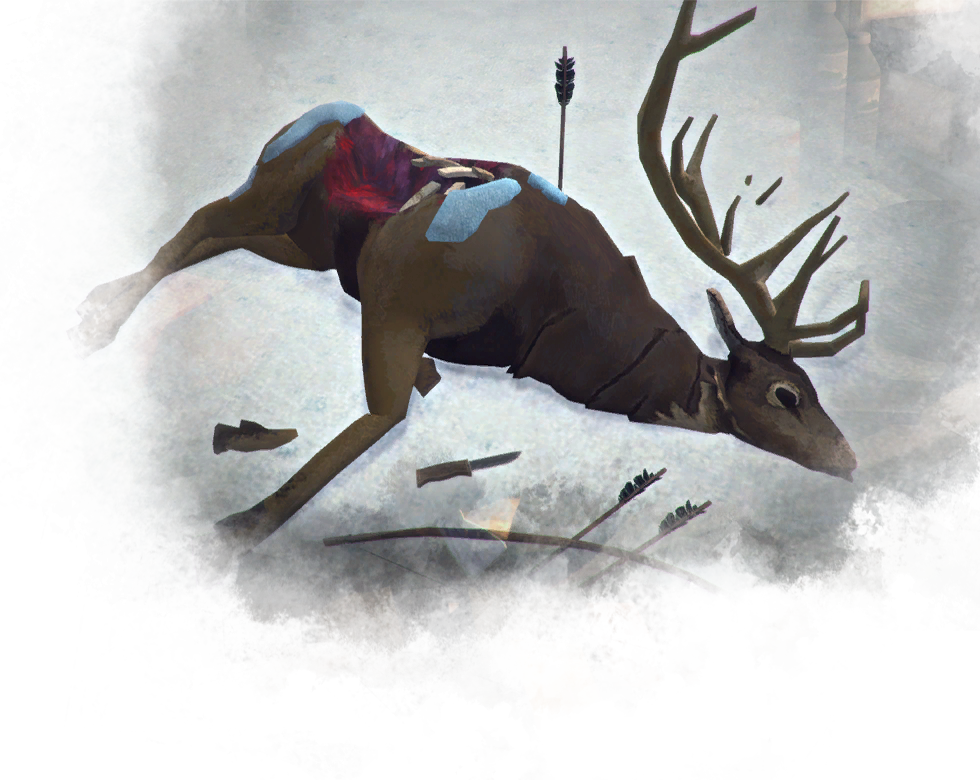
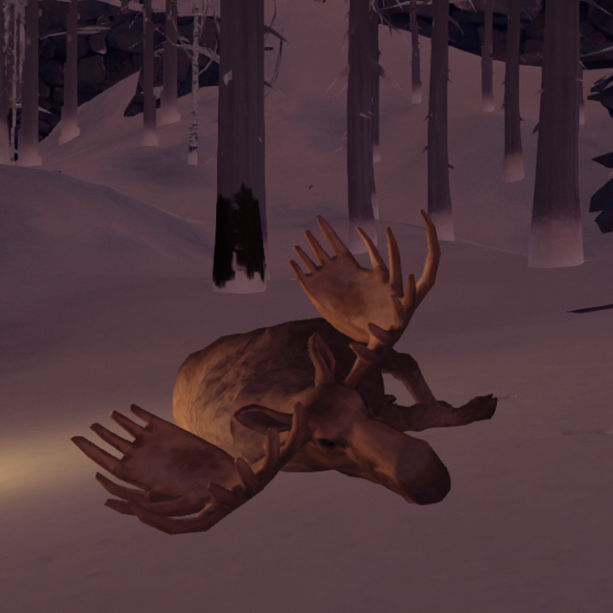
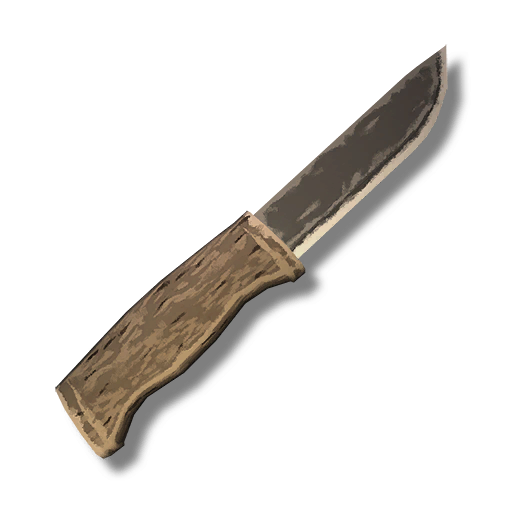
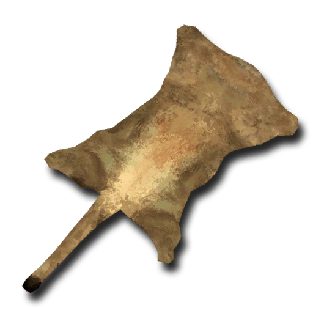

# Carcass Harvesting

**Contents**

- [How to harvest](#How_to_harvest)
- [Equipment](#Equipment)
- [Carcasses](#Carcasses)
- [Status](#Status)
- [Types](#Types)
- [Quartering](#Quartering)
- [Skill Levels](#Skill_Levels)

<table class="infobox">
<caption>Carcass Harvesting</caption>
<colgroup>
<col style="width: 50%" />
<col style="width: 50%" />
</colgroup>
<tbody>
<tr>
<td colspan="2"><figure>

<figcaption>Carcass_Harvesting_background.png</figcaption>
</figure></td>
</tr>
<tr>
<td>
Release
</td>
<td>
<a href="./The%20Long%20Dark%20%E2%80%94%20Early%20Access%20Changelog.md#0.346" class="wikilink" title="Penitent Scholar (v0.346)">Penitent Scholar (v0.346)</a>
</td>
</tr>
<tr>
<td>
Date
</td>
<td>
23 June 2016
</td>
</tr>
</tbody>
</table>

<figure>

<figcaption>|left|alt=Carcass harvesting|80px</figcaption>
</figure>

**Carcass Harvesting** is a Survival <a href="./Skills.md" class="wikilink" title="Skill">Skill</a> that is used to harvest meat, hides, and Guts from <a href="./Wildlife.md" class="wikilink" title="Wildlife">Wildlife</a>. There are 9 types of harvestable animals in *<a href="./The%20Long%20Dark.md" class="wikilink" title="The Long Dark">The Long Dark</a>*, and apart from <a href="./Rabbit.md" class="wikilink" title="Rabbit">Rabbit</a> and <a href="./Ptarmigan.md" class="wikilink" title="Ptarmigan">Ptarmigan</a>, all animals can only be harvested at the location of the carcass, unless that animal has been quartered. Higher levels in the carcass harvesting skill reduce the amount of time required to harvest and increase the amount that can be harvested by hand from a frozen carcass.

## How to harvest

A slain Moose Carcass Players can only harvest at the location of the animal, which cannot be moved by the player. The only exceptions to this are rabbits and ptarmigan, which can be picked up and harvested at any location.

- In order to harvest a carcass, the player needs to have a tool on them, as any non-ravaged carcass (other than rabbits and ptarmigan) cannot be harvested with bare hands, regardless of Carcass Harvesting skill level. Once a carcass has been harvested with a tool, to any degree, the player will be able to use their hands. This is shown by the carcass having exposed flesh.
- Choosing to harvest a carcass barehanded below Carcass Harvesting Level 3 <u>will always result in 8-17% of the unharvested usable meat to be lost</u>, even if the hide/guts/feathers was harvested instead. This is similar to smashing cans open without a tool before reaching <a href="./Cooking.md" class="wikilink" title="Cooking">Cooking</a> Level 3. As such, it is best to use a tool to extract the raw meat first before choosing to harvest the hide/guts/feathers without a tool.
- A carcass deteriorates over time, based on how frozen it is, which lowers the condition of the harvestable meat. Once said condition reaches 0, the carcass will become unable to be interacted with, so any remaining meat, hide, feathers, and guts will be lost.
- The player cannot harvest more than 5 hours worth of materials from a carcass (this usually applies to Bears and Moose, even with a Hunting Knife which reduces the most harvesting time).

Carcass harvesting is messy, and the raw animal parts the player takes will emit an <a href="./Scent.md" class="wikilink" title="odor">odor</a> that attracts predators from greater distances than usual (indicated by a icon of three wavy lines on the upper center area of the HUD). Cooking the meat and curing hides and guts reduces or eliminates the intensity of the scent.

## Equipment

Players can harvest carcasses by hand, but can decrease the amount of time needed for harvest with certain types of equipment. In most cases, any bladed tool will harvest faster than using one's hands, however, in a few situations (e.g., when harvesting guts with only a hatchet available or harvesting hides at high skill level) harvesting by hand may be slightly faster.

A 100% frozen carcass cannot be harvested barehanded if the carcass is intact, regardless of skill level, and requires a tool to break the carcass open first. After this, a frozen carcass can be harvested barehanded depending on carcass frozen state:

- 50% frozen level at Level 3
- 75% frozen level at Level 4
- 100% frozen level at Level 5
- 

Survivor's skill level also affects the freeze level at which unfrozen meat harvesting speed is used:

- Levels 1~3: Carcasses below or equal to 50% freeze level use the unfrozen meat harvesting speed.
- Level 4: Carcasses below or equal to 75% freeze level use the unfrozen meat harvesting speed.
- Level 5: Carcasses below or equal to 100% freeze level use the unfrozen meat harvesting speed.

This makes Hatchets & Hacksaws good starting tools for meat harvesting, since they have better frozen meat harvesting speed, but end up losing that situational bonus at higher levels, and as such get completely outclassed by hunting knives at skill level 5.

<table style="width:100%;">
<colgroup>
<col style="width: 14%" />
<col style="width: 14%" />
<col style="width: 14%" />
<col style="width: 14%" />
<col style="width: 14%" />
<col style="width: 14%" />
<col style="width: 14%" />
</colgroup>
<thead>
<tr>
<th colspan="2">
Tool
</th>
<th colspan="2">
Harvest rate 
(minutes per kg)
</th>
<th colspan="2">
Harvest rate 
(minutes per unit)
</th>
<th>
Tool decay 
(per hour)
</th>
</tr>
</thead>
<tbody>
<tr>
<td>
Meat
</td>
<td>
Frozen Meat
</td>
<td>
Hide
</td>
<td>
Gut
</td>
<td></td>
<td></td>
<td></td>
</tr>
<tr>
<td><figure>

<figcaption>Anywhere_icon.png</figcaption>
</figure></td>
<td>
Bare Hand
</td>
<td>
30.0
</td>
<td>
N/A
</td>
<td>
40.0
</td>
<td>
40.0
</td>
<td>
None
</td>
</tr>
<tr>
<td><figure>

<figcaption>Hacksaw_icon.png</figcaption>
</figure></td>
<td>
<a href="./Hacksaw.md" class="wikilink" title="Hacksaw">Hacksaw</a>
</td>
<td>
15.0
</td>
<td>
10.0
</td>
<td>
60.0
</td>
<td>
30.0
</td>
<td>
1.0%
</td>
</tr>
<tr>
<td><figure>

<figcaption>Hatchet_icon.png</figcaption>
</figure></td>
<td>
<a href="./Hatchet.md" class="wikilink" title="Hatchet">Hatchet</a>
</td>
<td>
15.0
</td>
<td>
10.0
</td>
<td>
45.0
</td>
<td>
20.0
</td>
<td>
1.0%
</td>
</tr>
<tr>
<td><figure>

<figcaption>Hunting_Knife_icon.png</figcaption>
</figure></td>
<td>
<a href="./Hunting%20Knife.md" class="wikilink" title="Hunting Knife">Hunting Knife</a>
</td>
<td>
8.0
</td>
<td>
20.0
</td>
<td>
30.0
</td>
<td>
10.0
</td>
<td>
1.0%
</td>
</tr>
<tr>
<td><figure>

<figcaption>Improvised_Hatchet_icon.png</figcaption>
</figure></td>
<td>
<a href="./Improvised%20Hatchet.md" class="wikilink" title="Improvised Hatchet">Improvised Hatchet</a>
</td>
<td>
20.0
</td>
<td>
15.0
</td>
<td>
60.0
</td>
<td>
30.0
</td>
<td>
1.5%
</td>
</tr>
<tr>
<td><figure>

<figcaption>Improvised_Knife_icon.png</figcaption>
</figure></td>
<td>
<a href="./Improvised%20Knife.md" class="wikilink" title="Improvised Knife">Improvised Knife</a>
</td>
<td>
12.0
</td>
<td>
30.0
</td>
<td>
40.0
</td>
<td>
15.0
</td>
<td>
1.5%
</td>
</tr>
<tr>
<td><figure>

<figcaption>Cougar_Claw_Knife_icon.png</figcaption>
</figure></td>
<td>
<a href="./Cougar%20Claw%20Knife.md" class="wikilink" title="Cougar Claw Knife">Cougar Claw Knife</a>
</td>
<td>
7.0
</td>
<td>
18.0
</td>
<td>
30.0
</td>
<td>
10.0
</td>
<td>
1.0%
</td>
</tr>
<tr>
<td><figure>

<figcaption>Survival_Knife_icon.png</figcaption>
</figure></td>
<td>
<a href="./Survival%20Knife.md" class="wikilink" title="Survival Knife">Survival Knife</a>
</td>
<td>
8.0
</td>
<td>
10.0
</td>
<td>
30.0
</td>
<td>
10.0
</td>
<td>
0.5%
</td>
</tr>
<tr>
<td><figure>

<figcaption>Scrap_Metal_Shard_icon.png</figcaption>
</figure></td>
<td>
<a href="./Scrap%20Metal%20Shard.md" class="wikilink" title="Scrap Metal Shard">Scrap Metal Shard</a>
</td>
<td>
8.0
</td>
<td>
20.0
</td>
<td>
30.0
</td>
<td>
10.0
</td>
<td>
1.0%
</td>
</tr>
</tbody>
</table>

## Carcasses

Carcasses can be obtained through <a href="./Hunting.md" class="wikilink" title="Hunting">Hunting</a>, <a href="./Trapping.md" class="wikilink" title="Trapping">Trapping</a>, or by scavenging for any existing ravaged carcasses.

### Status

A carcass can exist in two different states: Ravaged or Normal. A third state, Frozen, can occur if a carcass fully freezes over.

A ravaged carcass has a significant lack of meat on the corpse, depending on how long the carcass was being fed upon by a Wolf if it was killed by one after world generation, or if it spawned into the world ravaged. A frozen carcass generally requires a tool to harvest the carcass, depending on the player's carcass harvesting skill level. A normal carcass has either been recently killed or has been warmed up by a nearby <a href="./Fire.md" class="wikilink" title="Fire">Fire</a>.

### Types

<table>
<colgroup>
<col style="width: 20%" />
<col style="width: 20%" />
<col style="width: 20%" />
<col style="width: 20%" />
<col style="width: 20%" />
</colgroup>
<thead>
<tr>
<th>
Animal Carcass
</th>
<th>
Minimum Weight
</th>
<th>
Maximum Weight
</th>
<th>
Hide/Pelt/Other
</th>
<th>
Fresh Guts
</th>
</tr>
</thead>
<tbody>
<tr>
<td>
<a href="./Black%20Bear%20Carcass.md" class="wikilink" title="Black Bear Carcass">Black Bear Carcass</a>
</td>
<td>
25.00 kg 
(55 lb)<strong>Template:pic link</strong>
</td>
<td>
40.00 kg 
(88 lb)<strong>Template:pic link</strong>
</td>
<td>
1 x  <a href="./Fresh%20Black%20Bear%20Hide.md" class="wikilink" title="Fresh Black Bear Hide">Fresh Black Bear Hide</a>
</td>
<td>
10 x <strong>Template:pic link</strong>
</td>
</tr>
<tr>
<td>
<a href="./Cougar%20Carcass.md" class="wikilink" title="Cougar Carcass">Cougar Carcass</a>
</td>
<td>
N/A
</td>
<td>
4.00 kg 
(8.8 lb)<strong>Template:pic link</strong>
</td>
<td>
1 x  <a href="./Fresh%20Cougar%20Hide.md" class="wikilink" title="Fresh Cougar Hide">Fresh Cougar Hide</a> 
1 x  <a href="./Cougar%20Claw.md" class="wikilink" title="Cougar Claw">Cougar Claw</a>
</td>
<td>
2 x <strong>Template:pic link</strong>
</td>
</tr>
<tr>
<td>
<a href="./Deer%20Carcass.md" class="wikilink" title="Deer Carcass">Deer Carcass</a>
</td>
<td>
6.00 kg 
(13.2 lb)<strong>Template:pic link</strong>
</td>
<td>
11.00 kg 
(24.2 lb)<strong>Template:pic link</strong>
</td>
<td>
1 x  <a href="./Fresh%20Deer%20Hide.md" class="wikilink" title="Fresh Deer Hide">Fresh Deer Hide</a>
</td>
<td>
2 x <strong>Template:pic link</strong>
</td>
</tr>
<tr>
<td>
<a href="./Moose%20Carcass.md" class="wikilink" title="Moose Carcass">Moose Carcass</a>
</td>
<td>
32.00 kg 
(70.4 lb)<strong>Template:pic link</strong>
</td>
<td>
45.00 kg 
(99 lb)<strong>Template:pic link</strong>
</td>
<td>
1 x  <a href="./Fresh%20Moose%20Hide.md" class="wikilink" title="Fresh Moose Hide">Fresh Moose Hide</a>
</td>
<td>
12 x <strong>Template:pic link</strong>
</td>
</tr>
<tr>
<td>
<a href="./Poisoned%20Wolf%20Carcass.md" class="wikilink" title="Poisoned Wolf Carcass">Poisoned Wolf Carcass</a>
</td>
<td>
0 kg 
(0 lb) <a href="./Wolf%20Meat%20%28Raw%29.md" class="wikilink" title="Wolf Meat (Raw)">Wolf Meat (Raw)</a>
</td>
<td>
0 kg 
(0 lb) <a href="./Wolf%20Meat%20%28Raw%29.md" class="wikilink" title="Wolf Meat (Raw)">Wolf Meat (Raw)</a>
</td>
<td>
1 x  <a href="./Fresh%20Wolf%20Pelt.md" class="wikilink" title="Fresh Wolf Pelt">Fresh Wolf Pelt</a>
</td>
<td>
2 x <strong>Template:pic link</strong>
</td>
</tr>
<tr>
<td>
<a href="./Ptarmigan%20Carcass.md" class="wikilink" title="Ptarmigan Carcass">Ptarmigan Carcass</a>
</td>
<td>
0.60 kg 
(1.32 lb)<strong>Template:pic link</strong>
</td>
<td>
1.20 kg 
(2.64 lb)<strong>Template:pic link</strong>
</td>
<td>
4 x<strong>Template:pic link</strong>
</td>
<td>
None
</td>
</tr>
<tr>
<td>
<a href="./Rabbit%20Carcass.md" class="wikilink" title="Rabbit Carcass">Rabbit Carcass</a>
</td>
<td>
0.80 kg 
(1.76 lb)<strong>Template:iconlink</strong>
</td>
<td>
1.50 kg 
(3.3 lb)<strong>Template:iconlink</strong>
</td>
<td>
1 x  <a href="./Fresh%20Rabbit%20Pelt.md" class="wikilink" title="Fresh Rabbit Pelt">Fresh Rabbit Pelt</a>
</td>
<td>
1 x <strong>Template:pic link</strong>
</td>
</tr>
<tr>
<td>
<a href="./Timberwolf%20Carcass.md" class="wikilink" title="Timberwolf Carcass">Timberwolf Carcass</a>
</td>
<td>
4.00 kg 
(8.8 lb) <a href="./Wolf%20Meat%20%28Raw%29.md" class="wikilink" title="Wolf Meat (Raw)">Wolf Meat (Raw)</a>
</td>
<td>
7.00 kg 
(15.4 lb) <a href="./Wolf%20Meat%20%28Raw%29.md" class="wikilink" title="Wolf Meat (Raw)">Wolf Meat (Raw)</a>
</td>
<td>
1 x  <a href="./Fresh%20Wolf%20Pelt.md" class="wikilink" title="Fresh Wolf Pelt">Fresh Wolf Pelt</a>
</td>
<td>
2 x <strong>Template:pic link</strong>
</td>
</tr>
<tr>
<td>
<a href="./Wolf%20Carcass.md" class="wikilink" title="Wolf Carcass">Wolf Carcass</a>
</td>
<td>
3.00 kg 
(6.6 lb) <a href="./Wolf%20Meat%20%28Raw%29.md" class="wikilink" title="Wolf Meat (Raw)">Wolf Meat (Raw)</a>
</td>
<td>
6.00 kg 
(13.2 lb) <a href="./Wolf%20Meat%20%28Raw%29.md" class="wikilink" title="Wolf Meat (Raw)">Wolf Meat (Raw)</a>
</td>
<td>
1 x  <a href="./Fresh%20Wolf%20Pelt.md" class="wikilink" title="Fresh Wolf Pelt">Fresh Wolf Pelt</a>
</td>
<td>
2 x <strong>Template:pic link</strong>
</td>
</tr>
</tbody>
</table>

## Quartering

Harvesting a whole freshly killed animal often takes several hours to complete. Players can instead choose to quarter an animal, which harvests the hide and guts, and additionally harvests the meat into "quarters" with a weight of up to 10 kilograms (roughly 22 pounds), each of which contains half their weight in harvestable meat. Depending on the harvestable meat, a Wolf may yield only one "quarter", while a Moose may yield up to nine "quarters".

<table>
<colgroup>
<col style="width: 25%" />
<col style="width: 25%" />
<col style="width: 25%" />
<col style="width: 25%" />
</colgroup>
<thead>
<tr>
<th>
Animal
</th>
<th>
Minimum Weight
</th>
<th>
Maximum Weight
</th>
<th>
Quarter Bags Produced
</th>
</tr>
</thead>
<tbody>
<tr>
<td>
<a href="./Bear.md" class="wikilink" title="Bear">Bear</a>
</td>
<td>
50.00 kg 
(110 lb)<strong>Template:pic link</strong>
</td>
<td>
80.00 kg 
(176 lb)<strong>Template:pic link</strong>
</td>
<td>
5-8 (10kg per bag)
</td>
</tr>
<tr>
<td>
<a href="./Cougar.md" class="wikilink" title="Cougar">Cougar</a>
</td>
<td>
N/A
</td>
<td>
4.00 kg 
(8.8 lb)<strong>Template:pic link</strong>
</td>
<td>
1-2 (2.00kg per bag)
</td>
</tr>
<tr>
<td>
<a href="./Deer.md" class="wikilink" title="Deer">Deer</a> (Stag)
</td>
<td>
25.00 kg 
(55 lb)<strong>Template:pic link</strong>
</td>
<td>
25.00 kg 
(55 lb)<strong>Template:pic link</strong>
</td>
<td>
5 (5kg per bag)
</td>
</tr>
<tr>
<td>
<a href="./Deer.md" class="wikilink" title="Deer">Deer</a> (Doe)
</td>
<td>
15.00 kg 
(33 lb)<strong>Template:pic link</strong>
</td>
<td>
15.00 kg 
(33 lb)<strong>Template:pic link</strong>
</td>
<td>
3 (5kg per bag)
</td>
</tr>
<tr>
<td>
<a href="./Moose.md" class="wikilink" title="Moose">Moose</a>
</td>
<td>
60.00 kg 
(132 lb)<strong>Template:pic link</strong>
</td>
<td>
90.00 kg 
(198 lb)<strong>Template:pic link</strong>
</td>
<td>
6-9 (10kg per bag)
</td>
</tr>
<tr>
<td>
<a href="./Poisoned%20Wolf.md" class="wikilink" title="Poisoned Wolf">Poisoned Wolf</a>
</td>
<td>
0.00 kg 
(0 lb)<strong>Template:iconlink</strong>
</td>
<td>
0.00 kg 
(0 lb)<strong>Template:iconlink</strong>
</td>
<td>
0
</td>
</tr>
<tr>
<td>
<a href="./Timberwolf.md" class="wikilink" title="Timberwolf">Timberwolf</a>
</td>
<td>
5.00 kg 
(11 lb)<strong>Template:iconlink</strong>
</td>
<td>
10.00 kg 
(22 lb)<strong>Template:iconlink</strong>
</td>
<td>
1-2 (5kg per bag)
</td>
</tr>
<tr>
<td>
<a href="./Wolf.md" class="wikilink" title="Wolf">Wolf</a>
</td>
<td>
5.00 kg 
(11 lb)<strong>Template:iconlink</strong>
</td>
<td>
10.00 kg 
(22 lb)<strong>Template:iconlink</strong>
</td>
<td>
1-2 (5kg per bag)
</td>
</tr>
</tbody>
</table>

To quarter an animal, players have to interact with the animal carcass and select the *Quarter* option. Players are notified of the amount of time and the number of calories that will be spent while quartering. A bladed tool must be used in order to begin quartering, and all bladed tools take the same amount of time to quarter a carcass. Quartering can be interrupted and resumed without loss of progress, so if the player wishes to do other things intermittently while quartering, they can interrupt the action whenever they feel the need and resume where they left off.

Quartering a carcass yields Skill points at a ratio of 1 point per hour spent harvesting and will destroy the carcass in the process, leaving behind a blood stain, the creature's legs, and any unharvested meat, hides, or guts. After quartering a carcass, any overhead <a href="./Crow.md" class="wikilink" title="Crows">Crows</a> despawn, so if one requires <a href="./Crow%20Feather.md" class="wikilink" title="Crow Feathers">Crow Feathers</a> from the corpse sitting out, they may want to take this into account.

Quartering may be the safer option if there are nearby predators or potentially dangerous weather conditions, as the quarters can be harvested elsewhere at a later time. Quartering automatically harvests the hide and guts and place them on the ground, and is usually the fastest way to harvest large animals with lots of guts, namely Moose and Bears.

"Meat bags" created by quartering are much heavier than the meat they contain (or the meat you would get if you harvested the carcass outright). This should be taken into account as weight management is always important.

The <a href="./Travois.md" class="wikilink" title="Travois">Travois</a> (requires <a href="./Tales%20from%20the%20Far%20Territory.md" class="wikilink" title="Tales from the Far Territory">Tales from the Far Territory</a> DLC) is very useful for transporting a quartered animal as it can carry all but the highest maximum weight bag harvests (carry capacity of 75.00kg). If there are excess bags these could be harvested and the meat carried being half the weight of the bag as a workaround. The other big advantage is that currently there is no <a href="./Scent.md" class="wikilink" title="Scent">Scent</a> from a Travois; combined with the greater comparative speed of movement provided, they are ideal for this purpose.

## Skill Levels

Players can increase their carcass harvesting by harvesting meat, guts, or hides from a carcass.

The player will gain about 1 skill point per hour spent harvesting. If possible, one's hands should be used to acquire skill points faster. However, 1 kg (2.2 lbs) of meat will require 30 min with the Basic Harvesting skill. Therefore a large-sized Moose can take more than one day to be fully harvested (including hide and guts).

A limited increase can be obtained from the <a href="./Research%20Book.md" class="wikilink" title="Research Book">Research Book</a> *<a href="./Field%20Dressing%20Your%20Kill%2C%20Vol.%20I.md" class="wikilink" title="Field Dressing Your Kill, Vol. I">Field Dressing Your Kill, Vol. I</a>*, which allows players to increase their Carcass Harvesting by 10 skill points with 10 hours of research.

\<table-progress-tracking table-id="2" unique-column-index="1"\>

<table>
<colgroup>
<col style="width: 20%" />
<col style="width: 20%" />
<col style="width: 20%" />
<col style="width: 20%" />
<col style="width: 20%" />
</colgroup>
<thead>
<tr>
<th>
Level
</th>
<th>
Skill points needed
</th>
<th>
Points to next level
</th>
<th style="text-align: left; width: 40%;">
Effects
</th>
<th>
Flavor text
</th>
</tr>
</thead>
<tbody>
<tr>
<td>
1
</td>
<td>
0
</td>
<td>
15
</td>
<td style="text-align: left;"><ul>
<li>Basic carcass harvesting skill</li>
</ul></td>
<td>
You have a lay-person's understanding of harvesting a dead animal. Meaning, you are clumsy and unskilled. Don't cut yourself!
</td>
</tr>
<tr>
<td>
2
</td>
<td>
15
</td>
<td>
15
</td>
<td style="text-align: left;"><ul>
<li>10% reduction in meat harvesting times</li>
</ul></td>
<td>
You're a bit more comfortable with how to handle a carcass. You can tell which parts provide the best meat, but you still destroy a lot of it while harvesting.
</td>
</tr>
<tr>
<td>
3
</td>
<td>
30
</td>
<td>
20
</td>
<td style="text-align: left;"><ul>
<li>25% reduction in meat harvesting times</li>
<li>Can harvest 50% frozen carcasses by hand</li>
<li>10% reduction in hide or gut harvesting times</li>
</ul></td>
<td>
You know your way around a carcass. You're quick and can get the best parts without wrecking them. You don't waste time or meat.
</td>
</tr>
<tr>
<td>
4
</td>
<td>
50
</td>
<td>
50
</td>
<td style="text-align: left;"><ul>
<li>30% reduction in meat harvesting times</li>
<li>Can harvest 75% frozen carcasses by hand</li>
<li>20% reduction in hide or gut harvesting times</li>
<li>(Hidden bonus) Carcasses below or equal to 75% freeze level use the unfrozen meat harvesting speed</li>
</ul></td>
<td>
You're an artist when it comes to cutting up a carcass. You can get all the best parts and you know what to do with them. You waste very little.
</td>
</tr>
<tr>
<td>
5
</td>
<td>
100
</td>
<td>
Max level
</td>
<td style="text-align: left;"><ul>
<li>50% reduction in meat harvesting times</li>
<li>Can harvest 100% frozen carcasses by hand</li>
<li>30% reduction in hide or gut harvesting times</li>
<li>(Hidden bonus) Carcasses below or equal to 100% freeze level use the unfrozen meat harvesting speed</li>
</ul></td>
<td>
Your skills are legendary. Carcasses pray you'll be the one to harvest them. You don't waste a movement, and can practically strip a carcass with your eyes closed.
</td>
</tr>
</tbody>
</table>

\</table-progress-tracking\>

**Lua execution error in Module:Navbox function navbox**<a href="es:Recogida_de_cad%C3%A1veres" class="wikilink" title="es:Recogida de cadáveres">es:Recogida de cadáveres</a> <a href="fr:Collecte_sur_carcasse" class="wikilink" title="fr:Collecte sur carcasse">fr:Collecte sur carcasse</a> <a href="ru:%D0%A0%D0%B0%D0%B7%D0%B4%D0%B5%D0%BB%D0%BA%D0%B0_%D1%82%D1%83%D1%88" class="wikilink" title="ru:Разделка туш">ru:Разделка туш</a>

