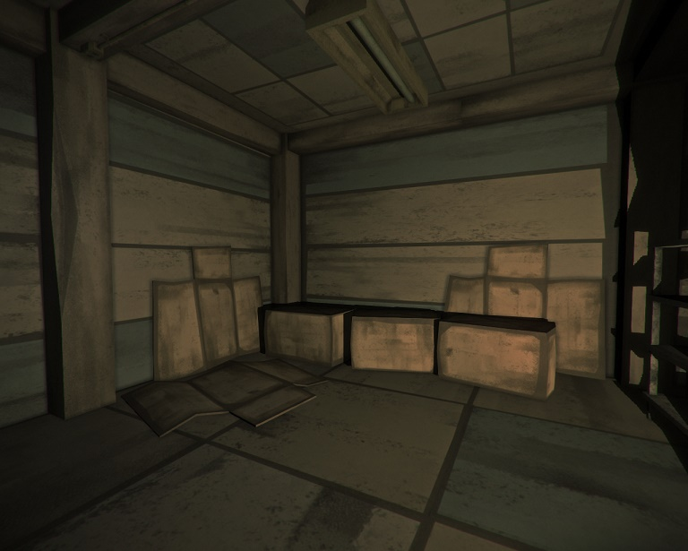
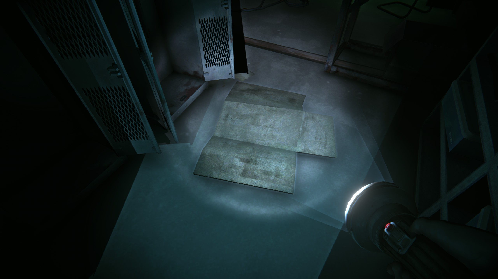
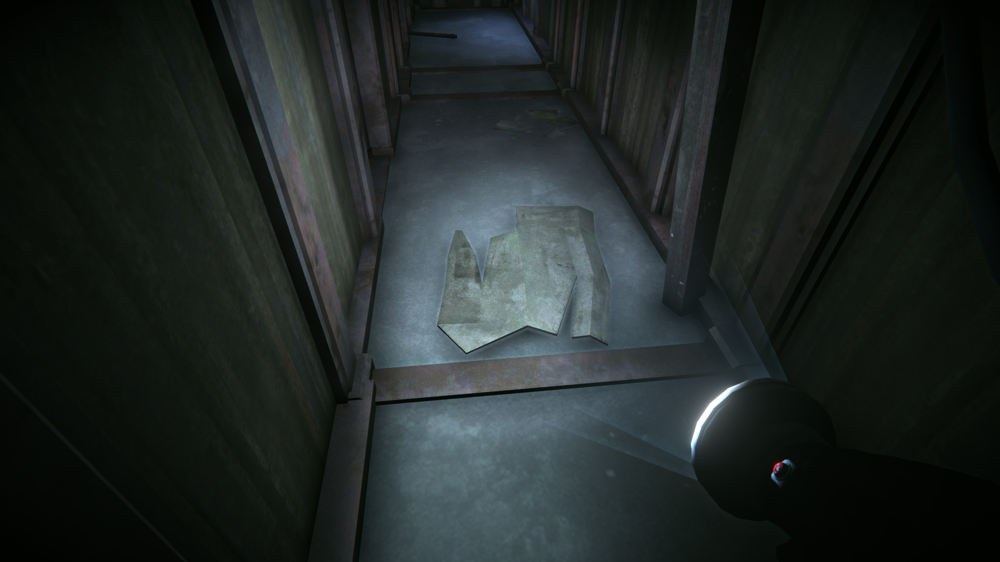

# Cardboard Box

**Categories:** Interactable Objects · **Source:** [Fandom](https://thelongdark.fandom.com/wiki/Cardboard_Box)

**Contents**

- [Overview](#overview)
- [Variants](#variants)
- [Breaking Down](#breaking-down)
- [Hidden Loot](#hidden-loot)

**Cardboard Box**

|

**General**

Item Type

Item

Wintermute

No

**Statistics**

Harvest

1-3 [Tinder Plugs](./Tinder%20Plug.md)

## Overview

The cardboard box is a cardboard container, coming in various sizes and shapes. Some cardboard boxes may have items hidden inside them, but cardboard boxes cannot be searched. Instead, they must be broken down, similar to [wooden crates](./Crate.md), to access the potential loot inside. However, very few cardboard boxes contain possible loot, and they are usually in very specific locations, so breaking down every cardboard box you see might be a waste of time. Cardboard boxes can be found in almost every [Region](./Region.md) and are mostly present to provide the player with tinder plugs and fill up empty space in a room or outdoor setting.

## Variants

There are several variants of cardboard box: small, large, and flat.

- Small cardboard boxes with [Granola Bar](./Granola%20Bar.md) or [Chocolate Bar](./Chocolate%20Bar.md) brand packaging on them in stores said items inside them.
- Small cardboard boxes yield less tinder plugs than larger ones, and usually are not the ones to contain items
- Large boxes yield 3 tinder plugs when broken down and have the chance to contain items if they are present in certain locations.
- Flat boxes are flat pieces of cardboard, usually found leaning against a wall or on the floor. Loot can sometimes be found hidden underneath these boxes. The amount of tinder plugs acquired when breaking one down varies on its size.
- Torn boxes are flat pieces of cardboard that are frayed and found on the ground. They generate 1-2 plugs.

## Breaking Down

All cardboard boxes can be broken down, yielding 1-3 [Tinder Plugs](./Tinder%20Plug.md). They can be broken down by hand, or using a [Hunting Knife](./Hunting%20Knife.md), to break them down faster. Large cardboard boxes yield 3 tinder plugs and take 27 minutes to harvest. (Add other times here)

## Hidden Loot

There are only a few places were breaking down these boxes can reveal potential loot, these include:

- [Summit](./Summit.md) of [Timberwolf Mountain](./Timberwolf%20Mountain.md)
- Box near the kitchen in [The Riken](./The%20Riken.md)
- Box next to the bed in [Quonset Garage](./Quonset%20Garage.md)
