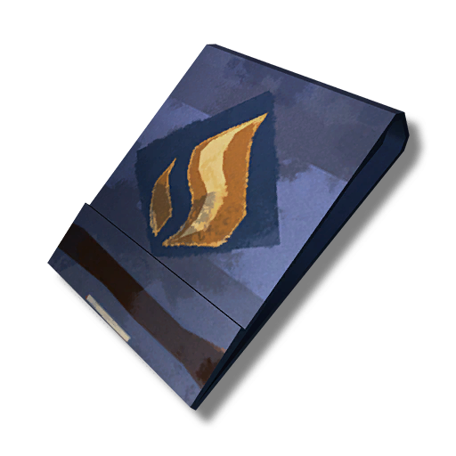

# Cardboard Matches

**Contents**

- [Overview](#Overview)
- [Tips](#Tips)
- [Gallery](#Gallery)
- [Trivia](#Trivia)

<table class="infobox">
<caption>Cardboard Matches</caption>
<colgroup>
<col style="width: 50%" />
<col style="width: 50%" />
</colgroup>
<tbody>
<tr>
<td colspan="2"><figure>

<figcaption>Cardboard_Matches_icon.png</figcaption>
</figure></td>
</tr>
<tr>
<td colspan="2" class="section">
<strong>General</strong>
</td>
</tr>
<tr>
<td>
Item Type
</td>
<td>
Fire Starting|-
</td>
</tr>
<tr>
<td>
Renewable
</td>
<td>
Yes (rare <a href="./Beachcombing.md" class="wikilink" title="Beachcombing">Beachcombing</a>)
</td>
</tr>
<tr>
<td>
Firestarting Slot
</td>
<td>
Starter
</td>
</tr>
<tr>
<td colspan="2" class="section">
<strong>Statistics</strong>
</td>
</tr>
<tr>
<td>
Weight
</td>
<td>
0.005 kg(0.01 lbs)
</td>
</tr>
<tr>
<td>
Bonus chance
</td>
<td>
+0%
</td>
</tr>
<tr>
<td>
Unit count
</td>
<td>
20match
</td>
</tr>
</tbody>
</table>

<table>
<colgroup>
<col style="width: 33%" />
<col style="width: 33%" />
<col style="width: 33%" />
</colgroup>
<tbody>
<tr>
<td style="vertical-align: top; font-size: 3em; color: #5d5980; padding-right: 10px">
“
</td>
<td>
Cardboard strike-anywhere matches.

&#10;

In-game description

</td>
<td style="vertical-align: bottom; font-size: 3em; color: #5d5980; padding-left: 10px">
”
</td>
</tr>
</tbody>
</table>

**Cardboard Matches** are <a href="./Fire%20Starting.md" class="wikilink" title="Fire Starting">Fire Starting</a> Tools and a small light source in *The Long Dark*.

## Overview

Each match weighs a mere 5 grams (0.005kg), but there are always 20 found together in one box. Using a Cardboard Match does not increase the base chance of successfully lighting a fire. Irrespective of real-life cardboard matches which are attached to a striker, these matches can be split into smaller stacks and are still usable.

Light sources are equipped with the '1' key by default. Hold the left mouse button to strike the match for a small light source that lasts for a few seconds. While a lit match is held, your "Feels Like" temperature will rise by a few degrees. Sadly, such a small fire will not deter <a href="./Wolf.md" class="wikilink" title="Wolves">Wolves</a>.

Lighting a match will cause the survivor to hold it closely in their hand, where it will create light for 13 seconds until the fire travels down the stem and reaches the survivor's fingers, where they drop it in pain. Running with a lit match will cause the flame to grow brighter, causing it to burn out faster.

Pressing H with a lit match will cause the survivor to flick the match into the distance, where it disappears and the light is extinguished.

## Tips

- <a href="./Firestriker.md" class="wikilink" title="Firestrikers">Firestrikers</a> and <a href="./Wood%20Matches.md" class="wikilink" title="Wood Matches">Wood Matches</a> are preferable to Cardboard Matches at low firestarting skill. This will likely save matches from failed fires, thanks to the firestrikers higher Bonus Chance.
- When selecting Cardboard Matches as a light source, the handheld model is always that of Wood Matches.
- Using a lit <a href="./Torch.md" class="wikilink" title="Torch">Torch</a> to start campfires is an effective way to save matches/firestriker durability.

## Gallery

<table class="gallery">
<colgroup>
<col style="width: 100%" />
</colgroup>
<tbody>
<tr>
<td><figure>
[Missing image: Cardboard_Matches.png]
<figcaption>old model</figcaption>
</figure></td>
</tr>
</tbody>
</table>

## Trivia

- Cardboard Matches are branded with the logo of "*Trusty Matches"*, the manufacturer of Wood Matches.
- Selecting Cardboard Matches will always use the Wood Matches model in the first person hand model.
- Despite being contained inside a cardboard box, no tinder is given or harvestable when wooden matches are used up unlike cardboard boxes present across <a href="./Great%20Bear%20Island.md" class="wikilink" title="Great Bear Island">Great Bear Island</a>.

**Lua execution error in Module:Navbox function navbox**

<a href="ru:%D0%9A%D0%B0%D1%80%D1%82%D0%BE%D0%BD%D0%BD%D1%8B%D0%B5_%D1%81%D0%BF%D0%B8%D1%87%D0%BA%D0%B8" class="wikilink" title="ru:Картонные спички">ru:Картонные спички</a>

