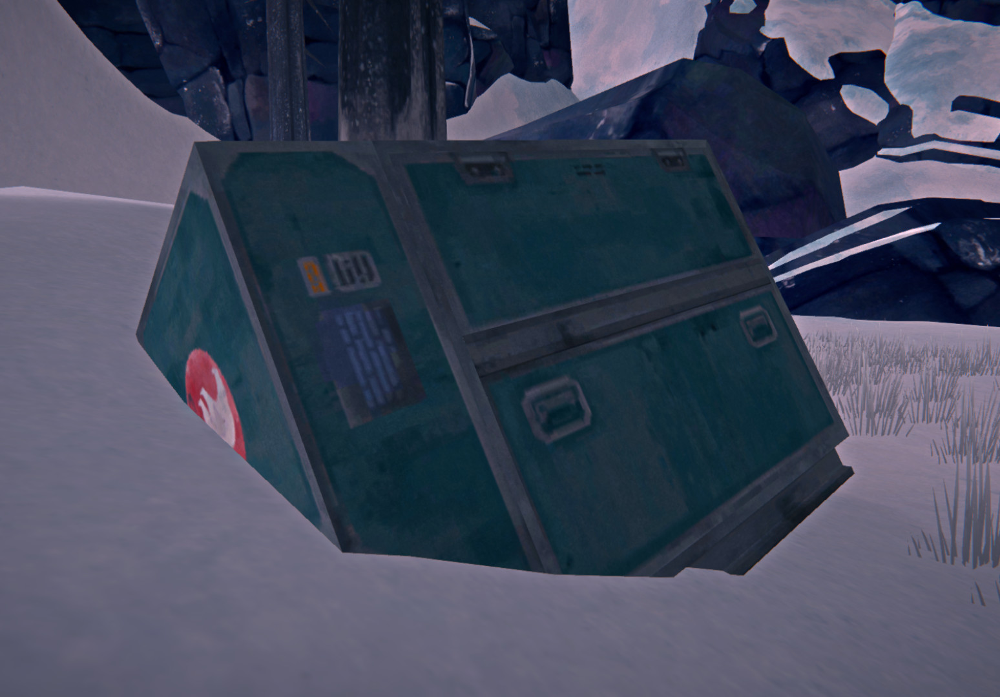
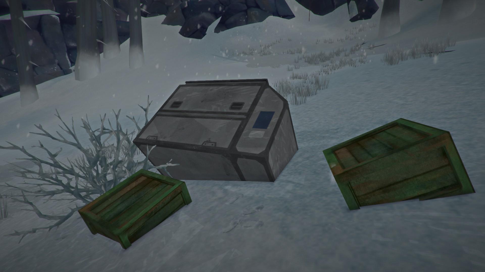

# Cargo Container

**Categories:** Interactable objects, Interactable Objects · **Source:** [Fandom](https://thelongdark.fandom.com/wiki/Cargo_Container)

**Cargo Container**

_Cargo\_container\_new.jpg_

**Release:** Dec 2015

**Update:** [0.298](./The%20Long%20Dark%20%E2%80%94%20Changelog.md#0.298)

**Container**

**Capacity:** 30.00 kg(66 lbs)

**Cargo Containers** are locked containers found in [Timberwolf Mountain](./Timberwolf%20Mountain.md) that can only be opened with a [Hacksaw](./Hacksaw.md).

## Overview

Cargo Containers are loot-filled blue-green shipping devices scattered across Timberwolf Mountain from a crashed cargo aircraft on the [Summit](./Summit.md). All Cargo Containers feature two locked compartments which require a Hacksaw to open. Each compartment holds a specific type of resource (e.g. Canned Food, Firestarting, Clothes, Medical), some of which may be found near the container beside/on a [Frozen Corpse](./Frozen%20Corpse.md).

- Each Cargo Container has **two doors**, each of which can contain loot.
- Cargo Containers must be opened with a Hacksaw.
- If the Hacksaw used to unlock the compartment is low condition (&lt;50%) and the tool breaks on use, there is a chance the cargo door will become **permanently ruined**: preventing its cargo from ever being accessible.
- Items inside Cargo Containers, like other Containers will [Decay](./Decay.md) slowly over time (based on Game Mode). Ruined (0% Condition) Clothes will become unwearable, and ruined food and medical supplies will disappear unless removed before they decay completely.
- Cargo Containers can hold 30kg, in both of their door.
- About half of all Cargo Containers do not spawn in Interloper mode, and those which do appear contain less and lower quality loot.
- 2-3 green Wooden Crates which may be broken down for Reclaimed Wood may be found near Cargo Container sites (these crate are always present, even on Interloper when Cargo Containers themselves may not spawn).

_The containers were gray Until the 1.00 update_

## Locations

Cargo containers can be found at the following locations in Timberwolf Mountain:

1. [Mountaineer's Hut](./Mountaineer%27s%20Hut.md) (not on Interloper)
2. [Wing](./Wing.md)
3. [Engine (West)](./Engine%20%28West%29.md) (not on Interloper)
4. [Engine (East)](./Engine%20%28East%29.md)
5. [Deer Clearing](./Deer%20Clearing.md)
6. [Eric's Falls](./Eric%27s%20Falls.md) (not on Interloper)
7. [Tail Section](./Tail%20Section.md) on [Summit](./Summit.md)
