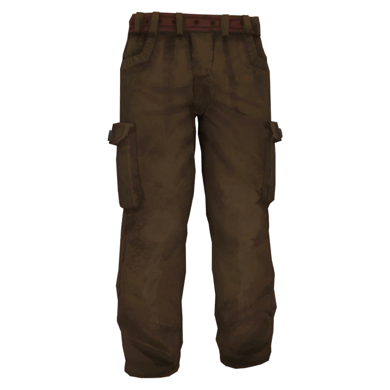

# Cargo Pants

**Categories:** Clothing · **Source:** [Fandom](https://thelongdark.fandom.com/wiki/Cargo_Pants)

**Cargo Pants**

[Cargo Pants icon](../assets/Cargo_Pants_icon.png)

**General**

**Item Type:** Clothing

**Clothing Slot:** Outer legs

**Statistics**

**Weight:** [Weight icon](../assets/Weight_icon.png)0.75 kg(1.65 lbs)

**Warmth bonus:** [Temp icon](../assets/Temp_icon.png)1.5 °C(2.7 °F)

**Windproof bonus:** [Windproofness icon](../assets/Windproofness_icon.png)0.5 °C(0.9 °F)

**Waterproof bonus:** [Waterproofness icon](../assets/Waterproofness_icon.png)0%

**Protection:** [Protection icon](../assets/Protection_icon.png)3%

**Mobility:** [Mobility icon](../assets/Mobility_icon.png)-1%

**Harvest:** 1 × [Cloth](./Cloth.md) 30 minutes

**Repair:** 1 × [Cloth](./Cloth.md) 30 minutes 30% condition

> “**Cotton pants with reinforced areas. Will take a bit of punishment.**”
>
> — In-game description

**Cargo Pants** are a type of [clothing](./Clothing.md) in _[The Long Dark](./The%20Long%20Dark.md)._

<!-- #Usefulnes -->
​

<!-- #usefulnes -->
## Usefulnes

The cargo pants are a low-tier type of pants in the game although giving 50% more warmth and weight than [Jeans](./Jeans.md). They don't need frequent repairs but, like all low-tier pants, have a bad repair to warmth ratio.

