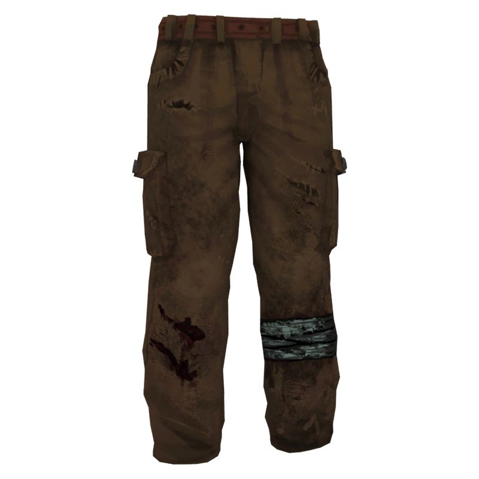

# Cargo Pants

**Cargo Pants**

| Property | Details |
| --- | --- |
|  |  / *Cargo\_Pants\_icon.png* |
| **General** |  |
| Item Type | Clothing\|- |
| Clothing Slot | Outer legs |
| **Statistics** |  |
| Weight | 0.75 kg(1.65 lbs) |
| Warmth bonus | 1.5 °C(2.7 °F) |
| Windproof bonus | 0.5 °C(0.9 °F) |
| Waterproof bonus | 0% |
| Protection | 3% |
| Mobility | -1% |
| Harvest | 1 × [Cloth](./Cloth.md) / 30 minutes |
| Repair | 1 × [Cloth](./Cloth.md) / 30 minutes / 30% condition |

> “**Cotton pants with reinforced areas. Will take a bit of punishment.**”
>
> — In-game description

**Cargo Pants** are a type of [clothing](./Clothing.md) in *[The Long Dark](./The%20Long%20Dark.md).*

## Usefulnes

The cargo pants are a low-tier type of pants in the game although giving 50% more warmth and weight than [Jeans](./Jeans.md). They don't need frequent repairs but, like all low-tier pants, have a bad repair to warmth ratio.

| Column 1 | Column 2 |
| --- | --- |
|  / *Clothing model icon* |  / *Clothing model icon damaged* |

**Lua execution error in Module:Navbox function navbox** [ru:Штаны\_карго](ru:%D0%A8%D1%82%D0%B0%D0%BD%D1%8B_%D0%BA%D0%B0%D1%80%D0%B3%D0%BE) [fr:Pantalon cargo](fr:Pantalon_cargo)
