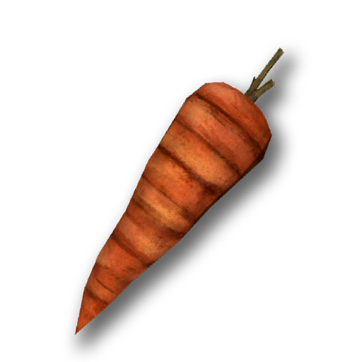

# Carrot

**Categories:** DLC Content, Food And Drink, Pages with update history · **Source:** [Fandom](https://thelongdark.fandom.com/wiki/Carrot)

**Carrot**

_Carrot\_icon.png_

**Release:** [21 June 2023](./The%20Long%20Dark%20%E2%80%94%20Changelog.md#2.17)

**Wintermute:** No

**Renewable:** Yes ([Trader](./Trader.md))

**Properties**

**Item type:** [Food And Drink](./Food%20And%20Drink.md)

**Stackable:** Yes

**Examine:** A root vegetable useful in many recipes.

**Values**

**Calories:** 175 kcal

**Hydration:** 0%

**[Vitamin C](./Scurvy.md):** Minor (9%)

**Weight:** 0.10 kg (0.22 lbs)

_Ptarmigan\_icon.png_

**DLC-Exclusive content.** / This content requires the [Tales from the Far Territory](./Tales%20from%20the%20Far%20Territory.md) addon to be installed before it can be seen or used in regular gameplay.

Item

Skills

Materials

&lt;a href="Porter's Soup"&gt;Porter's Soup&lt;/a&gt;

None

- 2 × &lt;a href="Carrot"&gt;Carrot&lt;/a&gt; / - 6 × &lt;a href="Cat Tail Stalk"&gt;Cat Tail Stalk&lt;/a&gt; / - 0.50 kg × &lt;a href="Ptarmigan (Raw)"&gt;Ptarmigan (Raw)&lt;/a&gt; / - 0.40 L × &lt;a href="Broth"&gt;Broth&lt;/a&gt; / - 0.01 kg × &lt;a href="Salt"&gt;Salt&lt;/a&gt;

&lt;a href="Ranger Stew"&gt;Ranger Stew&lt;/a&gt;

None

- 0.50 kg × &lt;a href="Venison (Raw)"&gt;Venison (Raw)&lt;/a&gt; / - 0.50 kg × &lt;a href="Rabbit (Raw)"&gt;Rabbit (Raw)&lt;/a&gt; / - 1 × &lt;a href="Potato"&gt;Potato&lt;/a&gt; / - 0.20 kg × &lt;a href="Carrot"&gt;Carrot&lt;/a&gt; / - 0.40 L × &lt;a href="Broth"&gt;Broth&lt;/a&gt; / - 0.05 kg × &lt;a href="Old Mill Flour"&gt;Old Mill Flour&lt;/a&gt;

&lt;a href="Thomson Family Stew"&gt;Thomson Family Stew&lt;/a&gt;

None

- 0.30 kg × &lt;a href="Canned Corn"&gt;Canned Corn&lt;/a&gt; / - 0.40 kg × &lt;a href="Carrot"&gt;Carrot&lt;/a&gt; / - 2 × &lt;a href="Potato"&gt;Potato&lt;/a&gt; / - 2 × &lt;a href="Reishi Mushroom"&gt;Reishi Mushroom&lt;/a&gt; / - 0.40 L × &lt;a href="Broth"&gt;Broth&lt;/a&gt; / - 0.05 kg × &lt;a href="Old Mill Flour"&gt;Old Mill Flour&lt;/a&gt;
