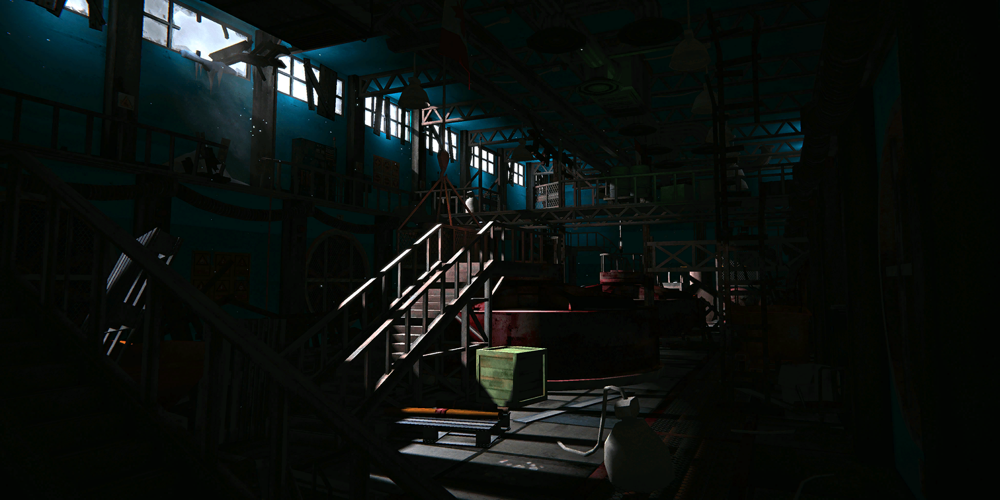
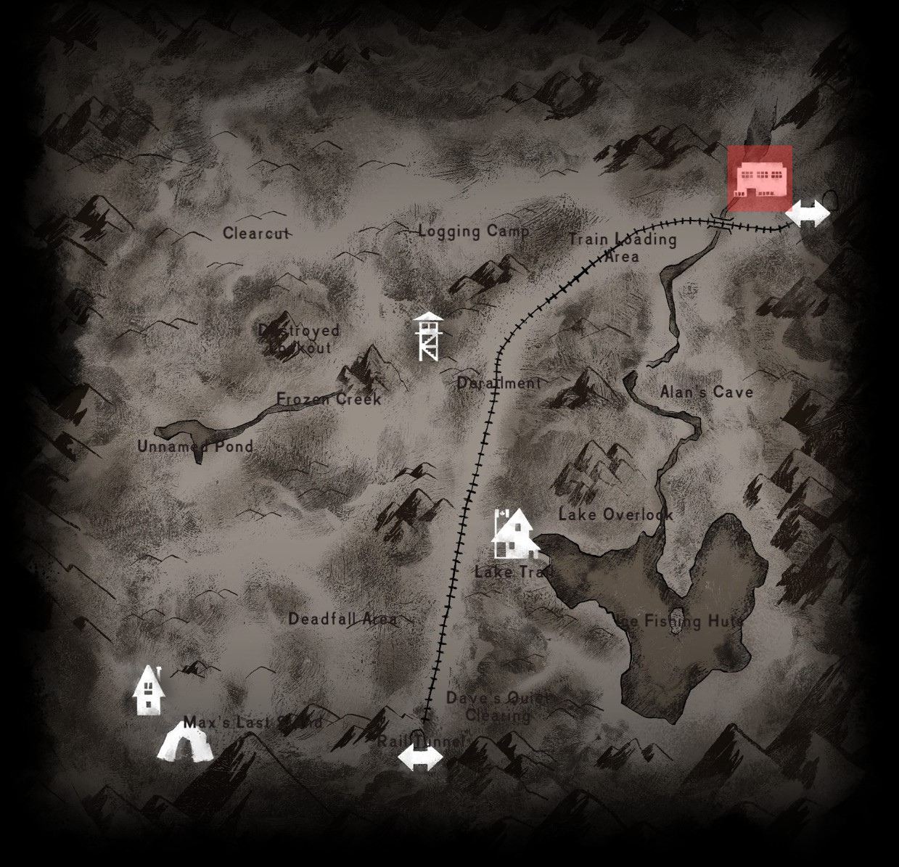
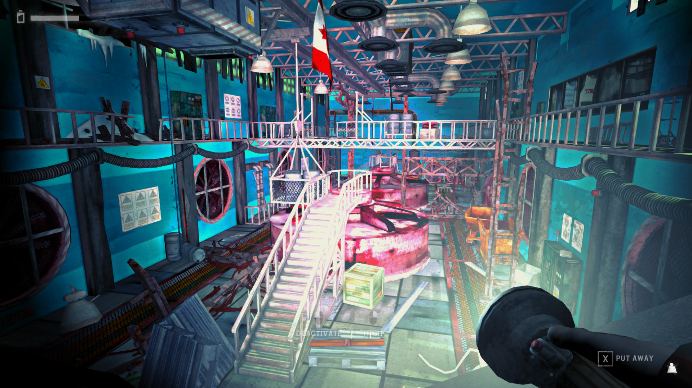
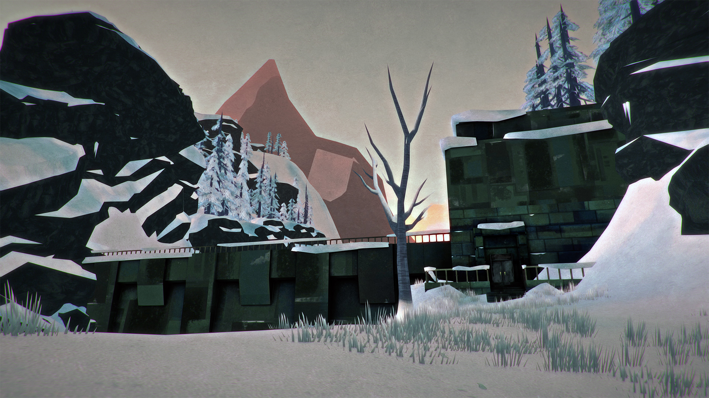
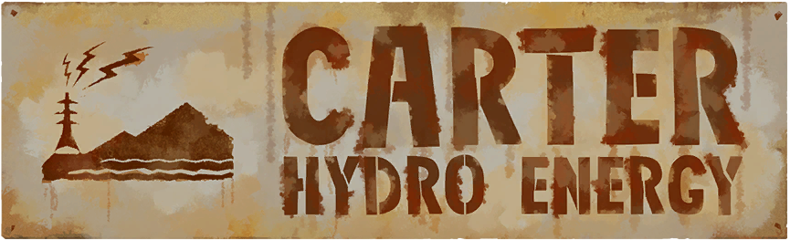
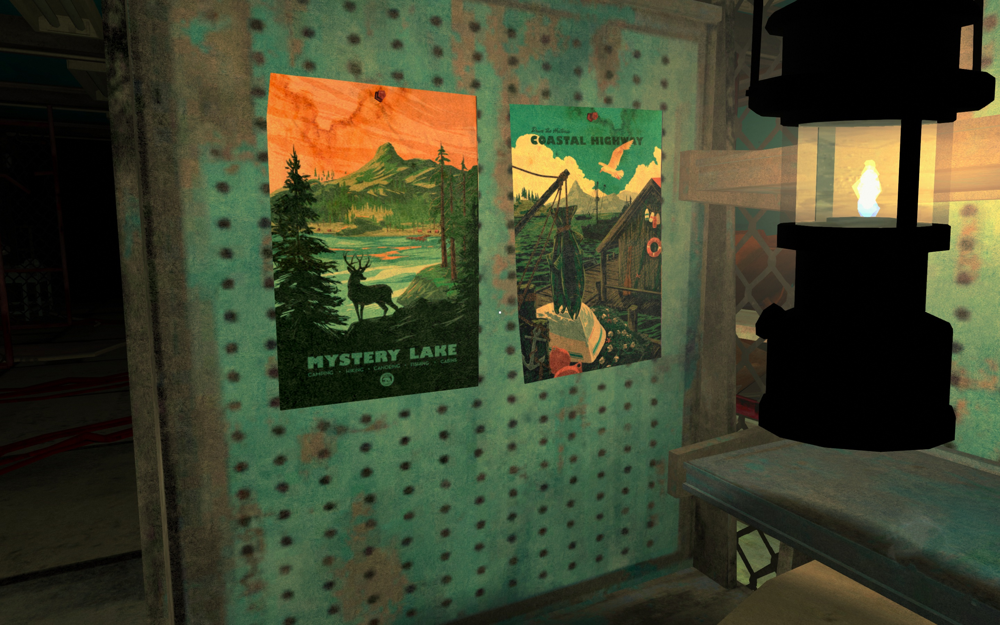
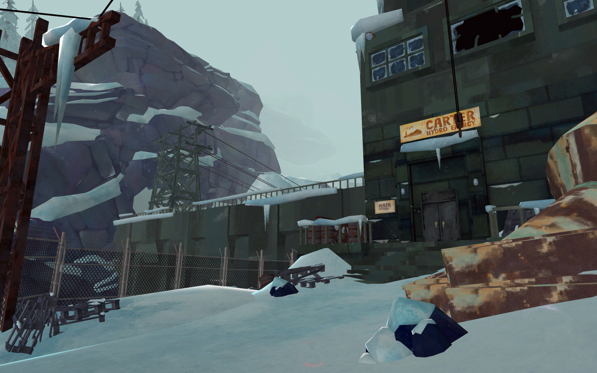

# Carter Hydro Dam

**Categories:** Indoor locations, Industrial locations, Locations, Locations in Mystery Lake, Locations with a workbench · **Source:** [Fandom](https://thelongdark.fandom.com/wiki/Carter_Hydro_Dam)

**Contents**

- [Overview](#overview)
- [History](#history)
- [Exclusive gear](#exclusive-gear)
- [Upper levels](#upper-levels)
- [Exterior](#exterior)
- [Fluffy](#fluffy)
- [Lower levels](#lower-levels)
- [Occupant](#occupant)
- [Exit](#exit)
- [Entrance](#entrance)
- [Story](#story)
- [Gallery](#gallery)
- [References](#references)

**Carter Hydro Dam**

|

**Location**

Region

[Mystery Lake](./Mystery%20Lake%20%28region%29.md)

Location

On the southern side of [Mystery Lake](./Mystery%20Lake%20%28region%29.md).

Description

A hydroelectric dam.

**General**

Type

Industrial

Firebox

[Fire Barrel](./Fire%20Barrel.md)

Has a workbench

Has an interior

**Wintermute**

Missions

[The Wounded Trapper](./Episode%202%20-%20Luminance%20Fugue.md#the-wounded-trapper)  
 [Renewed Hope](./Episode%202%20-%20Luminance%20Fugue.md#renewed-hope)

Characters

[Methuselah](./Methuselah.md)  
 [Mathis](./Mathis.md)

> “**The old Carter Dam -- it's a mess. Multiple quakes have left it pretty unstable. Nobody really goes in there anymore.**”
>
> — - [Jeremiah](./Jeremiah.md)

**Carter Hydro Dam** is a hydroelectric dam containing two generation turbines. It exists as two separate loading levels, each of which has an exit to the outside and serves as part of a series of transition zones (along with [Winding River](./Winding%20River.md)) between [Mystery Lake](./Mystery%20Lake%20%28region%29.md) and [Pleasant Valley](./Pleasant%20Valley.md).

The dam is featured in [Episode 2](./Episode%202%20-%20Luminance%20Fugue.md) of [Wintermute](./Wintermute.md).

## Overview

The dam is a vast multi-level complex with many lockers, boxes, drawers, and other containers to search. It also contains three [Work Benches](./Work%20Bench.md), a [Fire Barrel](./Fire%20Barrel.md) and usually a lot of valuable loot (possibly including high-quality clothing, tools, [ammo](./Rifle%20Ammunition.md), a pistol and a [Hunting Rifle](./Hunting%20Rifle.md)). In the event of an aurora touching any of the cords in the dam will inflict a burn and will damage the player.

## History

The dam was constructed on the Carter River in the 1960s. It was engineered and financed by the industrial magnate Richard Carter, who planned to use it to power a small town he was going to build for his mining workers. Due to seismic activity, and a drop in the price of coal and copper in the late 1960s, the project was nearly abandoned. There were attempts in the 1980s to modernize the dam and bring it back online, but hydrological changes in the [Mystery lake area](./Mystery%20Lake%20%28region%29.md) and public support for a newly created _Mystery Lake Provincial Park_ resulted in the dam being "shut down for good" in the late 1990s.[^1]

Following [The Collapse](./The%20Collapse.md), there was an unsuccessful attempt to re-open the dam, led by the CEO of Carter Hydro Energy, Robert Clarke.[^2] A skeleton crew was working in the dam, but were trapped inside by the [Forest Talkers](./Forest%20Talkers.md), an eco-activist group. The workers were reportedly trapped inside the dam for days before mediators were able to extract them. While the incident was not violent, it resulted in the dam remaining closed and has been used as an example by the [Forest Talkers](./Forest%20Talkers.md) to validate their continued work.

## Exclusive gear

[Vaughn's Rifle](./Vaughn%27s%20Rifle.md) will be found somewhere in or around the dam, its exact location varying between playthroughs. This rifle is 1.0 kg lighter than a normal [Hunting Rifle](./Hunting%20Rifle.md), with a higher rate of fire and reload speed, however it's only half as durable, requiring more frequent [cleaning](./Firearm%20Cleaning%20Kit.md).

## Upper levels

Exits to Mystery Lake and lower levels.

- First-Floor Employee Area (work bench, [fresh water](./Toilet.md))
- Control Room (work bench, aid cabinet, [combination safe](./Safe.md))
- Generator Room (fire barrel)
- Storage (lockers)

### Exterior

Outside of the upper dam entrance is a fenced storage yard. On Interloper a [wolf](./Wolf.md) has a small chance of spawning in here. Across the tracks from there are two trailers; one apparently for accommodations as has bunk beds, the other for administration.

### Fluffy

In earlier releases of the game, the dam was inhabited by a [wolf](./Wolf.md) dubbed _Fluffy_ by The Long Dark community. She would appear in the generator room and--like other wolves in the game--would chase and attack the player. Fluffy would not appear in Pilgrim difficulty and would only appear after a 12 to 24 hour safe period in Voyageur difficulty.[^4]

Following the update to version 1.0, Fluffy was completely removed from the Survival mode, with developers stating that she had escaped.[^5] In [Episode 2](./Episode%202%20-%20Luminance%20Fugue.md) of story mode, a dead wolf is found laying in the hallway adjacent to the generator room--possibly some other wolf, less navigationally adept than Fluffy.

Fluffy was eventually relocated to [Bleak Inlet](./Bleak%20Inlet.md). She's found residing in [Last Resort Cannery](./Last%20Resort%20Cannery.md) where the Ammunition bench is.

## Lower levels

Exits to [Winding River](./Winding%20River.md) and upper levels.

- Regulators
- Turbines
- Lounge

### Occupant

Behind the metal hatch to the Upper Levels at the top of some stairs (in the dark), a frozen corpse often spawns. Note the broken arrows and something hanging from the latch nearby.

### Exit

The exit door found in a storage room at the bottom of a staircase goes to Winding River; it is one-way. The door is an emergency exit and does not have a handle on the outside, making getting back into the dam difficult.

While the player may re-enter the lower dam through a broken window above the platform across the river, it is a dangerous, or at least inconvenient trip across a narrow ledge on the front of the dam itself.

### Entrance

The entrance from Winding River is also one-way. It may be accessed through a high window at the top of a mound of snow, but it is unreachable once the player drops down into the building. Reaching the window requires walking across the narrow front of the dam, accessed through the broken fence near the one-way exit.

## Story

_SPOILER WARNING_  
 _This section may contain spoilers from the [story](./Wintermute.md) of The Long Dark._

_The Generator Room in story mode._ The dam plays an important role as a location in [Episode 2: Luminance Fugue](./Episode%202%20-%20Luminance%20Fugue.md) of story mode. In story mode, the dam has a significantly different layout, with walkways across the Generator Room, an elevator, additional rooms, and a staircase leading up to the offices on the floor above the [Mystery Lake](./Mystery%20Lake%20%28region%29.md) entrance level.

## Gallery

_The dam during an [aurora](./Aurora.md)_

## References

## Notes

---

[^1]: _Place: Carter Hydro Dam_, in-game [Journal](./Journal.md) knowledge
[^2]: _Carter Hydro Dam -- Safety and Shutdown Notice_ [collectible](./Collectibles.md)
[^4]: Steam, _The "Silent Hunter" Update (v.233) -- We've Added Bows & Improved Hunting!_, viewed 22 May 2015, <<http://steamcommunity.com/games/305620/announcements/detail/235656499654813808>>.
[^5]: Raphael van Lierop, 4 August 2017, [Tweet](https://twitter.com/RaphLife/status/893315911880290305)
