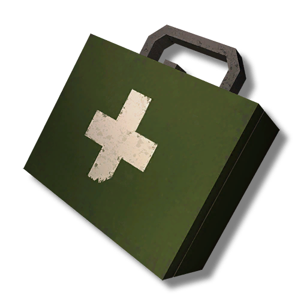

# Carter Hydro Medical Supplies

**Categories:** Collectibles, Pages with update history · **Source:** [Fandom](https://thelongdark.fandom.com/wiki/Carter_Hydro_Medical_Supplies)

**Carter Hydro Medical Supplies**

_Carter\_Hydro\_Medical\_Supplies\_icon.png_

**Release:** [1 August 2017](./The%20Long%20Dark%20%E2%80%94%20Early%20Access%20Changelog.md#1.00)

**Wintermute:** [Episode 2](./Episode%202%20-%20Luminance%20Fugue.md) - [The Wounded Trapper](./The%20Wounded%20Trapper.md)

**Properties**

**Item type:** [Collectibles](./Collectibles.md)\|-

**Stackable:** No

**Examine:** Dusty case holding medical supplies for the Carter Hydro first aid station. Looks like it hasn't been touched in a while.

**Values**

**Weight:** 0.00 kg (0 lbs)

**Actions**

**Backpack:** Examine

**On ground:** Take It, Leave It

**Carter Hydro Medical Supplies** is a [Collectible](./Collectibles.md) in [Episode 2](./Episode%202%20-%20Luminance%20Fugue.md) of [Wintermute](./Wintermute.md). It is found within the [Medical Locker](./Medical%20Locker.md) on the admin floor of the [Carter Hydro Dam](./Carter%20Hydro%20Dam.md), and requires the [Aid Station Medical Locker Key](./Aid%20Station%20Medical%20Locker%20Key.md) to unlock the locker.

- UPDATE **1 August 2017 ([Update](./The%20Long%20Dark%20%E2%80%94%20Changelog.md#1.00)):**
  - Added to game.
