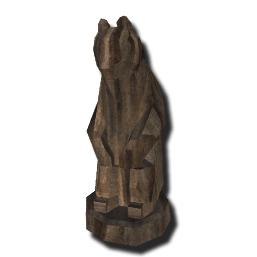

# Carved Bear Figurine

<table class="infobox">
<caption>Carved Bear Figurine</caption>
<colgroup>
<col style="width: 50%" />
<col style="width: 50%" />
</colgroup>
<tbody>
<tr>
<td colspan="2"><figure>

<figcaption>Carved_Bear_Figurine_icon.png</figcaption>
</figure></td>
</tr>
<tr>
<td>
Release
</td>
<td>
<a href="./The%20Long%20Dark%20%E2%80%94%20Changelog.md#2.33" class="wikilink" title="TFTFT Part 6 Broken Silence">TFTFT Part 6 Broken Silence</a>
</td>
</tr>
<tr>
<td colspan="2" class="section">
<strong>Values</strong>
</td>
</tr>
<tr>
<td>
Weight
</td>
<td>
0.25 kg (0.55 lbs)
</td>
</tr>
<tr>
<td colspan="2" class="section">
<strong>Actions</strong>
</td>
</tr>
<tr>
<td>
Backpack
</td>
<td>
Drop, Place
</td>
</tr>
</tbody>
</table>

The **Carved Bear Figurine** is a <a href="./Decorations.md" class="wikilink" title="Decorations">Decorations</a> item that can be <a href="./Crafting.md" class="wikilink" title="Crafted">Crafted</a> as part of the <a href="./Safehouse%20Customization.md" class="wikilink" title="Safehouse Customization">Safehouse Customization</a> feature.

## Overview

A carefully carved wooden figurine of a <a href="./Bear.md" class="wikilink" title="Bear">Bear</a>, a Carved Bear Figurine can be crafted anywhere by the player, but requires <a href="./Woodworking%20Tools.md" class="wikilink" title="Woodworking Tools">Woodworking Tools</a>.

Once crafted, the item is automatically placed into the player's inventory. It can only be placed on floors or flat surfaces when in Customization Mode. It can later be picked up and placed back into the player's inventory or destroyed (yielding no resources).

## Crafting

<table class="infobox">
<caption>Carved Bear Figurine</caption>
<tbody>
<tr>
<td colspan="2">
-
</td>
</tr>
<tr>
<td colspan="2">
-
</td>
</tr>
<tr>
<td colspan="2">
240 minutes (4 hour 0 minutes)
</td>
</tr>
<tr>
<td colspan="2" class="section">
<strong>Requirements</strong>
</td>
</tr>
<tr>
<td>
Facility
</td>
<td>
[[File:Anywhere icon.png
</td>
</tr>
<tr>
<td>
Tool
</td>
<td>
<strong>Template:iconlink</strong>
</td>
</tr>
<tr>
<td colspan="2" class="section">
<strong>Materials</strong>
</td>
</tr>
<tr>
<td colspan="2" class="section">
<strong>Template:iconlink plain</strong>
</td>
</tr>
<tr>
<td>
Item
</td>
<td>
<a href="./Cedar%20Firewood.md" class="wikilink" title="Cedar Firewood">Cedar Firewood</a>
</td>
</tr>
<tr>
<td>
Quantity
</td>
<td>
1
</td>
</tr>
</tbody>
</table>

## Update History

**Template:update historyLua execution error in Module:Navbox function navbox**

