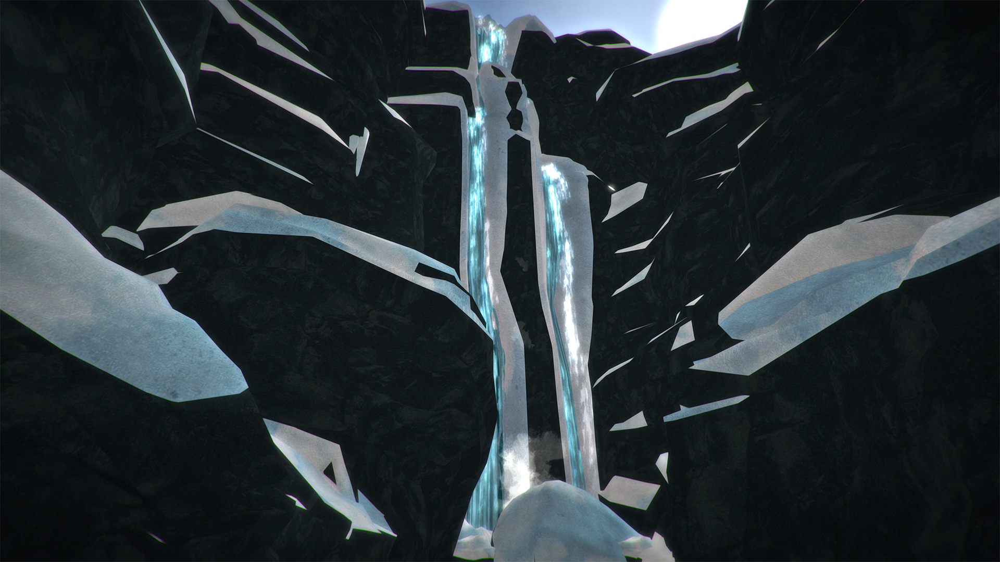

# Cascading Falls

**Cascading Falls**

| Property | Details |
| --- | --- |
|  |  / *Cascading\_Falls.jpg* |
| **Location** |  |
|  |  / *Cascading\_Falls\_Location.png* |
| Region | [Pleasant Valley](./Pleasant%20Valley.md)\|- |
| **General** |  |
| Type | Landmark\|- |
