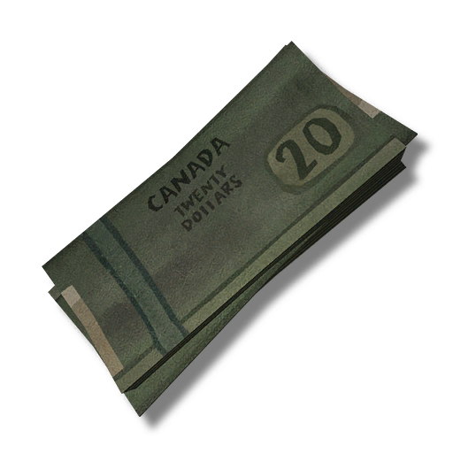
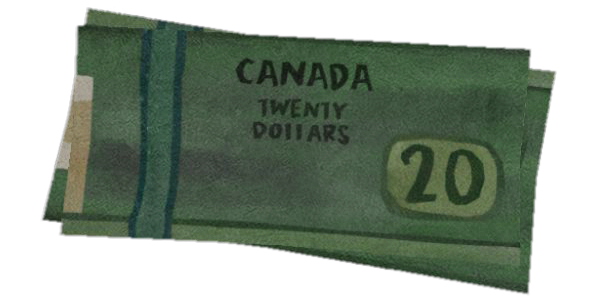

# Cash

**Contents**

- [Overview](#Overview)
- [Fire Starting info](#Fire_Starting_info)
- [Gallery](#Gallery)
- [Update history](#Update_history)

<table class="infobox">
<caption>Cash</caption>
<colgroup>
<col style="width: 50%" />
<col style="width: 50%" />
</colgroup>
<tbody>
<tr>
<td colspan="2"><figure>

<figcaption>Cash_icon.png</figcaption>
</figure></td>
</tr>
<tr>
<td>
Release
</td>
<td>
<a href="./The%20Long%20Dark%20%E2%80%94%20Early%20Access%20Changelog.md#1.00" class="wikilink" title="1 August 2017">1 August 2017</a>
</td>
</tr>
<tr>
<td colspan="2" class="section">
<strong>Properties</strong>
</td>
</tr>
<tr>
<td>
Item type
</td>
<td>
<a href="./Fire%20Starting.md" class="wikilink" title="Fire Starting">Fire Starting</a>|-
</td>
</tr>
<tr>
<td>
Stackable
</td>
<td>
yes
</td>
</tr>
<tr>
<td>
Examine
</td>
<td>
A bundle of cash. Pretty much worthless these days. Useful as tinder.
</td>
</tr>
<tr>
<td colspan="2" class="section">
<strong>Values</strong>
</td>
</tr>
<tr>
<td>
Weight
</td>
<td>
0.05 kg (0.11 lbs)
</td>
</tr>
<tr>
<td colspan="2" class="section">
<strong>Advanced data</strong>
</td>
</tr>
<tr>
<td>
Item key
</td>
<td>
GAMEPLAY_Cash
</td>
</tr>
</tbody>
</table>

**Cash** is a <a href="./Fire%20Starting.md" class="wikilink" title="Fire Starting">Fire Starting</a> item that can be used as tinder to start <a href="./Fire.md" class="wikilink" title="fire">fires</a>. Its appearance is of a green <a href="Wikipedia:Canadian_Journey_Series" class="wikilink" title="Canadian $20 note">Canadian $20 note</a> - the former currency of <a href="./Great%20Bear%20Island.md" class="wikilink" title="Great Bear Island">Great Bear Island</a> and Canada before <a href="./The%20Collapse.md" class="wikilink" title="The Collapse">The Collapse</a>.

## Overview

Cash fills the role of tinder, which is used for Fire Starting. Cash is the lightest tinder, tied with the <a href="./Cat%20Tail%20Head.md" class="wikilink" title="Cat Tail Head">Cat Tail Head</a>, <a href="./Birch%20Bark.md" class="wikilink" title="Birch Bark">Birch Bark</a>, and <a href="./Tinder%20Plug.md" class="wikilink" title="Tinder Plug">Tinder Plug</a>, and weighs only 0.05 kg per unit. Like all other types of tinder, it does not increase the chance to successfully light a fire.

## Fire Starting info

<table class="infobox">
<caption>Cash</caption>
<thead>
<tr>
<th>
Type
</th>
<th>
Tinder
</th>
</tr>
</thead>
<tbody>
<tr>
<th colspan="2" class="section">
<strong>Statistics</strong>
</th>
</tr>
&#10;<tr>
<th>
Start Chance
</th>
<td>
 0%
</td>
</tr>
</tbody>
</table>

## Gallery

<table class="gallery">
<colgroup>
<col style="width: 100%" />
</colgroup>
<tbody>
<tr>
<td><figure>

<figcaption>3d model</figcaption>
</figure></td>
</tr>
</tbody>
</table>

## Update history

- UPDATE **1 August 2017 (<a href="./The%20Long%20Dark%20%E2%80%94%20Changelog.md#1.00" class="wikilink" title="Update">Update</a>):**
  - Added to game.

==Trivia==

- Since 2011-2013, Canadian banknotes are no longer printed on paper, but on polypropylene plastic instead. These banknotes would tend to melt before starting to burn, making them considerably less useful than their paper counterparts for fire starting.

**Lua execution error in Module:Navbox function navbox** <a href="ru:%D0%91%D0%B0%D0%BD%D0%BA%D0%BD%D0%BE%D1%82%D1%8B" class="wikilink" title="ru:Банкноты">ru:Банкноты</a>

