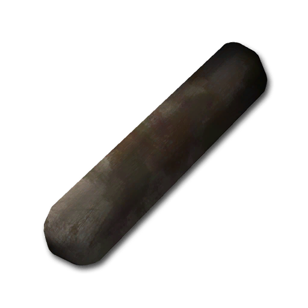
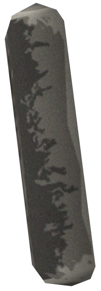

# Cat Tail Head

**Contents**

- [Overview](#overview)
- [Fire Starting info](#fire-starting-info)
- [Gallery](#gallery)
- [Update history](#update-history)

**Cat Tail Head**

| Property | Details |
| --- | --- |
|  |  / *Cat\_Tail\_Head\_icon.png* |
| Release | [1 April 2015](./The%20Long%20Dark%20%E2%80%94%20Changelog.md#0.212) |
| Wintermute | No |
| Renewable | Yes ([Beachcombing](./Beachcombing.md)) |
| **Properties** |  |
| Item type | [Fire Starting](./Fire%20Starting.md)\|- |
| Stackable | Yes |
| Examine | The Cat Tail's seed head, can be used as tinder. |
| **Values** |  |
| Weight | 0.05 kg (0.11 lbs) |

**Cat Tail Heads** are tinder item in *[The Long Dark](./The%20Long%20Dark.md),* obtained by harvesting [Cat Tail](./Cat%20Tail.md) plants.

## Overview

Cat Tail Heads can be used as tinder when starting a [fire](./Fire.md), being among the lightest types of tinder at only 0.05 kg each. It has the same chance to successfully light a fire as other tinders.

Cat Tails can be found in all regions, and are abundant in [Forlorn Muskeg](./Forlorn%20Muskeg.md), [Hushed River Valley](./Hushed%20River%20Valley.md), and [Mountain Town](./Mountain%20Town.md) (particular the Milton Basin). Each Cat Tail plant will always yield 1 [Cat Tail Stalk](./Cat%20Tail%20Stalk.md) and 1 Cat Tail Head.

Like all other plants, Cat Tails do not regrow.

## Fire Starting info

**Birch Bark**

| Property | Details |
| --- | --- |
| Type | Tinder |
| **Statistics** |  |
| Start Chance |  0% |

## Gallery

| Column 1 |
| --- |
|  / *old model* |

## Update history

- UPDATE **11 February 2015 ([Update](./The%20Long%20Dark%20%E2%80%94%20Changelog.md#.196)):**
  - Added to game.

**Lua execution error in Module:Navbox function navbox** [ru:Сухой плод Тимофеевки луговой](ru:%D0%A1%D1%83%D1%85%D0%BE%D0%B9_%D0%BF%D0%BB%D0%BE%D0%B4_%D0%A2%D0%B8%D0%BC%D0%BE%D1%84%D0%B5%D0%B5%D0%B2%D0%BA%D0%B8_%D0%BB%D1%83%D0%B3%D0%BE%D0%B2%D0%BE%D0%B9)
