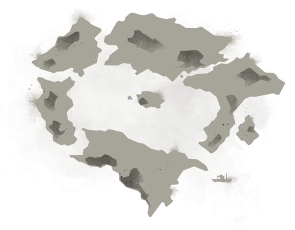

# Cauldron Island

**Contents**

- [Overview](#Overview)
- [Anna Island](#Anna_Island)
- [Regions](#Regions)
- [Stella Island](#Stella_Island)
- [Freya Island](#Freya_Island)
- [Morag Island](#Morag_Island)
- [Skye Island](#Skye_Island)
- [Gallery](#Gallery)
- [Trivia](#Trivia)

<table>
<colgroup>
<col style="width: 33%" />
<col style="width: 33%" />
<col style="width: 33%" />
</colgroup>
<tbody>
<tr>
<td width="40px"><figure>

<figcaption>Seal_icon.png</figcaption>
</figure></td>
<td>
<strong>DLC-Exclusive content.</strong> 

This content requires the <a href="./Iron%20Road.md" class="wikilink" title="Iron Road">Iron Road</a> addon to be installed before it can be seen or used in regular gameplay.

</td>
<td>
|}

<strong>Stub:</strong><em>This article is a stub. You can help by [//dummy.host/index.php?title=Cauldron+Island&amp;action=edit expanding it].</em>

<strong>Cauldron Island</strong> is a major location in <a href="./The%20Long%20Dark.md" class="wikilink" title="The Long Dark"><em>The Long Dark</em></a>, being the second playable area in the game. It is located even father north of <a href="./Great%20Bear%20Island.md" class="wikilink" title="Great Bear Island">Great Bear Island</a> in northern Canada and is the primary setting of <a href="./Iron%20Road.md" class="wikilink" title="Iron Road"><em>Iron Road</em></a>.

<h2 id="Overview">Overview</h2>

A remote location composed of 5 major islands, Cauldron Island is a volcanic caldera that gets its name from its cauldron like shape. It is reached from <a href="./Desolation%20Point.md" class="wikilink" title="Desolation Point">Desolation Point</a>, by taking the <a href="./Fulmar%20Autopilot%20Boat.md" class="wikilink" title="Fulmar Autopilot Boat">Fulmar Autopilot Boat</a> to <a href="./Port%20Remnant.md" class="wikilink" title="Port Remnant">Port Remnant</a>. The island's regions cannot be selected when starting a new <a href="./Survival%20Mode.md" class="wikilink" title="Survival Mode">Survival Mode</a> game, and the Fulmar must be used to reach the island on each new playthrough.

Not much is known about the history of the island at this time, but it has a history of whaling industry and exotic research around whales. The

Hamish McLeod, industrialist tycoon, named each island after his 5 daughters.

<h2 id="Anna_Island">Anna Island</h2>

An island focused primarily on a port for new arrivals and a few railways that connect to other islands.

<h3 id="Regions">Regions</h3>
<ul>
<li><a href="./Port%20Remnant.md" class="wikilink" title="Port Remnant">Port Remnant</a></li>
<li><a href="./Anna%20Island%20--%20Track%20Section%201.md" class="wikilink" title="Anna Island -- Track Section 1">Anna Island -- Track Section 1</a></li>
<li><a href="./Anna%20Island%20--%20Track%20Section%202.md" class="wikilink" title="Anna Island -- Track Section 2">Anna Island -- Track Section 2</a></li>
<li><a href="./Anna%20Island%20--%20Track%20Section%203.md" class="wikilink" title="Anna Island -- Track Section 3">Anna Island -- Track Section 3</a></li>
<li><a href="./Anna%20Island%20--%20Track%20Section%204.md" class="wikilink" title="Anna Island -- Track Section 4">Anna Island -- Track Section 4</a></li>
<li><a href="./Anna%20Island%20--%20Track%20Section%205.md" class="wikilink" title="Anna Island -- Track Section 5">Anna Island -- Track Section 5</a></li>
<li><a href="./Anna%20Island%20--%20Track%20Section%206.md" class="wikilink" title="Anna Island -- Track Section 6">Anna Island -- Track Section 6</a></li>
</ul>
<h2 id="Stella_Island">Stella Island</h2>
<h2 id="Freya_Island">Freya Island</h2>
<h2 id="Morag_Island">Morag Island</h2>
<h2 id="Skye_Island">Skye Island</h2>
<h2 id="Gallery">Gallery</h2>
<h2 id="Trivia">Trivia</h2>

<strong>Lua execution error in Module:Navbox function navbox</strong> <a href="ru:%D0%9E%D1%81%D1%82%D1%80%D0%BE%D0%B2_%D0%9A%D0%BE%D1%82%D1%91%D0%BB" class="wikilink" title="ru:Остров Котёл">ru:Остров Котёл</a>
</td>
</tr>
</tbody>
</table>

