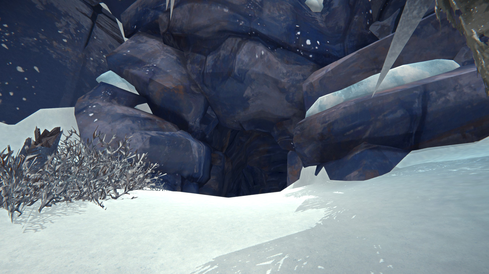
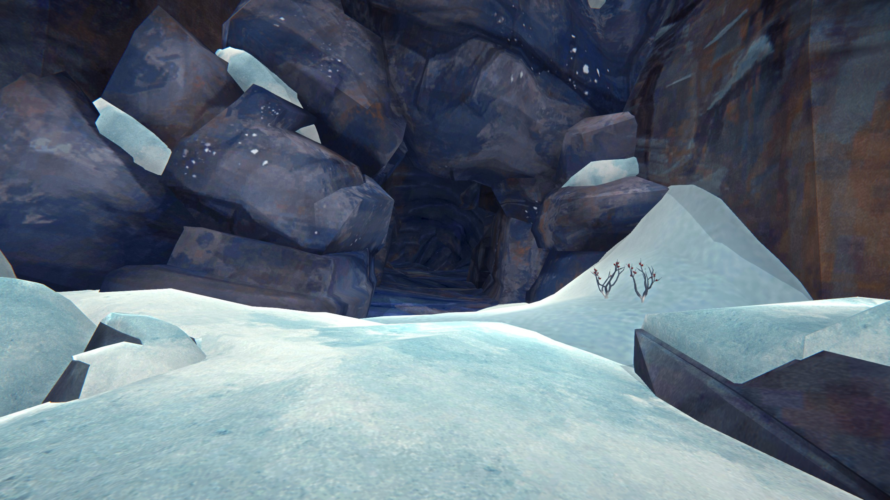

# Cave \(Ash Canyon location\)

**Categories:** Indoor locations, Locations, Locations in Ash Canyon, Military/Sporting locations · **Source:** [Fandom](https://thelongdark.fandom.com/wiki/Cave_%28Ash_Canyon_location%29)

**Cave**

| Property | Details |
| --- | --- |
| \[\[File: /  / _Lower Entrance_ /  / _Upper Entrance_ | 250px\]\] |
|  / _Lower Entrance_ |  / _Upper Entrance_ |
| **Location** |  |
|  / _Cave\_(Ash\_Canyon\_location)\_Location.png_ |  |
| Region | [Ash Canyon](./Ash%20Canyon.md)\|- / Location |
| Description | A large, explorable cave |
| **General** |  |
| Type | Military/Sporting\|- /  / _bed\_icon.png_ |
|  / _forge\_icon\_green.png_ |  |

|  |  / _Possible wolf carcass &amp; frozen corpse spawn on the second level_ |
