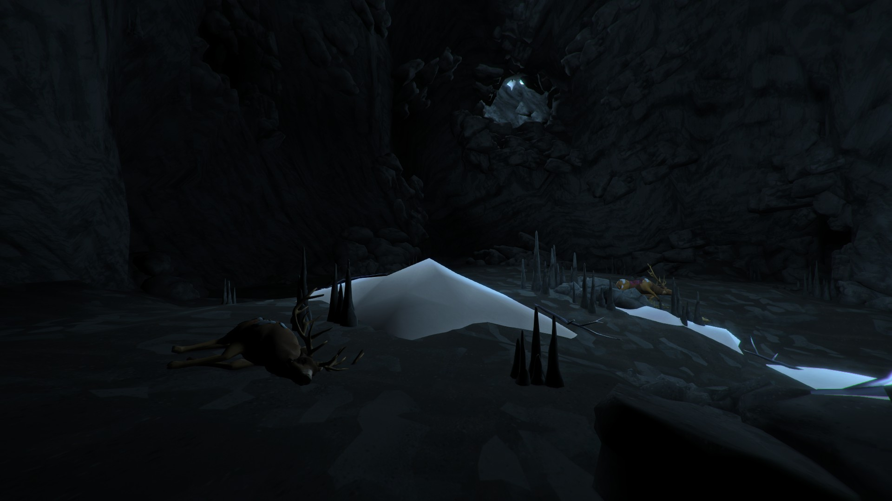
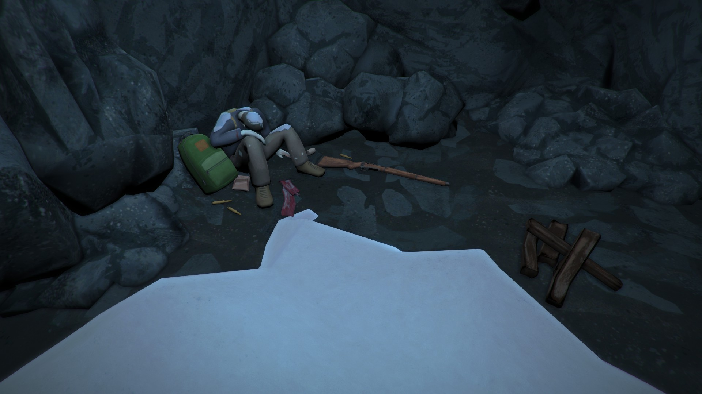

# Cave \(Desolation Point location\)

**Categories:** Caves, Indoor locations, Locations, Locations in Desolation Point · **Source:** [Fandom](https://thelongdark.fandom.com/wiki/Cave_%28Desolation_Point_location%29)

**Cave**

[Cave in Desolation Point interior entrance](../assets/Cave_in_Desolation_Point_interior_entrance.jpg)

**Location**

[Cave (Desolation Point location) Location](../assets/Cave_%28Desolation_Point_location%29_Location.png)

**Region:** [Desolation Point](./Desolation%20Point.md)

**Type:** Cave

<!-- #Overview -->
​

<!-- #overview -->
## Overview

The Cave is one of two in the region, but is the only one that has a loading screen.

Within the Cave, especially on harder difficulties, a [Wolf](./Wolf.md) may be found lurking around. The wolf is usually accompanied by one or two [Deer Carcasses](./Deer%20Carcass.md), and sometimes a [Hunting Rifle](./Hunting%20Rifle.md) may be found either with its dead owner or lodged in a crevice. Varying [food stuffs](./Food%20And%20Drink.md) may be found here, and inside the corpse's backpack as well.

The wolf tends to lurk near the large center portion of Cave, but can wander about through the tunnels. So it is recommended to enter with a weapon readied.

<!-- #Gallery -->
​

<!-- #gallery -->
## Gallery

[ru:Пещера (у водопада)](https://ru.wikipedia.org/wiki/%D0%9F%D0%B5%D1%89%D0%B5%D1%80%D0%B0_%28%D1%83_%D0%B2%D0%BE%D0%B4%D0%BE%D0%BF%D0%B0%D0%B4%D0%B0%29)
