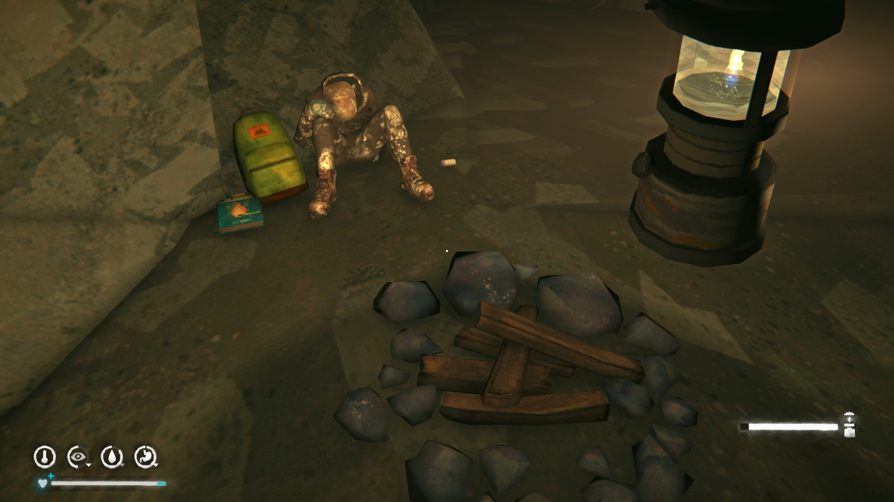

# Cave \(Timberwolf Mountain location 1\)

**Categories:** Article stubs, Caves, Indoor locations, Locations, Locations in Timberwolf Mountain · **Source:** [Fandom](https://thelongdark.fandom.com/wiki/Cave_%28Timberwolf_Mountain_location_1%29)

**Stub:****This article is a stub. You can help by [//dummy.host/index.php?title=Cave+%28Timberwolf+Mountain+location+1%29&action=edit expanding it].**

**Cave (Timberwolf Mountain location 1)**

\[\[File:

250px\]\]

**Location**

Region

[Timberwolf Mountain](./Timberwolf%20Mountain.md)|-

**General**

Type

Cave|-

## Overview

The Cave requires a light source to navigate, as beyond the exits, it is mostly pitch black. A [frozen corpse](./Frozen%20Corpse.md) and a backpack with some supplies may be found inside. The cave is also a renewable source of [Coal](./Coal.md).

There is a [Cargo Container](./Cargo%20Container.md) near Cave C exit (although it will not spawn on Interloper difficulty):

- Upper door: [energy bars](./Energy%20Bar.md), [Ketchup Chips](./Ketchup%20Chips.md), and [Salty Crackers](./Salty%20Crackers.md)
- Lower door: [Fleece Mittens](./Fleece%20Mittens.md), [Old Fashioned Parka](./Old%20Fashioned%20Parka.md), [Simple Parka](./Simple%20Parka.md), [sports vests](./Sport%20Vest.md), [wool ear wraps](./Wool%20Ear%20Wrap.md) and [Wool Toque](./Wool%20Toque.md)

## Gallery

