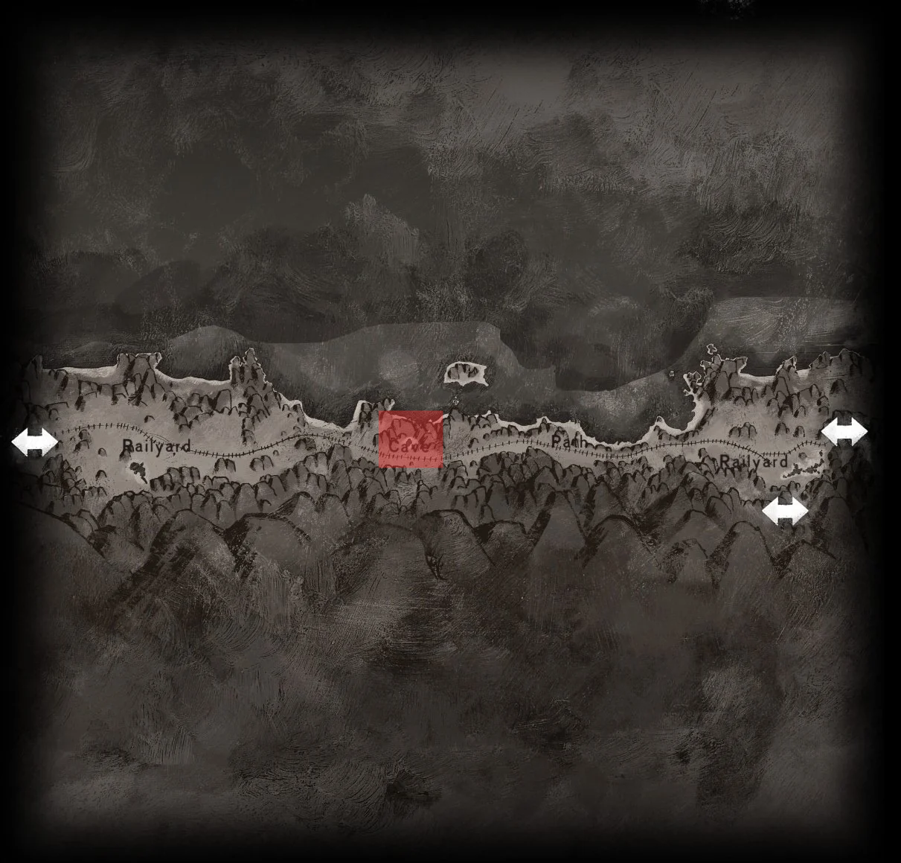

# Cave \(Track Section 5\)

**Categories:** DLC Content, Indoor locations, Locations, Locations in Anna Island -- Track Section 5 · **Source:** [Fandom](https://thelongdark.fandom.com/wiki/Cave_%28Track_Section_5%29)

**DLC-Exclusive content.** This content requires the [Iron Road](./Iron%20Road.md) addon to be installed before it can be seen or used in regular gameplay.

 **Cave (Track Section 5)**  **Location**  **Region:** [Anna Island -- Track Section 5](./Anna%20Island%20--%20Track%20Section%205.md)\\|- **Description:** A warm cave **General** Has an interior\ **Cave** is a location in [Anna Island -- Track Section 5](./Anna%20Island%20--%20Track%20Section%205.md).

## Overview
