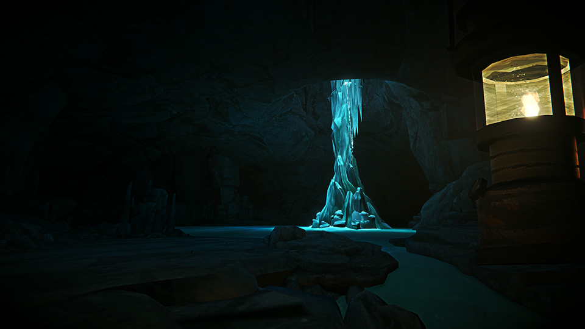

# Cave \(Transition Zone\)

**Contents**

- [Non cave transition zones](#Non_cave_transition_zones)
- [Cinder Hills Coal Mine](#Cinder_Hills_Coal_Mine)
- [Abandoned Mine No. 3](#Abandoned_Mine_No._3)
- [Carter Hydro Dam](#Carter_Hydro_Dam)
- [Pleasant Valley to Winding River](#Pleasant_Valley_to_Winding_River)
- [Mountain Town to Mystery Lake](#Mountain_Town_to_Mystery_Lake)
- [Mountain Town to Hushed River Valley](#Mountain_Town_to_Hushed_River_Valley)
- [Bleak Inlet to Forlorn Muskeg](#Bleak_Inlet_to_Forlorn_Muskeg)
- [Timberwolf Mountain to Ash Canyon](#Timberwolf_Mountain_to_Ash_Canyon)
- [Timberwolf Mountain to Blackrock](#Timberwolf_Mountain_to_Blackrock)
- [Keeper's Pass North to Keeper's Pass South](#Keeper%27s_Pass_North_to_Keeper%27s_Pass_South)
- [Route](#Route)
- [Far Territory Cave System](#Far_Territory_Cave_System)

<table class="infobox">
<caption>Cave (Transition Zone)</caption>
<colgroup>
<col style="width: 50%" />
<col style="width: 50%" />
</colgroup>
<tbody>
<tr>
<td colspan="2"><figure>

<figcaption>RegionAtlas-resources.assets-562_(6).png</figcaption>
</figure></td>
</tr>
<tr>
<td colspan="2" class="section">
<strong>Location on <a href="./Great%20Bear%20Island.md" class="wikilink" title="Great Bear Island">Great Bear Island</a></strong>
</td>
</tr>
<tr>
<td colspan="2"><figure>

<figcaption>No_picture.png</figcaption>
</figure></td>
</tr>
<tr>
<td colspan="2" class="section">
<strong>Details</strong>
</td>
</tr>
<tr>
<td>
Description
</td>
<td>
Transition Zones, Dark tunnels winding through the slopes separating regions.
</td>
</tr>
<tr>
<td>
Connecting Regions
</td>
<td>
<a href="./Pleasant%20Valley.md" class="wikilink" title="Pleasant Valley">Pleasant Valley</a> and <a href="./Winding%20River.md" class="wikilink" title="Winding River">Winding River</a>, <a href="./Mountain%20Town.md" class="wikilink" title="Mountain Town">Mountain Town</a> and <a href="./Mystery%20Lake%20%28disambiguation%29.md" class="wikilink" title="Mystery Lake">Mystery Lake</a>, <a href="./Mountain%20Town.md" class="wikilink" title="Mountain Town">Mountain Town</a> and <a href="./Hushed%20River%20Valley.md" class="wikilink" title="Hushed River Valley">Hushed River Valley</a>, <a href="./Forlorn%20Muskeg.md" class="wikilink" title="Forlorn Muskeg">Forlorn Muskeg</a> and <a href="./Bleak%20Inlet.md" class="wikilink" title="Bleak Inlet">Bleak Inlet</a>, <a href="./Timberwolf%20Mountain.md" class="wikilink" title="Timberwolf Mountain">Timberwolf Mountain</a> and <a href="./Ash%20Canyon.md" class="wikilink" title="Ash Canyon">Ash Canyon</a>
</td>
</tr>
</tbody>
</table>

There are several cave systems located on <a href="./Great%20Bear%20Island.md" class="wikilink" title="Great Bear Island">Great Bear Island</a> that serve as indoor Transition Zones between major regions. 2 of them are named Coal mines, while 7 of them are unnamed (simply called **Cave** when approached). Being indoor areas, they do not show up on any local maps, and cannot be surveyed with <a href="./Charcoal.md" class="wikilink" title="Charcoal">Charcoal</a> since they are indoor areas (save for the entrances/exits to the cave systems).

Despite appearing to be unique isolated areas on the island, every cave system is considered parented to a particular region (this can be seen when opening a map inside a cave system). While this would otherwise be considered trivial information, this detail can come in handy when attempting to wait out/escape the <a href="./Toxic%20Fog.md" class="wikilink" title="Toxic Fog">Toxic Fog</a> while playing <a href="./Escape%20the%20Darkwalker.md" class="wikilink" title="Escape the Darkwalker">Escape the Darkwalker</a>, and also affects the "days spent in" record for a region.

## Non cave transition zones

### <a href="./Cinder%20Hills%20Coal%20Mine.md" class="wikilink" title="Cinder Hills Coal Mine">Cinder Hills Coal Mine</a>

Located between the upper area of <a href="./Coastal%20Highway.md" class="wikilink" title="Coastal Highway">Coastal Highway</a> and a cliff overlooking <a href="./Thomson%27s%20Crossing.md" class="wikilink" title="Thomson&#39;s Crossing">Thomson's Crossing</a> in <a href="./Pleasant%20Valley.md" class="wikilink" title="Pleasant Valley">Pleasant Valley</a>, this coal mine is rich in coal, containers, and sometimes tools, as well as a <a href="./Work%20Bench.md" class="wikilink" title="Work Bench">Work Bench</a> that can be found inside.

This Cave system is part of Coastal Highway.

### <a href="./No.%203%20Coal%20Mine.md" class="wikilink" title="Abandoned Mine No. 3">Abandoned Mine No. 3</a>

Located between <a href="./Desolation%20Point.md" class="wikilink" title="Desolation Point">Desolation Point</a> and the <a href="./Crumbling%20Highway.md" class="wikilink" title="Old Island Connector">Old Island Connector</a> (Crumbling Highway), this coal mine is rich in coal, containers, and sometimes tools, as well as a work bench that can be found inside. There are several collapsed portions of the mine that must be crouched under in order to pass through.

This Cave system is part of Desolation Point.

### Carter Hydro Dam

Though technically not a cave system, the Carter Hydroelectric Dam Environs is an indoor Transition Zone (see <a href="./Carter%20Hydro%20Dam.md" class="wikilink" title="Carter Hydro Dam">Carter Hydro Dam</a> for more details) that connects <a href="./Mystery%20Lake%20%28region%29.md" class="wikilink" title="Mystery Lake">Mystery Lake</a> to <a href="./Winding%20River.md" class="wikilink" title="Winding River">Winding River</a>.

Both the upper and lower map cells of the dam are part of the Mystery Lake region.

## Pleasant Valley to Winding River

This cave system is located between the northwestern area near the <a href="./Hilltop%20Cave.md" class="wikilink" title="Hilltop Cave">Hilltop Cave</a> in <a href="./Pleasant%20Valley.md" class="wikilink" title="Pleasant Valley">Pleasant Valley</a> and the <a href="./Winding%20River.md" class="wikilink" title="Winding River">Winding River</a> regions.

The long and winding tunnels coupled with the low light make navigating this cave difficult. It is highly recommended that players venturing into the cave have a light source such as <a href="./Matches%20%28disambiguation%29.md" class="wikilink" title="matches">matches</a>, a fueled <a href="./Storm%20Lantern.md" class="wikilink" title="Storm Lantern">Storm Lantern</a>, or several <a href="./Flare.md" class="wikilink" title="flare">flares</a>. No <a href="./Wildlife.md" class="wikilink" title="animals">animals</a> are present in this transition cave, but several <a href="./Frozen%20Corpse.md" class="wikilink" title="Frozen Corpses">Frozen Corpses</a>, both human and <a href="./Deer.md" class="wikilink" title="deer">deer</a>, may be found throughout the tunnels. Many <a href="./Cairns.md" class="wikilink" title="Cairns">Cairns</a> can also be found throughout the cave.

This Cave system is part of Winding River.

## Mountain Town to Mystery Lake

The cave has a relatively linear layout. One end is found in the south of the the <a href="./Mountain%20Town.md" class="wikilink" title="Mountain Town">Mountain Town</a> region, and accessed via the climbing spot at the <a href="./Picnic%20Area.md" class="wikilink" title="Picnic Area">Picnic Area</a>. The other is found southeast of the <a href="./Trapper%27s%20Homestead.md" class="wikilink" title="Trapper&#39;s Homestead">Trapper's Homestead</a> in <a href="./Mystery%20Lake%20%28region%29.md" class="wikilink" title="Mystery Lake.">Mystery Lake.</a>

The cave contains no <a href="./Wildlife.md" class="wikilink" title="Wildlife">Wildlife</a>, but there are several <a href="./Stick.md" class="wikilink" title="Stick">Sticks</a>, logs, and pieces of <a href="./Coal.md" class="wikilink" title="Coal">Coal</a> found in the cave. A rabbit carcass and a soda might also spawn in the cave.

This Cave system is part of Mountain Town.

## Mountain Town to Hushed River Valley

The second transition cave in <a href="./Mountain%20Town.md" class="wikilink" title="Mountain Town">Mountain Town</a> is on the northernmost part of the map, close to the <a href="./Trailer%20%28Mountain%20Town%20Region%29.md" class="wikilink" title="Trailer (Mountain Town Region)">Trailer (Mountain Town Region)</a> and <a href="./Spruce%20Falls%20Bridge.md" class="wikilink" title="Spruce Falls Bridge">Spruce Falls Bridge</a>. The cave is rather short and unremarkable, but contains a few pieces of coal and some sticks.

This Cave system is part of Hushed River Valley.

## Bleak Inlet to Forlorn Muskeg

A very dark linear but winding cave with very little notable features, this cave connects to the lower elevations of <a href="./Bleak%20Inlet.md" class="wikilink" title="Bleak Inlet">Bleak Inlet</a> (close to <a href="./Ravine%27s%20End%20Waterfall.md" class="wikilink" title="Ravine&#39;s End Waterfall">Ravine's End Waterfall</a>) and to the slightly higher elevations of <a href="./Forlorn%20Muskeg.md" class="wikilink" title="Forlorn Muskeg">Forlorn Muskeg</a>, not far from the <a href="./Muskeg%20Overlook.md" class="wikilink" title="Muskeg Overlook">Muskeg Overlook</a>. It forms a path inside that splits into 2, only to ultimately reconnect to form a loop. One part of the path forces the player to climb a small cliff using roots; a moss bed is laid out at the base of the cliff. The other path is a straight line accessible by crouching and weaving through a narrow passage.

This Cave system is part of Bleak Inlet.

## Timberwolf Mountain to Ash Canyon

The entrance to this cave system starts in <a href="./Timberwolf%20Mountain.md" class="wikilink" title="Timberwolf Mountain">Timberwolf Mountain</a>, specifically near the <a href="./Deer%20Clearing.md" class="wikilink" title="Deer Clearing">Deer Clearing</a>. It is filled with the usual bits of Coal and fallen Sticks from holes in the ceiling, but contains notably also contains a chamber in the center of the cave system that spawns a corpse next to a campfire with some loot. The exit to this cave system leads to the upper plateau area of <a href="./Ash%20Canyon.md" class="wikilink" title="Ash Canyon">Ash Canyon</a>.

The cave does NOT contain a rope climb, only two "root climbs". As such it is possible to traverse it while being overloaded.

This Cave system is part of Ash Canyon.

## Timberwolf Mountain to Blackrock

The entrance to the cave in <a href="./Timberwolf%20Mountain.md" class="wikilink" title="Timberwolf Mountain">Timberwolf Mountain</a> can be found by following the frozen river uphill which is right next to <a href="./Andre%27s%20Peak.md" class="wikilink" title="Andre&#39;s Peak">Andre's Peak</a>. A <a href="./Rose%20Hip.md" class="wikilink" title="Rose Hip">Rose Hip</a> bush can be found right in front of the cave. It is a very dark cave and requires an artificial light source. It contains two small cliffs with roots that can be climbed. The lower part of the cave may also contain a ravaged wolf carcass very close to the exit towards <a href="./Blackrock.md" class="wikilink" title="Blackrock.">Blackrock.</a> Caution is advised since the cave also contains pools of cold water that can wet the players clothing, though some of them cannot be seen. Whether this a bug or an intended feature is unknown.

This Cave System is part of Blackrock.

## <a href="./Keeper%27s%20Pass%20North.md" class="wikilink" title="Keeper&#39;s Pass North">Keeper's Pass North</a> to <a href="./Keeper%27s%20Pass%20South.md" class="wikilink" title="Keeper&#39;s Pass South">Keeper's Pass South</a>

The entrance to the cave system is easy to get to as both Keeper's Pass regions are rather linearly structured. The inside of the cave itself contain a torch on the North side, a possible deer carcass with some arrows sticking out of it on the south side, a dead end where a <a href="./Wool%20Toque.md" class="wikilink" title="Wool Toque">Wool Toque</a> may spawn and a large shining moss covered room containing a backpack with randomized loot and a <a href="./Marine%20Flare.md" class="wikilink" title="Marine Flare">Marine Flare</a> which may be hard to spot due to its color, but lies near the spiky rock in the middle of the room.

### Route

The cave is very easy to navigate, featuring only a simple loop on the north side and a couple of dead ends. When going north to south choose the second right split (the last one that isn't a dead end), you should arrive at a place where there are stalactites in the hallway, take a left and you should be in the well lit moss covered room, it should now be a straight path to the exit, in the room with the deer carcass climb a little ramp to reach it.

This Cave system is part of Keeper's Pass North.

## Far Territory Cave System

This Transition Cave is by far the largest and longest cave in the game, so be prepared to bring plenty of light sources.

The entrance to the cave in <a href="./Forsaken%20Airfield.md" class="wikilink" title="Forsaken Airfield">Forsaken Airfield</a> can be found slightly south of the crashed <a href="./Helicopter.md" class="wikilink" title="Helicopter">Helicopter</a> in the mountains on the east of the map.

The Zone of Contamination entrance can be found at <a href="./Enduring%20Waterfall.md" class="wikilink" title="Enduring Waterfall">Enduring Waterfall</a>.

A second path in the middle of the cave system will allow the player to climb their way up a Rope Climb section to travel to <a href="./Sundered%20Pass.md" class="wikilink" title="Sundered Pass">Sundered Pass</a> instead. The entrance can be found halfway up the eastern path from the <a href="./Last%20Lonely%20House.md" class="wikilink" title="Last Lonely House">Last Lonely House</a> to the <a href="./Weather%20Station.md" class="wikilink" title="Weather Station">Weather Station</a>.

The Cave system is part of the <a href="./Zone%20of%20Contamination.md" class="wikilink" title="Zone of Contamination">Zone of Contamination</a>.

<table class="gallery">
<colgroup>
<col style="width: 50%" />
<col style="width: 50%" />
</colgroup>
<tbody>
<tr>
<td><figure>

<figcaption>The waterfall near the end of Sundered Pass transition cave</figcaption>
</figure></td>
<td><figure>
[Missing image: Far_Territory_Cave_waterfall.jpg]
<figcaption>Far_Territory_Cave_waterfall.jpg</figcaption>
</figure></td>
</tr>
</tbody>
</table>

**Lua execution error in Module:Navbox function navbox**

