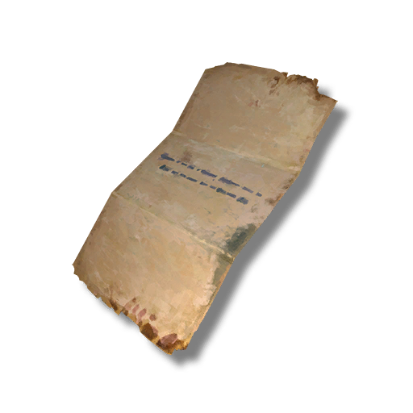

# Cave Hidden Cache Note

**Cave Hidden Cache Note**

| Property | Details |
| --- | --- |
|  |  / *Cave\_Hidden\_Cache\_Note\_icon.png* |
| Release | [1 August 2017](./The%20Long%20Dark%20%E2%80%94%20Early%20Access%20Changelog.md#1.00) |
| Wintermute | [Episode 1](./Episode%201%20-%20Do%20Not%20Go%20Gentle.md) - [Milton Supply Caches](./Milton%20Supply%20Caches.md) |
| **Properties** |  |
| Item type | [Collectibles](./Collectibles.md)\|- |
| Stackable | No |
| Examine | There are some supplies hidden under a pile rocks in a cave near the Radio Tower. |
| **Values** |  |
| Weight | 0.00 kg (0 lbs) |
| **Actions** |  |
| Backpack | Examine |
| On ground | Take It, Read Text, Leave It |
| **Advanced data** |  |
| Item key | STORY\_Collectible\_MiltonCaveCache |

**Cave Hidden Cache Note** is a [Collectible](./Collectibles.md) item found in [Episode 1](./Episode%201%20-%20Do%20Not%20Go%20Gentle.md) of the [Wintermute](./Wintermute.md) inside the house on the hill outside of Milton and is used to start the [Milton Supply Caches](./Milton%20Supply%20Caches.md) side mission.

During the course of the mission, the survivor finds the note *Cave Hidden Cache Note* from inside a residential home outside of [Milton](./Milton.md), located at the top of the hill southwest of the [Old Schoolhouse](./Old%20Schoolhouse.md).

## Transcript

*The following text is transcribed from **Cave Hidden Cache Note***

**I don't trust anyone anymore. People are getting desperate, and it's only been a few days since the power went out. I'm going to stash some supplies in our special place above town. You know, near where we look at the stars together? We may need them before help gets here.**

## Update history

- UPDATE **1 August 2017 ([Update](./The%20Long%20Dark%20%E2%80%94%20Changelog.md#1.00)):**
  - Added to game.

**Lua execution error in Module:Navbox function navbox**
