# Cedar Firewood

**Categories:** Fire Starting, Materials, Pages with update history · **Source:** [Fandom](https://thelongdark.fandom.com/wiki/Cedar_Firewood)

**Contents**

- [Fire Starting info](#fire-starting-info)
- [Obtaining](#obtaining)
- [Tips](#tips)
- [Products](#products)
- [Update history](#update-history)

**Cedar Firewood**

_Cedar\_Firewood\_icon.png_

**Release:** [12 June 2014](./The%20Long%20Dark%20%E2%80%94%20Changelog.md#0.01)

**Wintermute:** No

**Renewable:** Yes

**Properties**

**Item type:** [Fire Starting](./Fire%20Starting.md)

**Stackable:** yes

**Examine:** Cedar burns with an aromatic glow, but doesn't burn for long.

**Values**

**Weight:** 0.50 kg (1.1 lbs)

**Advanced data**

**Item key:** gear\_softwood

**Cedar Firewood** is a fuel item in _The Long Dark_.

## Fire Starting info

**Cedar Firewood**

**Type:** Fuel

**Statistics**

**Duration:**  60 minutes

**Start Chance:**  15%

**Heat:**  +6°C (+10.8°F)

**Burn Density:** 2 hr/kg (0.91 hr/lb)

## Obtaining

Cedar Firewood can be harvested from downed Cedar Limbs found outdoors with a [tool](./Tools.md). It can also be found inside of structures, firewood bins, rotten tree trunks, or near campfires and corpses. It can also be found by [Beachcombing](./Beachcombing.md).

## Tips

- Cedar Firewood increases the chance of starting a fire (+15%), which is useful at low [Firestarting Skill](./Skills.md). [Sticks](./Stick.md), [Accelerant](./Accelerant.md), [Lantern Fuel](./Lantern%20Fuel.md), [Gunpowder](./Can%20of%20Gunpowder.md), [Wood Matches](./Wood%20Matches.md), and [Firestrikers](./Firestriker.md) also increase Firestarting chance.
- Cedar Limbs respawn after high winds and blizzards, making them a renewable resource.
- Small Cedar Limbs yield 3 Cedar Firewood with a [Hatchet](./Hatchet.md), [Improvised Hatchet](./Improvised%20Hatchet.md), or [Hacksaw](./Hacksaw.md). They take 45 minutes to harvest with a hatchet, 58 minutes with an improvised hatchet, and 1 hour and 30 minutes with a hacksaw.
- Large Cedar Limbs yield 5 Cedar Firewood, but cannot be harvested with a Hacksaw.
- Large and Small Cedar Limbs cost tools the same condition per use (4%), making Large limbs more tool-friendly to harvest, except with the Hacksaw which cannot harvest Large Cedar or Large Fir Limbs.
- A single piece of Cedar firewood has a fire duration of 60 minutes, so its 120 min/kg is more weight efficient than the 90 min/kg of [Fir Firewood](./Fir%20Firewood.md). However, Fir Firewood is more tool-efficient, since harvesting any limb costs 4% durability and Small Fir Limbs yield 4.5 hours of fuel (4.0 for Cedar) and Large Fir Limb yields 6.0 hours of fuel (5 for Cedar).
- Cedar Firewood has the same weight efficiency as [Reclaimed Wood](./Reclaimed%20Wood.md), with two pieces of Reclaimed Wood being identical to one piece of Cedar Firewood.
- Cedar Firewood, [Fir Firewood](./Fir%20Firewood.md), and [Reclaimed Wood](./Reclaimed%20Wood.md) can be used to craft various [Decorations](./Decorations.md) that can be used in [Safehouse Customization](./Safehouse%20Customization.md).

## Products

| Item | Skills | Materials |
| --- | --- | --- |
| [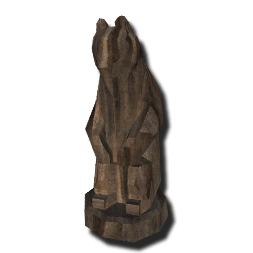](./Carved%20Bear%20Figurine.md) [Carved Bear Figurine](./Carved%20Bear%20Figurine.md) | None | - 1 × [Cedar Firewood](./Cedar%20Firewood.md) |
| [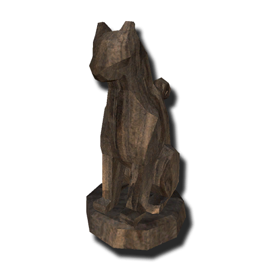](./Carved%20Cougar%20Figurine.md) [Carved Cougar Figurine](./Carved%20Cougar%20Figurine.md) | None | - 1 × [Cedar Firewood](./Cedar%20Firewood.md) |
| [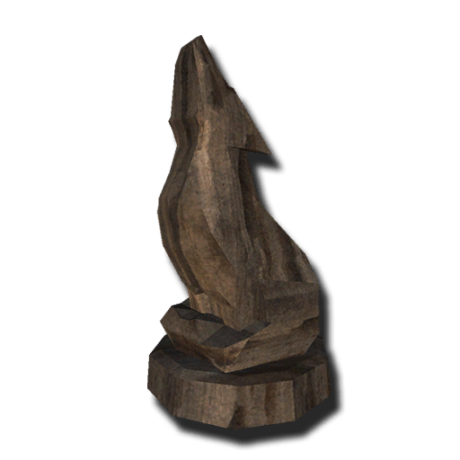](./Carved%20Wolf%20Figurine.md) [Carved Wolf Figurine](./Carved%20Wolf%20Figurine.md) | None | - 1 × [Cedar Firewood](./Cedar%20Firewood.md) |
| [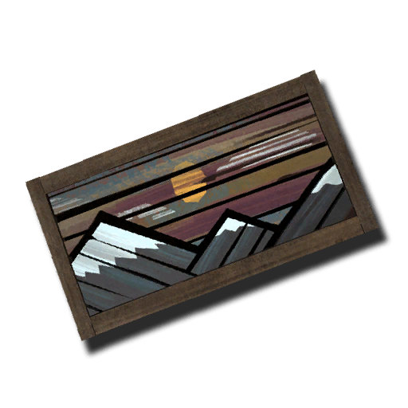](./Decorative%20Art.md) [Decorative Art](./Decorative%20Art.md) | None | - 2 × [Fir Firewood](./Fir%20Firewood.md) / - 1 × [Cedar Firewood](./Cedar%20Firewood.md) / - 1 × [Reclaimed Wood](./Reclaimed%20Wood.md) |
|  [Decorative Art (2)](./Decorative%20Art%20%282%29.md) | None | - 2 × [Fir Firewood](./Fir%20Firewood.md) / - 1 × [Cedar Firewood](./Cedar%20Firewood.md) / - 1 × [Reclaimed Wood](./Reclaimed%20Wood.md) |
| [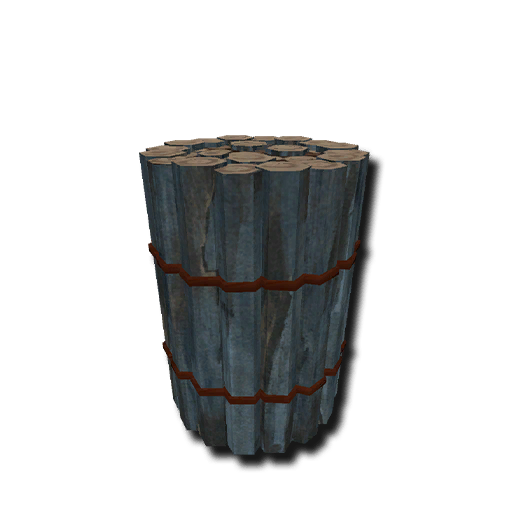](./Decorative%20End%20Table.md) [Decorative End Table](./Decorative%20End%20Table.md) | None | - 6 × [Cedar Firewood](./Cedar%20Firewood.md) |
| [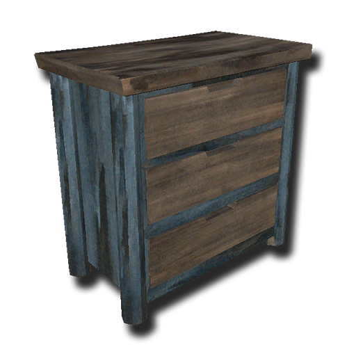](./Dresser.md) [Dresser](./Dresser.md) | None | - 10 × [Cedar Firewood](./Cedar%20Firewood.md) / - 4 × [Reclaimed Wood](./Reclaimed%20Wood.md) |
| [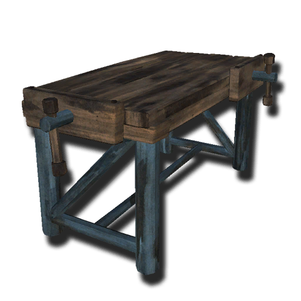](./Furniture%20Workbench.md) [Furniture Workbench](./Furniture%20Workbench.md) | None | - 10 × [Cedar Firewood](./Cedar%20Firewood.md) |
| [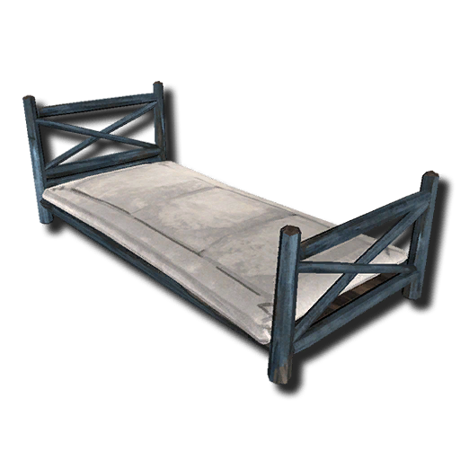](./Rustic%20Bed.md) [Rustic Bed](./Rustic%20Bed.md) | None | - 10 × [Cedar Firewood](./Cedar%20Firewood.md) / - 12 × [Cloth](./Cloth.md) / - 2 × [Cured Gut](./Cured%20Gut.md) |
| [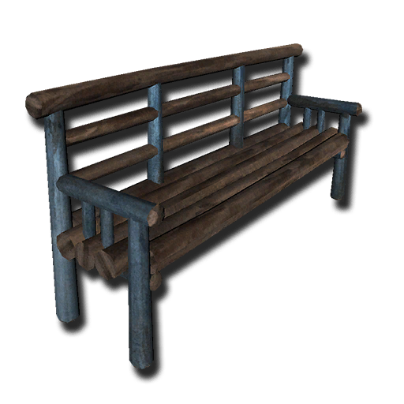](./Rustic%20Bench.md) [Rustic Bench](./Rustic%20Bench.md) | None | - 10 × [Cedar Firewood](./Cedar%20Firewood.md) / - 2 × [Reclaimed Wood](./Reclaimed%20Wood.md) |
| [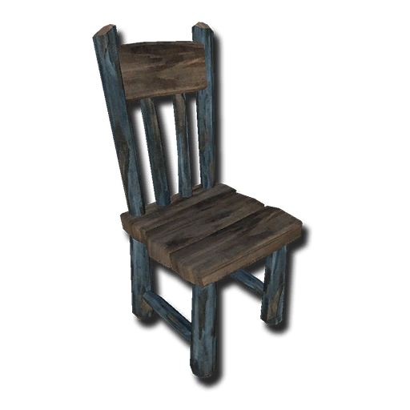](./Rustic%20Chair.md) [Rustic Chair](./Rustic%20Chair.md) | None | - 4 × [Cedar Firewood](./Cedar%20Firewood.md) / - 2 × [Reclaimed Wood](./Reclaimed%20Wood.md) |
| [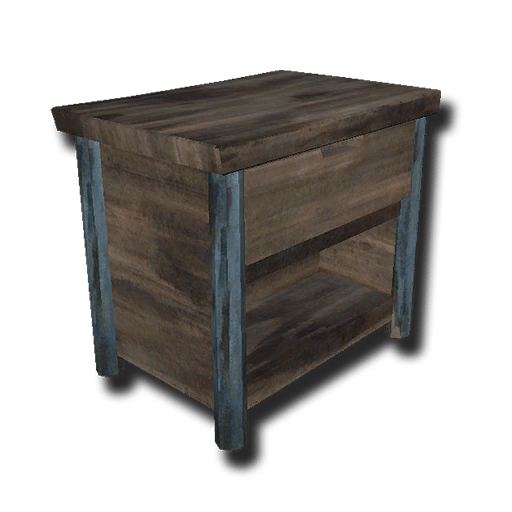](./Rustic%20End%20Table.md) [Rustic End Table](./Rustic%20End%20Table.md) | None | - 6 × [Cedar Firewood](./Cedar%20Firewood.md) / - 2 × [Reclaimed Wood](./Reclaimed%20Wood.md) |
| [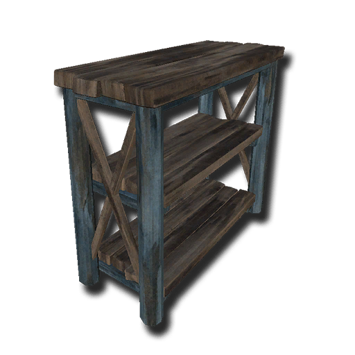](./Rustic%20Shelf.md) [Rustic Shelf](./Rustic%20Shelf.md) | None | - 8 × [Cedar Firewood](./Cedar%20Firewood.md) |
| [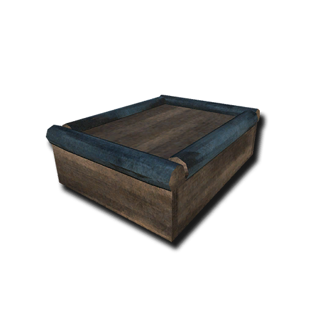](./Rustic%20Storage%20Box.md) [Rustic Storage Box](./Rustic%20Storage%20Box.md) | None | - 8 × [Cedar Firewood](./Cedar%20Firewood.md) |
| [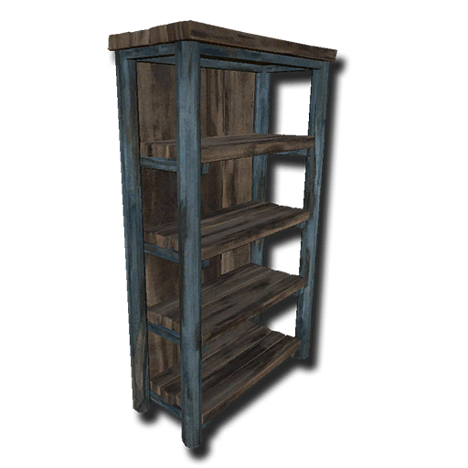](./Tall%20Rustic%20Shelf.md) [Tall Rustic Shelf](./Tall%20Rustic%20Shelf.md) | None | - 10 × [Cedar Firewood](./Cedar%20Firewood.md) |
| 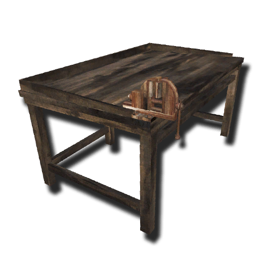 Workbench | None | - 15 × [Cedar Firewood](./Cedar%20Firewood.md) / - 1 × [Workbench Vice](./Workbench%20Vice.md) |

## Update history

- UPDATE **31 July 2014 ([Update](./The%20Long%20Dark%20%E2%80%94%20Changelog.md#.073)):**
  - Fuel Sources: Increased the heating radius of Hardwood, Softwood, and Reclaimed Wood fuel types.
  - Tuned all Fuel sources. Hardwood, Softwood, and Reclaimed wood all now have reduced burn times, but are also lighter to carry. Wood Foraging has been tuned to be more generous. Net result is Fuel is easier to find and carry, but you need more of it.
- UPDATE **12 June 2014 ([Update](./The%20Long%20Dark%20%E2%80%94%20Changelog.md#.01)):**
  - Added to game.
