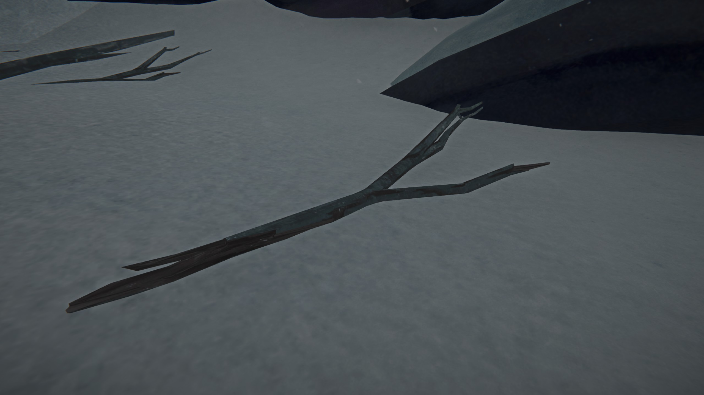
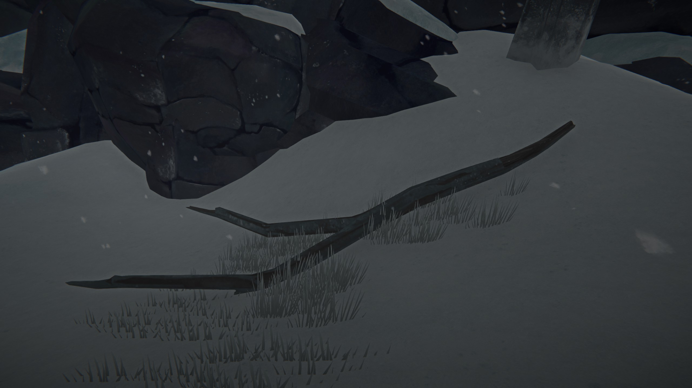

# Cedar Limb

**Categories:** Interactable Objects · **Source:** [Fandom](https://thelongdark.fandom.com/wiki/Cedar_Limb)

**Cedar Limb**

**General**

Item Type

Item

Wintermute

**Statistics**

Harvest

45-60 Minutes

Yields 3-4 [Cedar Firewood](./Cedar%20Firewood.md), 1 [Tinder Plug](./Tinder%20Plug.md)

A **Cedar Limb** is one of the many stationary interactable objects found in _The Long Dark_. They respawn randomly in the world over time under trees, making them a renewable [material](./Materials.md).

## Overview

There are two variants of this object: small and large. Both can be turned into [Cedar Firewood](./Cedar%20Firewood.md) and [Tinder Plugs](./Tinder%20Plug.md).

In addition to Cedar Firewood, these limbs will always yield one [Tinder Plug](./Tinder%20Plug.md) when harvested. This, along with cedar being easier to start than [Fir Fireword](./Fir%20Firewood.md), means that breaking down a Cedar Limb will provide all the resources needed to start a fire.

It's commonly believed that limbs respawn after strong winds or blizzards, but this is untrue. Radial spawns (sticks, branches, coal, stones ect.) simply spawn on a randomized timer, independent of any weather conditions.

### Small Limb

Small limbs will provide 3 firewood and 1 and can be cut up using a [Hatchet](./Hatchet.md) (45 min), [Improvised Hatchet](./Improvised%20Hatchet.md) (58 min), or [Hacksaw](./Hacksaw.md) (90 min).

| Cedar Firewood, Tinder Plug | Time | Calories | Condition of Tool |
| --- | --- | --- | --- |
| 3 / 1 | 45 minutes | 135 | -2% Hatchet |
| 3 / 1 | 58 minutes | 176 | -2% Improvised Hatchet |
| 3 / 1 | 90 minutes | 270 | -5% Hacksaw |

### Large Limb

Large limbs cannot be cut up with a Hacksaw, and take 60 min to harvest with a normal Hatchet, or 78 min with an Improvised Hatchet. Large Cedar Limbs are very rare and only appear in set locations:

- [Signal Hill](./Signal%20Hill.md) in [Pleasant Valley](./Pleasant%20Valley.md)
- In [The Ravine](./The%20Ravine.md), in the incropping with [Rose Hips](./Rose%20Hip.md) turning left right after the bridge exiting from [Mystery Lake](./Mystery%20Lake%20%28region%29.md)

| Cedar Firewood/Tinder Plug | Time | Calories | Condition of Tool |
| --- | --- | --- | --- |
| 5/2 | 60 minutes |  | -2% Hatchet |
| 5/2 | 78 minutes | 325 | -2% Improvised Hatchet |
