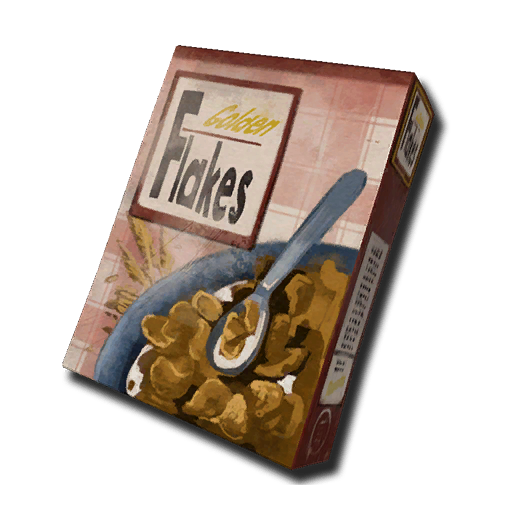

# Cereal

**Cereal**

| Property | Details |
| --- | --- |
|  |  / *Cereal\_icon.png* |
| Release | [2 December 2024](./The%20Long%20Dark%20%E2%80%94%20Changelog.md#2.33) |
| Wintermute | No |
| Renewable | Yes ([Trader](./Trader.md) only) |
| **Properties** |  |
| Item type | [Food And Drink](./Food%20And%20Drink.md)\|- |
| Stackable | No |
| Examine | Dry, boxed Cereal. A good source of calories. |
| **Values** |  |
| Calories | 700 kcal |
| Hydration | -10% |
| Weight | 0.20 kg (0.44 lbs) |

| Column 1 | Column 2 | Column 3 |
| --- | --- | --- |
|  / *Ptarmigan\_icon.png* | **DLC-Exclusive content.** / This content requires the [Tales from the Far Territory](./Tales%20from%20the%20Far%20Territory.md) addon to be installed before it can be seen or used in regular gameplay. | \|}**Cereal** is a [Food And Drink](./Food%20And%20Drink.md) item in *[The Long Dark](./The%20Long%20Dark.md)*. / ## Overview / It is only acquired when trading with the [Trader](./Trader.md). The price to acquire a single box is quite steep, costing 20 firewood, but the amount of calories is quite high for a single food and drink item. / Cereal costs the following to acquire from the Trader: / - 20  [Cedar Firewood](./Cedar%20Firewood.md) / - 2.00 L  [Water (Potable)](./Water%20%28Potable%29.md) / ## Trivia / - The box is branded as "Golden Flakes" / - The side of the box lists "Ingredients: Whole Grain Wheat, Wheat Bran, Sugar, salt." / ## Update history / **Template:update history** / **Lua execution error in Module:Navbox function navbox** [ru:Хлопья](ru:%D0%A5%D0%BB%D0%BE%D0%BF%D1%8C%D1%8F) |
