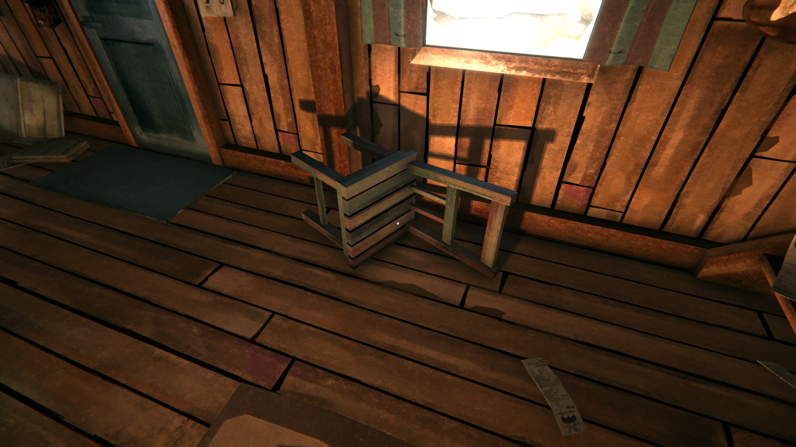
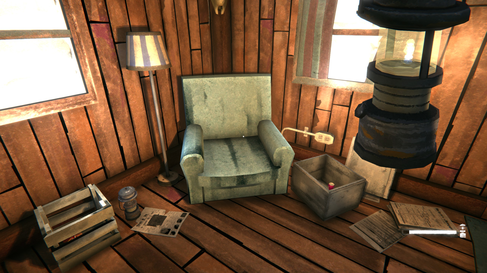

# Chair

**Categories:** Interactable Objects · **Source:** [Fandom](https://thelongdark.fandom.com/wiki/Chair)

**Contents**

- [Chair/Rocking Chair](#chairrocking-chair)
- [Cushioned chair](#cushioned-chair)
- [Sofa chair](#sofa-chair)
- [Stool](#stool)

**Chair**

\[\[File:

250px\]\]

**General**

Item Type

Item

Wintermute

No

 **Template:images needed**A **Chair** is a wooden seat which is used primarily as a source of [Reclaimed Wood](./Reclaimed%20Wood.md). They require a [Hatchet](./Hatchet.md) to break down, and some can be broken down by hand.

## Chair/Rocking Chair

Chairs yield 4 Reclaimed Wood, require a Hatchet to harvest, and take 1 hour to harvest.

| Reclaimed Wood | Time | Calories | Condition of Tool |
| --- | --- | --- | --- |
| 4 |  |  | -0% Hand |
| 4 | 1 hour | 112 | -2% Hatchet |
| 4 |  | 146 | -3% Improvised Hatchet |
| 4 |  | 169 | -0.5% Heavy Hammer |

## Cushioned chair

Padded chairs yield 3 [Reclaimed Wood](./Reclaimed%20Wood.md), 2 [Cloth](./Cloth.md), require a hatchet to harvest, and take 45 minutes to harvest.

| Reclaimed Wood | Time | Calories | Condition of Tool |
| --- | --- | --- | --- |
| 3 | 38 minutes | 112 | -2% Hatchet |
| 3 | 49 minutes | 146 | -3% Improvised Hatchet |
| 3 | 56 minutes | 169 | -0.5% Heavy Hammer |

## Sofa chair

Sofa chairs yield 4 Reclaimed Wood, 6 [Cloth](./Cloth.md), 2 [Tinder Plug](./Tinder%20Plug.md), require a hatchet to harvest, and take 1.5 hours to harvest.

| Reclaimed Wood | Time | Calories | Condition of Tool |
| --- | --- | --- | --- |
| 4/6 Cloth/2 Tinder Plugs | 1 hour 30 minutes | 112 | -2% Hatchet |
| 4/6 Cloth/2 Tinder Plugs |  | 146 | -3% Improvised Hatchet |
| 4/6 Cloth/2 Tinder Plugs |  | 169 | -0.5% Heavy Hammer |

## Stool

The stool is a wooden seat which is used primarily as a source of reclaimed wood. When a chair is broken down, it yields Reclaimed Wood.

Stools yield 3 reclaimed wood, require a hatchet to harvest, and take 30 minutes to harvest.

| Reclaimed Wood | Time | Calories | Condition of Tool |
| --- | --- | --- | --- |
| 3 | 38 minutes | 112 | -2% Hatchet |
| 3 | 49 minutes | 146 | -3% Improvised Hatchet |
| 3 | 56 minutes | 169 | -0.5% Heavy Hammer |
