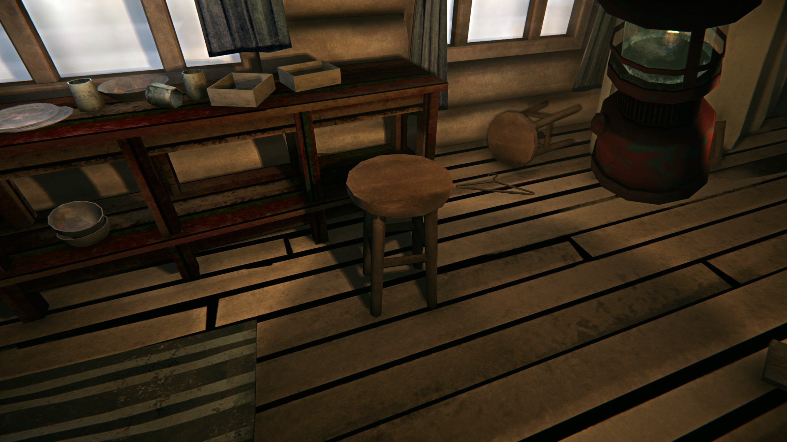

# Chair

**Contents**

- [Chair/Rocking Chair](#Chair%2FRocking_Chair)
- [Cushioned chair](#Cushioned_chair)
- [Sofa chair](#Sofa_chair)
- [Stool](#Stool)

<table class="infobox">
<caption>Chair</caption>
<colgroup>
<col style="width: 33%" />
<col style="width: 33%" />
<col style="width: 33%" />
</colgroup>
<tbody>
<tr>
<td colspan="2">
[[File:

<table class="gallery">
<colgroup>
<col style="width: 33%" />
<col style="width: 33%" />
<col style="width: 33%" />
</colgroup>
<tbody>
<tr>
<td><figure>
[Missing image: Chair.jpg]
<figcaption>Chair</figcaption>
</figure></td>
<td><figure>
[Missing image: Sofa_Chair.jpg]
<figcaption>Sofa</figcaption>
</figure></td>
<td><figure>

<figcaption>Stool</figcaption>
</figure></td>
</tr>
</tbody>
</table></td>
<td>
250px]]
</td>
</tr>
<tr>
<td colspan="2">
<strong>General</strong>
</td>
<td></td>
</tr>
<tr>
<td>
Item Type
</td>
<td>
Item
</td>
<td></td>
</tr>
<tr>
<td>
Wintermute
</td>
<td>
No
</td>
<td></td>
</tr>
</tbody>
</table>

**Template:stub** **Template:images needed**A **Chair** is a wooden seat which is used primarily as a source of <a href="./Reclaimed%20Wood.md" class="wikilink" title="Reclaimed Wood">Reclaimed Wood</a>. They require a <a href="./Hatchet.md" class="wikilink" title="Hatchet">Hatchet</a> to break down, and some can be broken down by hand.

## Chair/Rocking Chair

Chairs yield 4 Reclaimed Wood, require a Hatchet to harvest, and take 1 hour to harvest.

| Reclaimed Wood | Time   | Calories | Condition of Tool      |
|----------------|--------|----------|------------------------|
| 4              |        |          | -0% Hand               |
| 4              | 1 hour | 112      | -2% Hatchet            |
| 4              |        | 146      | -3% Improvised Hatchet |
| 4              |        | 169      | -0.5% Heavy Hammer     |

## Cushioned chair

Padded chairs yield 3 <a href="./Reclaimed%20Wood.md" class="wikilink" title="Reclaimed Wood">Reclaimed Wood</a>, 2 <a href="./Cloth.md" class="wikilink" title="Cloth">Cloth</a>, require a hatchet to harvest, and take 45 minutes to harvest.

| Reclaimed Wood | Time       | Calories | Condition of Tool      |
|----------------|------------|----------|------------------------|
| 3              | 38 minutes | 112      | -2% Hatchet            |
| 3              | 49 minutes | 146      | -3% Improvised Hatchet |
| 3              | 56 minutes | 169      | -0.5% Heavy Hammer     |

## Sofa chair

Sofa chairs yield 4 Reclaimed Wood, 6 <a href="./Cloth.md" class="wikilink" title="Cloth">Cloth</a>, 2 <a href="./Tinder%20Plug.md" class="wikilink" title="Tinder Plug">Tinder Plug</a>, require a hatchet to harvest, and take 1.5 hours to harvest.

| Reclaimed Wood           | Time              | Calories | Condition of Tool      |
|--------------------------|-------------------|----------|------------------------|
| 4/6 Cloth/2 Tinder Plugs | 1 hour 30 minutes | 112      | -2% Hatchet            |
| 4/6 Cloth/2 Tinder Plugs |                   | 146      | -3% Improvised Hatchet |
| 4/6 Cloth/2 Tinder Plugs |                   | 169      | -0.5% Heavy Hammer     |

## Stool

The stool is a wooden seat which is used primarily as a source of reclaimed wood. When a chair is broken down, it yields Reclaimed Wood.

Stools yield 3 reclaimed wood, require a hatchet to harvest, and take 30 minutes to harvest.

| Reclaimed Wood | Time       | Calories | Condition of Tool      |
|----------------|------------|----------|------------------------|
| 3              | 38 minutes | 112      | -2% Hatchet            |
| 3              | 49 minutes | 146      | -3% Improvised Hatchet |
| 3              | 56 minutes | 169      | -0.5% Heavy Hammer     |

**Lua execution error in Module:Navbox function navbox**

