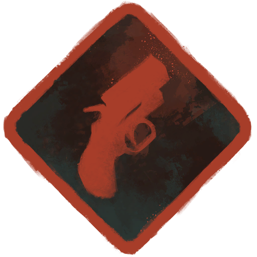
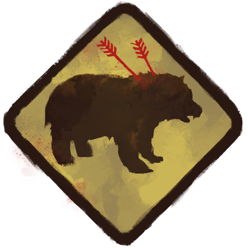
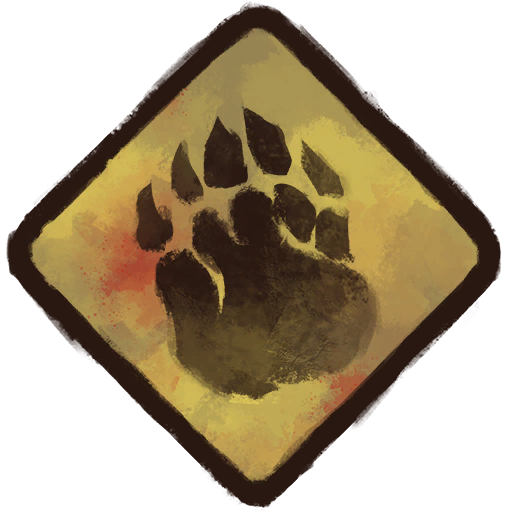
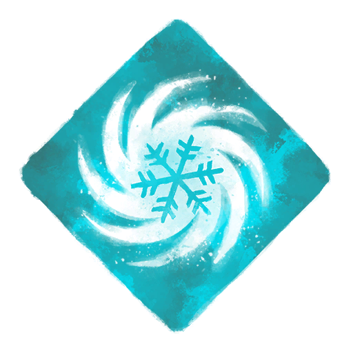
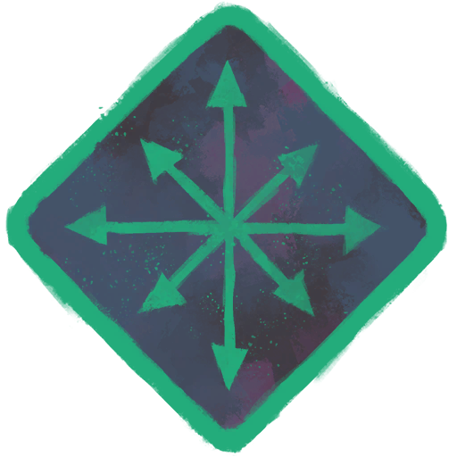
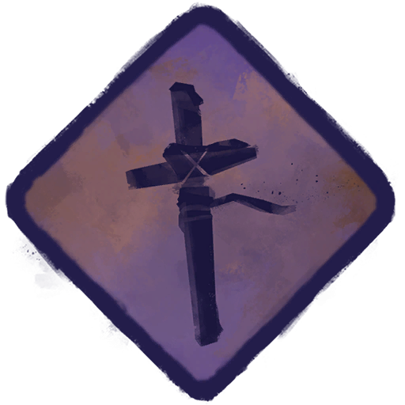
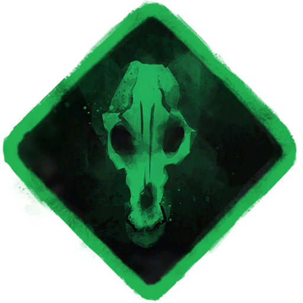
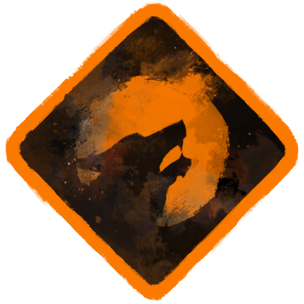
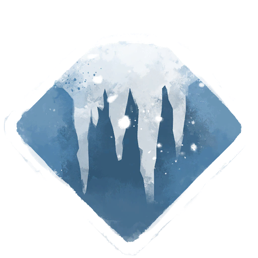

# Challenge

**Challenges** are special survival scenarios within <a href="./The%20Long%20Dark.md" class="wikilink" title="The Long Dark&#39;s"><em>The Long Dark's</em></a> <a href="./Survival%20Mode.md" class="wikilink" title="Survival Mode">Survival Mode</a> sandbox. In addition to the normal survival mechanics, Challenges contain narrative-based objectives, unique gameplay and enemies not normally found in normal survival mode, and in some cases, a time limited objective. Challenges can be found within the Survival main menu as their own separate game mode.

There are currently eight challenges in the *<a href="./The%20Long%20Dark.md" class="wikilink" title="The Long Dark">The Long Dark</a>*. Completing a Challenge will unlock a <a href="./Badges.md" class="wikilink" title="Badge">Badge</a> as proof of completion and allows the player to compare their completion time with other players. Completing all of them (excluding difficulty 6 challenges) yields the *Challenge Mastery* <a href="./The%20Long%20Dark%20%E2%80%94%20Achievements.md" class="wikilink" title="achievement">achievement</a>.

<table>
<colgroup>
<col style="width: 25%" />
<col style="width: 25%" />
<col style="width: 25%" />
<col style="width: 25%" />
</colgroup>
<thead>
<tr>
<th style="border-style: solid none solid solid"><figure>

<figcaption>Challenge_icon.png</figcaption>
</figure></th>
<th style="border-style: solid solid solid none">
Challenge
</th>
<th>
Description
</th>
<th>
Difficulty
</th>
</tr>
</thead>
<tbody>
<tr>
<td><figure>

<figcaption>Badge_challenge_hopelessRescue.png</figcaption>
</figure></td>
<td>
<a href="./Hopeless%20Rescue.md" class="wikilink" title="Hopeless Rescue">Hopeless Rescue</a>
</td>
<td>
Recover the Distress Pistol from the summit of Timberwolf Mountain. Fire it from the top of the Desolation Point Lighthouse.
</td>
<td>
4
</td>
</tr>
<tr>
<td><figure>

<figcaption>The_Hunted_Part_One_icon.png</figcaption>
</figure></td>
<td>
<a href="./The%20Hunted%2C%20Part%20One.md" class="wikilink" title="The Hunted, Part One">The Hunted, Part One</a>
</td>
<td>
Avoid the Bear. Get to Trapper's Cabin in Mystery Lake.
</td>
<td>
5
</td>
</tr>
<tr>
<td><figure>

<figcaption>Badge_challenge_huntedPart2.png</figcaption>
</figure></td>
<td>
<a href="./The%20Hunted%2C%20Part%20Two.md" class="wikilink" title="The Hunted, Part Two">The Hunted, Part Two</a>
</td>
<td>
Take the rifle and go face the Old Bear.
</td>
<td>
5
</td>
</tr>
<tr>
<td></td>
<td>
<a href="./The%20Hunted%2C%20Part%20Three.md" class="wikilink" title="The Hunted, Part Three">The Hunted, Part Three</a>
</td>
<td>
TBA
</td>
<td>
TBA
</td>
</tr>
<tr>
<td><figure>

<figcaption>Badge_challenge_whiteout.png</figcaption>
</figure></td>
<td>
<a href="./Whiteout.md" class="wikilink" title="Whiteout">Whiteout</a>
</td>
<td>
The storm arrives in 30 days. Stockpile enough food, water, and supplies in the Coastal Highway Quonset Garage before it hits.
</td>
<td>
4
</td>
</tr>
<tr>
<td><figure>

<figcaption>Badge_challenge_nomad.png</figcaption>
</figure></td>
<td>
<a href="./Nomad.md" class="wikilink" title="Nomad">Nomad</a>
</td>
<td>
Survive for 3 days each in 15 specific locations across the game world.
</td>
<td>
3
</td>
</tr>
<tr>
<td><figure>

<figcaption>Badge_challenge_archivist.png</figcaption>
</figure></td>
<td>
<a href="./Archivist.md" class="wikilink" title="Archivist">Archivist</a>
</td>
<td>
During the aurora, collect Buffer Memories from across Great Bear Island at the locations listed in your journal.
</td>
<td>
3
</td>
</tr>
<tr>
<td><figure>

<figcaption>Badge_challenge_Deadman.png</figcaption>
</figure></td>
<td>
<a href="./As%20the%20Dead%20Sleep.md" class="wikilink" title="As the Dead Sleep">As the Dead Sleep</a>
</td>
<td>
Visit all the grave sites marked on your map. There is no time limit. As your life ebbs, death is the only barrier.
</td>
<td>
6
</td>
</tr>
<tr>
<td><figure>

<figcaption>Badge_Umbra.png</figcaption>
</figure></td>
<td>
<a href="./Escape%20the%20Darkwalker.md" class="wikilink" title="Escape the Darkwalker">Escape the Darkwalker</a>
</td>
<td>
Search for the Green Fires. Learn all you can about the Darkwalker. Knowledge will help you find a way to defeat the enemy.
</td>
<td>
6
</td>
</tr>
</tbody>
</table>

The following 2 challenges were timed Events that are currently unavailable to be played within the game.

<table>
<colgroup>
<col style="width: 33%" />
<col style="width: 33%" />
<col style="width: 33%" />
</colgroup>
<thead>
<tr>
<th><figure>

<figcaption>Challenge_icon.png</figcaption>
</figure></th>
<th>
Challenge
</th>
<th>
Description
</th>
</tr>
</thead>
<tbody>
<tr>
<td><figure>

<figcaption>Badge_challenge_FourDaysOfNightFull.png</figcaption>
</figure></td>
<td>
<a href="./4%20Days%20of%20Night%20Event.md" class="wikilink" title="4 Days of Night Event">4 Days of Night Event</a>
</td>
<td>
An endless night has arrived on Great Bear Island. Survive across 4 real world days as the island changes each day. Survive for 2 hours each day to accumulate progress.
</td>
</tr>
<tr>
<td><figure>

<figcaption>Badge_WinterInJuly.png</figcaption>
</figure></td>
<td>
<a href="./Winter%27s%20Embrace.md" class="wikilink" title="Winter&#39;s Embrace">Winter's Embrace</a>
</td>
<td>
Survive an ever increasingly cold world as you hunt for 2 brand new food items. Average world temperatures are -10° C indoors and outdoors.
</td>
</tr>
</tbody>
</table>

## History

- <a href="./Hopeless%20Rescue.md" class="wikilink" title="Hopeless Rescue">Hopeless Rescue</a> and <a href="./The%20Hunted%2C%20Part%20One.md" class="wikilink" title="The Hunted, Part One">The Hunted, Part One</a> were added in <a href="./The%20Long%20Dark%20%E2%80%94%20Early%20Access%20Changelog.md#0.321" class="wikilink" title="version 0.321">version 0.321</a>
- <a href="./Whiteout.md" class="wikilink" title="Whiteout">Whiteout</a> and <a href="./Nomad.md" class="wikilink" title="Nomad">Nomad</a> were added in <a href="./The%20Long%20Dark%20%E2%80%94%20Early%20Access%20Changelog.md#0.346" class="wikilink" title="version 0.346">version 0.346</a>
- <a href="./The%20Hunted%2C%20Part%20Two.md" class="wikilink" title="The Hunted, Part Two">The Hunted, Part Two</a> was added in <a href="./The%20Long%20Dark%20%E2%80%94%20Early%20Access%20Changelog.md#0.364" class="wikilink" title="version 0.364">version 0.364</a>
- <a href="./Archivist.md" class="wikilink" title="Archivist">Archivist</a> was added in <a href="./The%20Long%20Dark%20%E2%80%94%20Changelog.md#1.41" class="wikilink" title="version 1.41">version 1.41</a>
- <a href="./As%20the%20Dead%20Sleep.md" class="wikilink" title="As the Dead Sleep">As the Dead Sleep</a> was added in <a href="./The%20Long%20Dark%20%E2%80%94%20Changelog.md#1.64" class="wikilink" title="version 1.64">version 1.64</a>
- <a href="./Escape%20the%20Darkwalker.md" class="wikilink" title="Escape the Darkwalker">Escape the Darkwalker</a> was added in <a href="./The%20Long%20Dark%20%E2%80%94%20Changelog.md#1.86" class="wikilink" title="version 1.86">version 1.86</a> as a Halloween event, then permanently added as a challenge in <a href="./The%20Long%20Dark%20%E2%80%94%20Changelog.md#1.89" class="wikilink" title="version 1.89">version 1.89</a>

## Pause Menu icons

<table class="gallery">
<colgroup>
<col style="width: 100%" />
</colgroup>
<tbody>
<tr>
<td><figure>

<figcaption>4DON</figcaption>
</figure></td>
</tr>
</tbody>
</table>

**Lua execution error in Module:Navbox function navboxLua execution error in Module:Navbox function navbox** <a href="ru:%D0%9A%D0%B0%D1%82%D0%B5%D0%B3%D0%BE%D1%80%D0%B8%D1%8F:%D0%98%D1%81%D0%BF%D1%8B%D1%82%D0%B0%D0%BD%D0%B8%D1%8F" class="wikilink" title="ru:Категория:Испытания">ru:Категория:Испытания</a>

<a href="fr:D%C3%A9fis" class="wikilink" title="fr:Défis">fr:Défis</a>

