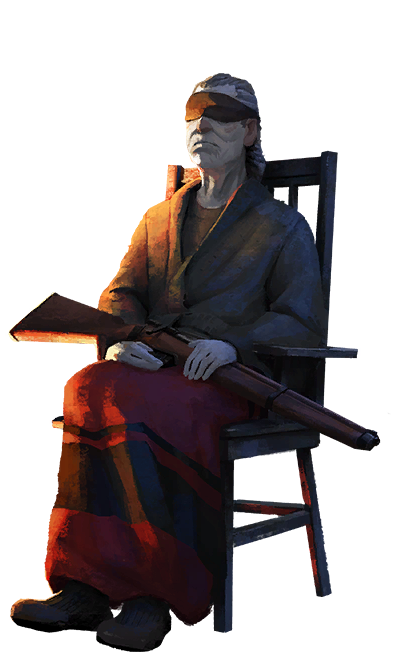
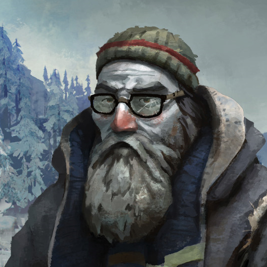
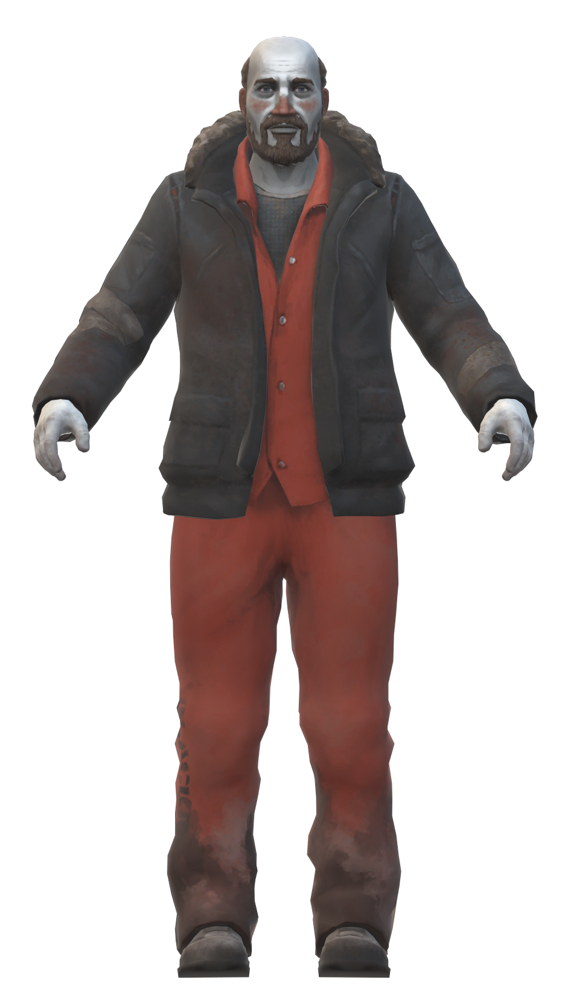
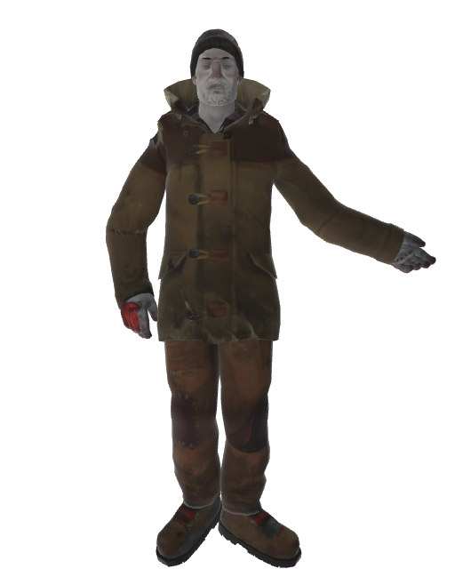

# Characters

**Contents**

- [Wintermute](#Wintermute)
- [Episode 1: Do Not Go Gentle](#Episode_1%3A_Do_Not_Go_Gentle)
- [Will Mackenzie](#Will_Mackenzie)
- [Astrid Greenwood](#Astrid_Greenwood)
- [Grey Mother](#Grey_Mother)
- [Methuselah](#Methuselah)
- [Hobbs](#Hobbs)
- [Episode 2: Luminance Fugue](#Episode_2%3A_Luminance_Fugue)
- [Jeremiah](#Jeremiah)
- [Mathis](#Mathis)
- [Episode 3: Crossroads Elegy](#Episode_3%3A_Crossroads_Elegy)
- [Molly](#Molly)
- [Father Thomas](#Father_Thomas)
- [Episode 4: Fury, then Silence](#Episode_4%3A_Fury%2C_then_Silence)
- [Vachon and Heller](#Vachon_and_Heller)
- [Franklin](#Franklin)
- [Jace](#Jace)
- [Episode 5: The Light At The End Of All Things](#Episode_5%3A_The_Light_At_The_End_Of_All_Things)
- [Atwood](#Atwood)
- [Jane Yang](#Jane_Yang)
- [Minor Wintermute Characters](#Minor_Wintermute_Characters)
- [Maureen](#Maureen)
- [Astrid and Will's Son](#Astrid_and_Will%27s_Son)
- [Martin Barker](#Martin_Barker)
- [Lilith Barker](#Lilith_Barker)
- [Lake Forest Talker](#Lake_Forest_Talker)
- [Hank](#Hank)
- [Radio Voice Man](#Radio_Voice_Man)
- [Convicts](#Convicts)
- [Molly's Husband](#Molly%27s_Husband)
- [Gwen](#Gwen)
- [Logan, Ava, Wade](#Logan%2C_Ava%2C_Wade)
- [Dimitri](#Dimitri)
- [Crash Survivor](#Crash_Survivor)
- [Donner](#Donner)
- [Townsperson One and Two](#Townsperson_One_and_Two)
- [Survival Mode](#Survival_Mode)
- [Tales From the Far Territory Characters](#Tales_From_the_Far_Territory_Characters)
- [Dr. Rüdiger](#Dr._R%C3%BCdiger)
- [Security Chief Lena Vertasky](#Security_Chief_Lena_Vertasky)
- [The Foreman](#The_Foreman)
- [Project Medical Officer](#Project_Medical_Officer)
- [Patient 7](#Patient_7)
- [Trader](#Trader)
- [Mentioned Characters](#Mentioned_Characters)
- [Wintermute](#Wintermute_2)
- [Episode 1](#Episode_1)
- [Episode 2](#Episode_2)
- [Episode 3](#Episode_3)
- [Episode 4](#Episode_4)
- [Episode 5](#Episode_5)
- [Survival Mode](#Survival_Mode_2)
- [Mentioned Organizations](#Mentioned_Organizations)
- [Buffer Memory Characters](#Buffer_Memory_Characters)

**Images Needed:***This article is in need of more images and/or higher quality images. You can help by uploading an image and \[//dummy.host/index.php?title=Characters&action=edit adding it to the article\].*

  

*SPOILER WARNING*\
*This section may contain spoilers from the <a href="./Wintermute.md" class="wikilink" title="story">story</a> of The Long Dark.*

<a href="./Great%20Bear%20Island.md" class="wikilink" title="Great Bear Island">Great Bear Island</a> contains many residents that once thrived in the various regions and towns across the Island before and after the <a href="./First%20Flare.md" class="wikilink" title="First Flare">First Flare</a>. Many are found and interacted with in <a href="./Wintermute.md" class="wikilink" title="Wintermute">Wintermute</a>. <a href="./Survival%20Mode.md" class="wikilink" title="Survival Mode">Survival Mode</a> also contains its own references to many of the Island's inhabitants, but many characters and locations found within Wintermute have been changed, suggesting an alternate timeline of events takes place in Survival Mode.

## Wintermute

Wintermute places a large focus on interacting with several inhabitants of Great Bear Island. Several story points only progress when speaking with or accepting quests for many central characters.

### <a href="./Episode%201%20-%20Do%20Not%20Go%20Gentle.md" class="wikilink" title="Episode 1: Do Not Go Gentle">Episode 1: Do Not Go Gentle</a>

### <a href="./Will%20Mackenzie.md" class="wikilink" title="Will Mackenzie">Will Mackenzie</a>

<figure>

<figcaption>Will.png</figcaption>
</figure>

William Mackenzie is the central protagonist of the story of *The Long Dark*. The current caretaker of <a href="./Jackrabbit%20Hangar.md" class="wikilink" title="Jackrabbit Remote Transport">Jackrabbit Remote Transport</a>, Mackenzie is tasked by Astrid Greenwood to help fly herself and a <a href="./Astrid%27s%20Hardcase.md" class="wikilink" title="Hardcase">Hardcase</a> to the local to Great Bear Island. During the flight, their plane crashes into the mountains of the island, with Mackenzie being trapped at the bottom of a nearby ravine. Stranded far from the closest human civilization while being lost, wounded, and alone, Mackenzie must quickly master basic wilderness survival skills if he's to last long enough to find Astrid and understand how his world has just changed forever.

He is voiced by <a href="wikipedia:Mark_Meer" class="wikilink" title="Mark Meer">Mark Meer</a>.

### <a href="./Astrid%20Greenwood.md" class="wikilink" title="Astrid Greenwood">Astrid Greenwood</a>

<figure>

<figcaption>Astrid.png</figcaption>
</figure>

Astrid Greenwood is the deuteragonist of the story of *The Long Dark*. A researcher wishing to travel to Great Bear Island with a mysterious Hardcase, Astrid is separated from Mackenzie after their small plane crashes to the ground in the northern Canadian wilderness. The two are separated and forced to survive in the unforgiving reality of the Quiet Apocalypse, as Astrid is forced to continue her journey to <a href="./Perseverance%20Mills.md" class="wikilink" title="Perseverance Mills">Perseverance Mills</a> alone and without the Hardcase.

She is voiced by <a href="wikipedia:Jennifer_Hale" class="wikilink" title="Jennifer Hale">Jennifer Hale</a>.

### <a href="./Grey%20Mother.md" class="wikilink" title="Grey Mother">Grey Mother</a>

<figure>

<figcaption>Grey_Mother.png</figcaption>
</figure>

An old, blind woman living alone in the <a href="./Milton%20House%20%28Grey%20Mother%27s%29.md" class="wikilink" title="Milton House">Milton House</a>, Grey Mother is the only survivor found in <a href="./Milton.md" class="wikilink" title="Milton">Milton</a> after a nearby <a href="./Crashed%20Prison%20Transport%20Bus.md" class="wikilink" title="Crashed Prison Transport Bus">Crashed Prison Transport Bus</a> containing several Convicts abducted everyone in town and forced them into the <a href="./Old%20Schoolhouse.md" class="wikilink" title="Old Schoolhouse">Old Schoolhouse</a> before it burned down with everyone inside. She successfully defended herself with a <a href="./Hunting%20Rifle.md" class="wikilink" title="Hunting Rifle">Hunting Rifle</a> and slowly helps Mackenzie find Astrid after warming up to him.

In Survival Mode, Grey Mother's home is ransacked, with knocked over furniture and several bullet holes in the wall facing away from her overturned rocking chair and blanket suggesting that she was taken by Convicts and placed with the other residents of Milton inside the Old Schoolhouse before it burned down.

She is voiced by <a href="wikipedia:Gwynyth_Walsh" class="wikilink" title="Gwynyth Walsh">Gwynyth Walsh</a>.

### <a href="./Methuselah.md" class="wikilink" title="Methuselah">Methuselah</a>

<figure>

<figcaption>Methuselah.png</figcaption>
</figure>

A mysterious old man that seems to be able to travel around the Island with no difficulty despite its treacherous conditions, Methuselah is a "guardian angel" that appears to Mackenzie multiple times after he crash lands on the Island. He explains to the Mackenzie that the world is changing, and that human acts of neglect towards nature are being repaid by the onset of the "Quiet Apocalypse," and that he must condition himself to survive in this new world.

Methuselah appears in Episodes 1 and 2.

He is voiced by <a href="wikipedia:Richard_Newman_(actor)" class="wikilink" title="Richard Newman">Richard Newman</a>.

### <a href="./Hobbs.md" class="wikilink" title="Hobbs">Hobbs</a>

<figure>
[Missing image: Hobbs.jpg]
<figcaption>Hobbs.jpg</figcaption>
</figure>

Hobbs is a Convict that can be encountered by Mackenzie at <a href="./Paradise%20Meadows%20Farm.md" class="wikilink" title="Paradise Meadows Farm">Paradise Meadows Farm</a> bleeding on a couch. He reveals that he helped gather many residents of Milton into the Old Schoolhouse before it caught on fire, and was subsequently stabbed by Astrid with a knife, which is currently still inside him. Mackenzie can choose to plunge the knife deeper into Hobbs which will kill him, but his fate is unknown if Mackenzie removes the knife.

In Survival Mode, the Paradise Meadows Farmhouse contains signs of a struggle, with a bloodstain near the couch that Hobbs rested on and several books strewn around the couch being the only sign of Hobbs' presence.

He is voiced by Ben Cotton.

### <a href="./Episode%202%20-%20Luminance%20Fugue.md" class="wikilink" title="Episode 2: Luminance Fugue">Episode 2: Luminance Fugue</a>

### <a href="./Jeremiah.md" class="wikilink" title="Jeremiah">Jeremiah</a>

<figure>

<figcaption>Jeremiah.png</figcaption>
</figure>

An old hermit trapper living within the <a href="./Trapper%27s%20Homestead.md" class="wikilink" title="Trapper&#39;s Homestead">Trapper's Homestead</a> in <a href="./Mystery%20Lake%20%28region%29.md" class="wikilink" title="Mystery Lake">Mystery Lake</a>, Jeremiah is found being mauled by a bear at the end of Episode 1 and is saved and nursed back to help by Mackenzie. He is the deuteragonist of Episode 2, tasking Mackenzie to kill the <a href="./Old%20Bear.md" class="wikilink" title="Old Bear">Old Bear</a> stalking them if they are to ever leave the area. He ultimately tasks Mackenzie with delivering a message to his friend Atwood at Perseverance Mills; Wintermute.

Jeremiah's homestead is vacant in Survival Mode, suggesting that he may have been successfully killed and eaten by the Old Bear.

He is voiced by <a href="wikipedia:David_Hayter" class="wikilink" title="David Hayter">David Hayter</a>.

### <a href="./Mathis.md" class="wikilink" title="Mathis">Mathis</a>

<figure>
[Missing image: Mathis_snow.jpg]
<figcaption>Mathis_snow.jpg</figcaption>
</figure>

Mathis is the central antagonist of Wintermute. Found at the end of Episode 2 taking Mackenzie hostage, he is revealed to be the leader of a gang of <a href="./Convicts.md" class="wikilink" title="Convicts">Convicts</a> in Episode 4, who have made their home base of operations inside a Federal Penitentiary in the <a href="./Blackrock.md" class="wikilink" title="Blackrock">Blackrock</a> region. Cold and unempathetic to the suffering of others, his current goal is to free his son Donner and escape the Island, possibly with his Convict army in tow to conquer other parts of the world.

Mathis may return in Episode 5

He is voiced by <a href="Wikipedia:Elias_Toufexis" class="wikilink" title="Elias Toufexis">Elias Toufexis</a> (previously Gord Marriott in Episode 2).

### <a href="./Episode%203%20-%20Crossroads%20Elegy.md" class="wikilink" title="Episode 3: Crossroads Elegy">Episode 3: Crossroads Elegy</a>

### <a href="./Molly.md" class="wikilink" title="Molly">Molly</a>

<figure>
[Missing image: Molly.jpg]
<figcaption>Molly.jpg</figcaption>
</figure>

Molly is a local of <a href="./Pleasant%20Valley.md" class="wikilink" title="Pleasant Valley">Pleasant Valley</a> who has lived most of her life on <a href="./Paradise%20Meadows%20Farm.md" class="wikilink" title="Paradise Meadows Farm">Paradise Meadows Farm</a>. A former widow of a farmer, she finds Astrid's nearly frozen corpse after she escaped the madness that gripped Milton. After nursing Astrid back to health, she leaves the hope to go hunting, before Astrid discovers the corpse of Molly's husband and frees her from a <a href="./Timberwolf.md" class="wikilink" title="Timberwolf">Timberwolf</a> attack at her <a href="./Barn%20%28Molly%27s%29.md" class="wikilink" title="Barn">Barn</a>, Molly leaves the farmhouse and begins stalking Astrid around the Valley, while also hunting any nearby Convicts.

Her fate in Survival Mode is unknown, with her nearby <a href="./Barn%20%28Molly%27s%29.md" class="wikilink" title="Barn">Barn</a> having a Timberwolf sized hole in it but no dead Timberwolf, suggesting that she was eaten.

She is voiced by Jennifer Kitchen.

### <a href="./Father%20Thomas.md" class="wikilink" title="Father Thomas">Father Thomas</a>

<figure>
[Missing image: Father_thomas.jpg]
<figcaption>Father_thomas.jpg</figcaption>
</figure>

A Christian priest that once resided over the dwindling population of <a href="./Thomson%27s%20Crossing.md" class="wikilink" title="Thomson&#39;s Crossing">Thomson's Crossing</a>, Father Thomas has received a new flock after the First Flare caused a <a href="./Crash%20Site%20%28Pleasant%20Valley%29.md" class="wikilink" title="passenger airliner">passenger airliner</a> to crash into the northern mountains. His main purpose is to look over the Crash Survivors in Episode 3, literally and metaphorically guiding the lost souls of the plane crash safely to his sanctuary located within the <a href="./Community%20Hall.md" class="wikilink" title="Community Hall">Community Hall</a>, will also offering guidance regarding the local topography to Astrid.

Thomson's Crossing Community Hall is vacant in Survival Mode, and Father Thomas is nowhere to be found, subsequently dooming all survivors of the Plane Crash.

He is voiced by Alec Willows.

### <a href="./Episode%204%20-%20Fury%2C%20Then%20Silence.md" class="wikilink" title="Episode 4: Fury, then Silence">Episode 4: Fury, then Silence</a>

### <a href="./Vachon.md" class="wikilink" title="Vachon">Vachon</a> and <a href="./Heller.md" class="wikilink" title="Heller">Heller</a>

2 Convicts that serve as the right and left hands of Mathis, Vachon and Heller serve as the secondary antagonists of Episode 4, taking orders directly from Mathis himself to keep an eye on Mackenzie.

Heller is voiced by Jordan Waunch.

Vachon is voiced by Jacques Lalonde.

### <a href="./Franklin.md" class="wikilink" title="Franklin">Franklin</a>

<figure>
[Missing image: Franklin_Torture.jpg]
<figcaption>Franklin_Torture.jpg</figcaption>
</figure>

The former warden of <a href="./Blackrock%20Prison.md" class="wikilink" title="Blackrock Prison">Blackrock Prison</a>, Franklin has been captured by Mathis and his Convicts and is ultimately executed by Mathis.

Franklin's bloodied chair can be found in its cell in Survival Mode.

He is voiced by Laurie Mcginnis.

### <a href="./Jace.md" class="wikilink" title="Jace">Jace</a>

<figure>

<figcaption>Jace.png</figcaption>
</figure>

A young graduate student in astrophysics, Jace has become trapped in a guerilla war against the Convicts of Blackrock Prison, teaming up with Mackenzie to prevent their further expansion into the nearby wilderness. She is ultimately rescued by Mackenzie, and the two journey to Perseverance Mills in search of Atwood at the end of Episode 4.

She is voiced by Tina Grant.

### <a href="./Episode%205%20-%20The%20Light%20At%20The%20End%20Of%20All%20Things.md" class="wikilink" title="Episode 5: The Light At The End Of All Things">Episode 5: The Light At The End Of All Things</a>

### <a href="./Atwood.md" class="wikilink" title="Atwood">Atwood</a>

Jace's thesis professor and a resident of Perseverance Mills as well as the friend of Jeremiah, Atwood is currently a woman that Mackenzie is in search of in order to pass the message "Wintermute" along to.

### <a href="./Jane%20Yang.md" class="wikilink" title="Jane Yang">Jane Yang</a>

<figure>

<figcaption>Jane_Yang.png</figcaption>
</figure>

Originally appearing in 2 cameos in Episodes 3 and 4, Jane Yang is a resident of Perseverance Mills that tasks Astrid Greenwood with coming to the Island to help her people.

She is voiced by Rita Yee.

## Minor Wintermute Characters

### Maureen

A woman that is heard briefly in a cutscene in the beginning flashback of Episode 1, while Mackenzie is still in the <a href="./Jackrabbit%20Hangar.md" class="wikilink" title="Jackrabbit Remote Transport">Jackrabbit Remote Transport</a>. She is possibly a secretary or someone that works for the company, as she phones Mackenzie to deliver a message that someone is arriving. Her voice can barely be heard over the call, but subtitles reveal what she is saying. Her phone call with Mackenzie is interrupted when Astrid Greenwood arrives. Her name appears in the credits for Episode 1 and 2.

She is voiced by Jackie Blackmore.

### Astrid and Will's Son

Astrid Greenwood and Will Mackenzie had a son at one point in the past, with his death affecting the two and causing a divorce (and Astrid to reclaim her maiden name).

The son's name is never mentioned, but is brought up the start of Episode 1 during Will and Astrid's conversation about flying to Great Bear Island. Mackenzie initially mistakes Astrid's desire to fly to the Great Bear as a way of bringing their son back, but Astrid rejects this idea, starting an argument between the two that neither feels empathy for the mourning of their son.

Despite the divorce, both Will and Astrid kept their wedding rings, possibly to remember the good times they had with their son and former spouse. Will later sympathizes with Grey Mother's predicament regarding her own daughter after having lost his own, saying that "Losing a child is like..." with Grey Mother finishing him, "Like losing your life".

### <a href="./Martin%20Barker.md" class="wikilink" title="Martin Barker">Martin Barker</a>

<figure>

<figcaption>Martin_Barker.png</figcaption>
</figure>

The owner of <a href="./Paradise%20Meadows%20Farm.md" class="wikilink" title="Paradise Meadows Farm">Paradise Meadows Farm</a> and former husband of Grey Mother, Martin Barker is found dead during the course of Episode 1, being eaten by a Wolf. He can also be found dead in Survival Mode as a possible spawn for the <a href="./Paradise%20Meadows%20Farm%20Key.md" class="wikilink" title="Paradise Meadows Farm Key">Paradise Meadows Farm Key</a>.

### <a href="./Lilith%20Barker.md" class="wikilink" title="Lilith Barker">Lilith Barker</a>

<figure>
[Missing image: Lilith_Barker.png]
<figcaption>Lilith_Barker.png</figcaption>
</figure>

The deceased daughter of Grey Mother and Martin Barker, she is a woman that Grey Mother occasionally confuses for Astrid when helping Mackenzie. She is currently buried at the cemetery at <a href="./St.%20Christopher%27s%20Church.md" class="wikilink" title="St. Christopher&#39;s Church">St. Christopher's Church</a>.

### Lake Forest Talker

<figure>
[Missing image: Lake_Gunshots_Forest_Talker.jpg]
<figcaption>Lake_Gunshots_Forest_Talker.jpg</figcaption>
</figure>

A Forest Talker can be found at <a href="./Mystery%20Lake%20%28location%29.md" class="wikilink" title="Mystery Lake">Mystery Lake</a> in Episode 2 and gives the <a href="./Lake%20Gunshots.md" class="wikilink" title="Lake Gunshots">Lake Gunshots</a> side mission. He is fully voiced, but cannot be seen when initially met. Depending on choices made during his questline, he will live and reward Mackenzie with <a href="./Deerskin%20Pants.md" class="wikilink" title="Deerskin Pants">Deerskin Pants</a> or will be found dead outside his cabin with an arrow stuck in him.

The Forest Talker is voiced by Brian Drummond.

### Hank

<figure>
[Missing image: Hank_in_his_hatch.jpg]
<figcaption>Hank_in_his_hatch.jpg</figcaption>
</figure>

Hank is center focus of the side mission <a href="./Hank%27s%20Hatch.md" class="wikilink" title="Hank&#39;s Hatch">Hank's Hatch</a>. He was once a fire watch man who lived in the <a href="./Lookout%20%28Mystery%20Lake%20location%29.md" class="wikilink" title="Fire Watch Lookout">Fire Watch Lookout</a> in Mystery Lake and began prepping for any upcoming future disasters. Across the mission, his relatives Angela, her mother, are both found dead trying to make their way to the underwound bunker he created. By the time the player finds him, he is found dead on the floor inside his prepper bunker having died from an infected leg wound from a recent wolf attack.

- "Hank" is a nod to the protagonist <a href="w:c:firewatch:Henry" class="wikilink" title="&quot;Henry&quot;">"Henry"</a> from the videogame *Firewatch*. Hank (a common nickname for Henry) shares many similarities with his counterpart, including taking a job working in a fire tower to be away from other people. In his journal, Hank complains about "the chatty lady" on the radio, a reference to <a href="w:c:firewatch:Delilah" class="wikilink" title="Delilah">Delilah</a>, Henry's supervisor in *Firewatch* who communicates with him by radio throughout the game and also occasionally refers to him as "Hank". Hank's Journal refers to him finding a "weird old bunker," also a reference to the plot of *Firewatch.*
- In his second journal entry, found in the bunker, Hank mentions hearing someone trying to get in. He does not open the door for them, and then dies from an infected leg wound from a Wolf attack. The body found outside, presumably the person trying to enter, has antibiotics and antiseptic on them. Had he let them in, they both may have survived.

He shares the same model as Martin Barker, but with different facial features. Curiously, his corpse appears at the start of <a href="./Episode%203%20-%20Crossroads%20Elegy.md" class="wikilink" title="Episode 3">Episode 3</a> inside a car as Molly is patrolling.

<table class="gallery">
<colgroup>
<col style="width: 50%" />
<col style="width: 50%" />
</colgroup>
<tbody>
<tr>
<td><figure>
[Missing image: Hank.jpg]
<figcaption>Hank.jpg</figcaption>
</figure></td>
<td><figure>
[Missing image: Hank_in_Episode_3.jpg]
<figcaption>"Hank" at the start of <a href="./Episode%203%20-%20Crossroads%20Elegy.md" class="wikilink" title="Episode 3">Episode 3</a>, but with facial hair</figcaption>
</figure></td>
</tr>
</tbody>
</table>

### Radio Voice Man

In Episode 2, while attempting to get a radio message out on a repaired radio, Will Mackenzie and Jeremiah hear a man on another frequency calling from Perseverance Mills desperately calling anyone for aid from another party that is currently heading to the Island. The broadcast is interrupted when the radio the 2 men are using dies. This same broadcast can be heard again by Astrid Greenwood in Episode 3, from another perspective.

The man is voiced by Noel Johansen.

### <a href="./Convicts.md" class="wikilink" title="Convicts">Convicts</a>

<figure>
[Missing image: Mathis_and_his_Convicts.jpg]
<figcaption>Mathis_and_his_Convicts.jpg</figcaption>
</figure>

Various Convicts of Blackrock Prison roam the Island in many of Wintermute's Episodes. All appear to be men, with many being found dead across every Episode. Some can be seen alive as part of Mathis' gang in Episode 4.

Some of the Convicts in Episode 4 are voiced by Jordan Waunch and Jacques Lalonde.

### <a href="./Molly%27s%20Husband.md" class="wikilink" title="Molly&#39;s Husband">Molly's Husband</a>

<figure>

<figcaption>Molly's_Husband_Picture.png</figcaption>
</figure>

The deceased husband of Molly, his body is found in the basement of the <a href="./Pleasant%20Valley%20Farmstead.md" class="wikilink" title="Pleasant Valley Farmstead">Pleasant Valley Farmstead</a> in Episode 3. While a backstory is never fully given, Molly alludes to a possible abusive relationship stemming between the two of them that ultimately resulted in his recent death at the hands of wolves.

### Gwen

<figure>
[Missing image: Gwen_Crash_Survivor.jpg]
<figcaption>Gwen_Crash_Survivor.jpg</figcaption>
</figure>

Gwen is a plane Crash Survivor found by Astrid Greenwood in Episode 3. She is found near the tail section of the <a href="./Crash%20Site%20%28Pleasant%20Valley%29.md" class="wikilink" title="Crash Site">Crash Site</a> trapped underneath a plane seat. She is suffering from extreme hypothermia and her right leg is <a href="./Blood%20Loss.md" class="wikilink" title="bleeding badly">bleeding badly</a>, only barely being kept alive by a nearby fire, and is later rescued and taken to the <a href="./Community%20Hall.md" class="wikilink" title="Community Hall">Community Hall</a>. She wears <a href="./Work%20Boots.md" class="wikilink" title="Work Boots">Work Boots</a>, <a href="./Jeans.md" class="wikilink" title="Jeans">Jeans</a>, and a <a href="./Thin%20Wool%20Sweater.md" class="wikilink" title="Thin Wool Sweater">Thin Wool Sweater</a>.

In Survival Mode, a blood stain appears at the tail section where she is found in Wintermute, suggesting that she was taken away by some force, either predator wildlife or another survivor.

She is voiced by Paula Hoffman.

### Logan, Ava, Wade

3 Crash Survivors found scattered across Pleasant Valley in Episode 3 in the <a href="./Coming%20Storm.md" class="wikilink" title="Coming Storm">Coming Storm</a> mission. Much like Gwen, they must be rescued by Astrid and returned to the Community Hall.

- Logan is voiced by Ross Huguet.
- Ava is voiced by Aimee Ayotte.
- Wade is voiced by Adam Trask.

### Dimitri

A plane Crash Survivor found in the Community Hall in Episode 3, he is only notable because he forces Astrid to head to the plane crash site in order to retrieve his <a href="./Insulin.md" class="wikilink" title="Insulin">Insulin</a>, as he suffers from the <a href="./Hyperglycemic%20Risk.md" class="wikilink" title="Hyperglycemic Risk">Hyperglycemic Risk</a> affliction. The <a href="./Suitcase.md" class="wikilink" title="Suitcase">Suitcase</a> holding his Insulin at the <a href="./Crash%20Site%20%28Pleasant%20Valley%29.md" class="wikilink" title="Crash Site (Pleasant Valley)">Crash Site (Pleasant Valley)</a> is labeled "<a href="./Suitcase%20belonging%20to%20Dimitri%20S..md" class="wikilink" title="Suitcase belonging to Dimitri S.">Suitcase belonging to Dimitri S.</a>"

### <a href="./Crash%20Survivor.md" class="wikilink" title="Crash Survivor">Crash Survivor</a>

<figure>
[Missing image: Community_hall_interior.jpg]
<figcaption>Community_hall_interior.jpg</figcaption>
</figure>

The passengers of the crashed plane found inside the Community Hall in Episode 3. The living survivors have very few voice lines aside from coughing, moaning or pleading Astrid to find their missing companions Logan, Ava, or Wade. A list of names for the crash survivors includes:

- Sam
- Mande
- Winston
- Ruby
- Jake
- Sadie
- Nolan
- Chloe
- Eric
- Bennett
- Franklin

### <a href="./Donner.md" class="wikilink" title="Donner">Donner</a>

Donner is an unseen character that is the center focus of the Convict's motivations in Episode 4. The son of Mathis, his father desperately tries to free him from the solitary cell of Blackrock Prison. He is described as a once in a generation criminal, too psychopathic to ever return to normal society.

### Townsperson One and Two

<figure>
[Missing image: Townsperson_1_and_2.jpg]
<figcaption>Townsperson_1_and_2.jpg</figcaption>
</figure>

2 men seen in the ending of Episode 4 at the docks of Perseverance Mills. They are alarmed and confused at the arrival of Astrid and believe she is a quarantine breaker. They are eventually accompanied by Jane Yang, who quickly takes control of the situation when she recognizes Astrid.

They appear in <a href="./Cooper%27s%20Blind.md" class="wikilink" title="Cooper&#39;s Blind">Cooper's Blind</a> in Episode 5, but have no lines of dialogue.

Townsperson One is voiced by Jeff Cooper. Townsperson Two is voiced by Jason McKinnon.

## Survival Mode

Survival Mode is unique in that it has no real plot found outside of the <a href="./Tales.md" class="wikilink" title="Tales">Tales</a> found within the <a href="./Tales%20from%20the%20Far%20Territory.md" class="wikilink" title="Tales from the Far Territory">Tales from the Far Territory</a>. <a href="./Buffer%20Memories.md" class="wikilink" title="Buffer Memories">Buffer Memories</a> reveal the existence of various Great Bear Island inhabitants of various locations encountered in Wintermute, but the player character does encounter any other humans aside from the occasional <a href="./Frozen%20Corpse.md" class="wikilink" title="Frozen Corpse">Frozen Corpse</a>. Below is a list of characters mentioned only in Survival Mode:

### Tales From the Far Territory Characters

### Dr. Rüdiger

<a href="./Dr.%20R%C3%BCdiger.md" class="wikilink" title="Rüdiger">Rüdiger</a> is the central focus of the Tales of From the Far Territory storyline. Very little is known about him, other than that he is responsible for the creation of a large machine inside the <a href="./Langston%20Mine.md" class="wikilink" title="Langston Mine">Langston Mine</a>, as well as ordering an unknown experimentation on several people.

### Security Chief Lena Vertasky

Former <a href="./The%20Security%20Chief.md" class="wikilink" title="Security Chief">Security Chief</a> under the employ of Rüdiger. <a href="./The%20Security%20Chief%27s%20Remains.md" class="wikilink" title="The Security Chief&#39;s Remains">The Security Chief's Remains</a> can be found, as well as the <a href="./Security%20Chief%27s%20Rifle%20Holster.md" class="wikilink" title="Security Chief&#39;s Rifle Holster">Security Chief's Rifle Holster</a>. Name mentioned in <a href="./Security%20Chief%27s%20Log%2031.md" class="wikilink" title="Security Chief&#39;s Log 31">Security Chief's Log 31</a>, with her full name and image displayed on <a href="./Security%20Chief%27s%20ID%20Badge.md" class="wikilink" title="Security Chief&#39;s ID Badge">Security Chief's ID Badge</a>.

She is voiced by Devon Busswood

### The Foreman

The former head <a href="./The%20Foreman.md" class="wikilink" title="Foreman">Foreman</a> of the Langston Mine, The Foreman was responsible for ensuring that the mine operated safely as well as helping oversee the construction of Rüdiger's machine inside the mine. His fate is unknown, but his <a href="./Foreman%27s%20Tool%20Belt.md" class="wikilink" title="Tool Belt">Tool Belt</a> is found inside the control room of the Glimmer Fog machine deep inside the Mine.

### Project Medical Officer

The <a href="./Project%20Medical%20Officer.md" class="wikilink" title="Project Medical Officer">Project Medical Officer</a> was employed by Rüdiger to study the mental effects of the Langston Mine workers after they were exposed to The Machine. He receives the most attention in <a href="./Signal%20Void.md" class="wikilink" title="Signal Void">Signal Void</a>, but is mentioned a few times in the two remaining Tales.

### Patient 7

An unknown man affected by an unknown mentally degrading condition, Patient 7 only appears in the Interview Transcripts left by the Project Medical Officer in Signal Void.

### <a href="./Trader.md" class="wikilink" title="Trader">Trader</a>

A currently unknown figure that appears in Survival Mode.

## Mentioned Characters

Below is a list of names involving any characters mentioned or found in Wintermute/Survival Mode in notes. Sometimes they appear as corpses.

### Wintermute

#### Episode 1

- 
- Bank Manager - Manager of the <a href="./Milton%20Credit%20Union.md" class="wikilink" title="Milton Credit Union">Milton Credit Union</a>. Owner of Bank Manager's House, <a href="./Bank%20Manager%27s%20House%20Key.md" class="wikilink" title="Bank Manager&#39;s House Key">Bank Manager's House Key</a>, <a href="./Bank%20Vault%20Code.md" class="wikilink" title="Bank Vault Code">Bank Vault Code</a>
- Unknown person - Wrote <a href="./Betrayal.md" class="wikilink" title="Betrayal">Betrayal</a> note
- The Millers - Mentioned by Grey Mother as a Trust reward. Have a <a href="./Hidden%20Cache.md" class="wikilink" title="Hidden Cache">Hidden Cache</a> in their backyard at the <a href="./Milton%20Supply%20Caches.md#Destroyed_house" class="wikilink" title="destroyed house">destroyed house</a>
- Henry McDermott - Mentioned by Grey Mother in <a href="./Light%20Up%20The%20Night.md" class="wikilink" title="Light Up The Night">Light Up The Night</a>. Former Coast Guard. Had a <a href="./Distress%20Pistol.md" class="wikilink" title="Distress Pistol">Distress Pistol</a>
- Alice - Mentioned in the <a href="./Neighbour%27s%20Note.md" class="wikilink" title="Neighbour&#39;s Note">Neighbour's Note</a>. Author of <a href="./Lost%20in%20the%20Storm.md" class="wikilink" title="Lost in the Storm">Lost in the Storm</a>. Her corpse is found in the cave past <a href="./Spruce%20Falls%20Bridge.md" class="wikilink" title="Spruce Falls Bridge">Spruce Falls Bridge</a>
- Molly - Mentioned being lost and found in Neighbour's Note
- John - Wrote Neighbour's Note
- Margaret - Mentioned in <a href="./Milton%20Post%20Office%20Note.md" class="wikilink" title="Milton Post Office Note">Milton Post Office Note</a>, post office worker
- Jack - Mentioned in Milton Post Office Note, mail truck driver
- M. Antonides - Mentioned in <a href="./Park%20Warning%20Notice.md" class="wikilink" title="Park Warning Notice">Park Warning Notice</a> as part of the Milton & Area parks Board
- Father Francis McGill - Father/Pastor of <a href="./St.%20Christopher%27s%20Church.md" class="wikilink" title="St. Christopher&#39;s Church">St. Christopher's Church</a>. Wrote <a href="./Pastor%27s%20Note.md" class="wikilink" title="Pastor&#39;s Note">Pastor's Note</a>
- The following people are mentioned in the <a href="./Prison%20Transport%20Manifest.md" class="wikilink" title="Prison Transport Manifest">Prison Transport Manifest</a>:
  - WHITE, S.
  - IRVINE, K.
  - <a href="./Vachon.md" class="wikilink" title="VACHON, B.">VACHON, B.</a>
  - KANG, D.
  - KELLEY, P.
  - HARRIS, S.
  - <a href="./Hobbs.md" class="wikilink" title="HOBBS, T.">HOBBS, T.</a>
  - <a href="./Mathis.md" class="wikilink" title="MATHIS, D.">MATHIS, D.</a>
  - GABAS, E.
  - NG, R.
  - LECLERC, Y. - Mentioned dead by <a href="./Vachon.md" class="wikilink" title="Vachon">Vachon</a> with an <a href="./Molly.md" class="wikilink" title="arrow through his chest">arrow through his chest</a>
  - KOWALSKI, M.
  - BAKER, J.
  - DESCUBES, V.
  - <a href="./Heller.md" class="wikilink" title="HELLER, S.">HELLER, S.</a>

<!-- -->

- N. - Wrote <a href="./Tearful%20Letter.md" class="wikilink" title="Tearful Letter">Tearful Letter</a>
- T - Wrote <a href="./Medicine%20in%20my%20backyard.md" class="wikilink" title="Medicine in my backyard">Medicine in my backyard</a>
- Susan - Mentioned in Medicine in my backyard
- Peter - Wrote <a href="./Highway%20Robbery.md" class="wikilink" title="Highway Robbery">Highway Robbery</a>
- Bud - Mentioned in Highway Robbery
- Jason - Mentioned in Highway Robbery
- Unknown person - Wrote <a href="./Milton%20Hidden%20Cache%20Note.md" class="wikilink" title="Milton Hidden Cache Note">Milton Hidden Cache Note</a>
- "Girl" - Mentioned in Milton Hidden Cache Note
- <a href="./Orca%20Gas%20Station.md" class="wikilink" title="Orca Gas Station">Orca Gas Station</a> Owner - Mentioned in Milton Hidden Cache Note
- Great Bear Water Authority - Posted <a href="./Public%20Notice.md" class="wikilink" title="Public Notice">Public Notice</a> note to the Milton Water Tower

#### Episode 2

- Unknown person - Wrote <a href="./Aurora%20Observations.md" class="wikilink" title="Aurora Observations">Aurora Observations</a>
- Crew 17 Foreman - Issued <a href="./Breyerhouse%20Crew%20Winter%20Warning.md" class="wikilink" title="Breyerhouse Crew Winter Warning">Breyerhouse Crew Winter Warning</a>
- Richard Carter - Original architect of <a href="./Carter%20Hydro%20Dam.md" class="wikilink" title="Carter Hydro Dam">Carter Hydro Dam</a> according to <a href="./Mystery%20Lake%20%26%20Area.md" class="wikilink" title="Mystery Lake &amp; Area">Mystery Lake &amp; Area</a>
- Robert Clarke, CEO, Carter Hydro Energy - Issued <a href="./Carter%20Hydro%20Dam%20--%20Safety%20%26%20Shutdown%20Notice.md" class="wikilink" title="Carter Hydro Dam -- Safety &amp; Shutdown Notice">Carter Hydro Dam -- Safety &amp; Shutdown Notice</a>
- Unknown Convict - Deceased. <a href="./Convict%20Journal%20Entry.md" class="wikilink" title="Convict Journal Entry">Convict Journal Entry</a> is on his corpse
- Unknown person - Wrote <a href="./Elevator%20Maintenance%20Note.md" class="wikilink" title="Elevator Maintenance Note">Elevator Maintenance Note</a>
- John - Deceased Forest Talker who wrote <a href="./Forest%20Talker%20Dam%20Note.md" class="wikilink" title="Forest Talker Dam Note">Forest Talker Dam Note</a>, possibly wrote <a href="./Trash%20Can%20Letter.md" class="wikilink" title="Trash Can Letter">Trash Can Letter</a>
- Phil - Mentioned in Forest Talker Dam Note
- Jackson - Mentioned in Forest Talker Dam Note
- Unknown Forest Talker - Wrote <a href="./Forest%20Talker%20Flyer.md" class="wikilink" title="Forest Talker Flyer">Forest Talker Flyer</a>
- Unknown person - Wrote <a href="./Park%20Notice.md" class="wikilink" title="Park Notice">Park Notice</a>
- Unknown person - Wrote <a href="./Off%20Season%20Fun.md" class="wikilink" title="Off Season Fun">Off Season Fun</a>
- Eliza - Wrote <a href="./Torn%20Paper.md" class="wikilink" title="Torn Paper">Torn Paper</a> to her "Papa"
- Unknown person - Corpse of a Milton resident found holding <a href="./Blood%20Soaked%20Note.md" class="wikilink" title="Blood Soaked Note">Blood Soaked Note</a>
- Unknown person - Wrote <a href="./Charcoal%20Note.md" class="wikilink" title="Charcoal Note">Charcoal Note</a>
- Unknown person - Wrote <a href="./Crumpled%20Note.md" class="wikilink" title="Crumpled Note">Crumpled Note</a>
- K - Forest Talker who wrote <a href="./Simple%20Note.md" class="wikilink" title="Simple Note">Simple Note</a>
- A - Forest Talker addressed in <a href="./Simple%20Note.md" class="wikilink" title="Simple Note">Simple Note</a>
- Unknown person - Wrote <a href="./Handwritten%20Note.md" class="wikilink" title="Handwritten Note">Handwritten Note</a>
- Unknown Forest Talker - Wrote <a href="./Forest%20Talker%20Map%20Note.md" class="wikilink" title="Forest Talker Map Note">Forest Talker Map Note</a>
- Unknown Forest Talker - Wrote <a href="./Crumpled%20Note%20%282%29.md" class="wikilink" title="Crumpled Note (2)">Crumpled Note (2)</a>
- Unknown Forest Talker - Stole <a href="./Forest%20Talker%20Documents.md" class="wikilink" title="Forest Talker Documents">Forest Talker Documents</a>
- G - Wrote <a href="./Aurora%20Hatch%20Door%20Entry%20Code.md" class="wikilink" title="Aurora Hatch Door Entry Code">Aurora Hatch Door Entry Code</a>
- Deb - Mentioned in <a href="./Aurora%20Hatch%20Door%20Entry%20Code.md" class="wikilink" title="Aurora Hatch Door Entry Code">Aurora Hatch Door Entry Code</a>
- Hank - Center focus of the <a href="./Hank%27s%20Hatch.md" class="wikilink" title="Hank&#39;s Hatch">Hank's Hatch</a> side mission, found dead on the floor inside his prepper bunker. Wrote <a href="./Letter%20for%20Hank%27s%20Niece.md" class="wikilink" title="Letter for Hank&#39;s Niece">Letter for Hank's Niece</a>, <a href="./Hank%27s%20Journal%20-%20Part%20One.md" class="wikilink" title="Hank&#39;s Journal - Part One">Hank's Journal - Part One</a>, <a href="./Hank%27s%20Journal%20-%20Part%20Two.md" class="wikilink" title="Hank&#39;s Journal - Part Two">Hank's Journal - Part Two</a>
- Angela - Hank's niece. Possibly found dead just outside Hank's hatch after being mistake for a Wolf by Hank or found dead near <a href="./Unnamed%20Pond.md" class="wikilink" title="Unnamed Pond">Unnamed Pond</a>
- Angela's mom - Mentioned in <a href="./Letter%20for%20Hank%27s%20Niece.md" class="wikilink" title="Letter for Hank&#39;s Niece">Letter for Hank's Niece</a>, possibly found dead just outside Hank's hatch after being mistake for a Wolf by Hank or found dead near <a href="./Unnamed%20Pond.md" class="wikilink" title="Unnamed Pond">Unnamed Pond</a>\*

#### Episode 3

- <a href="./Passenger%20Manifest.md" class="wikilink" title="Passenger Manifest">Passenger Manifest</a> includes the names of passengers and personnel onboard the plane that died in at the <a href="./Crash%20Site%20%28Pleasant%20Valley%29.md" class="wikilink" title="Crash Site (Pleasant Valley)">Crash Site (Pleasant Valley)</a>:
  - D. Belanger
  - T. Chan
  - S. Gagne
  - O. Gould
  - W. Jones
  - F. Leblanc
  - L. Lee
  - A. Lewis
  - K. Morrison
  - G. Russell
  - V. Singh
  - A. Roy
  - R. Tan
  - any others who made it to the Community hall and perished. Their remains were stored in the basement.
- Officer Gray - Found as a <a href="./Dead%20Prison%20Guard.md" class="wikilink" title="Dead Prison Guard">Dead Prison Guard</a> near <a href="./Heartbreak%20Bridge.md" class="wikilink" title="Heartbreak Bridge">Heartbreak Bridge</a> after being stabbed with an <a href="./Improvised%20Knife.md" class="wikilink" title="Improvised Knife">Improvised Knife</a> by a convict. Holds <a href="./Blackrock%20Penitentiary%20Memo.md" class="wikilink" title="Blackrock Penitentiary Memo">Blackrock Penitentiary Memo</a> starting the side mission <a href="./Blackrock%20%28mission%29.md" class="wikilink" title="Blackrock (mission)">Blackrock (mission)</a>
- Unknown Convict - Stabbed Officer Gray but was mortally wounded by <a href="./Molly.md" class="wikilink" title="Molly">Molly</a> and died in a barn. Carrying <a href="./Blood%20Stained-Convict%20Note.md" class="wikilink" title="Blood Stained-Convict Note">Blood Stained-Convict Note</a>
- R. Stevens - Deputy Commissioner who issued <a href="./Blackrock%20Penitentiary%20Memo.md" class="wikilink" title="Blackrock Penitentiary Memo">Blackrock Penitentiary Memo</a> to Officer Gray
- Unknown Convict - Killed by Molly, holding <a href="./Convict%20Note.md" class="wikilink" title="Convict Note">Convict Note</a>
- Unknown Convict - Killed by Molly, holding <a href="./Convict%20Cache%20Directions.md" class="wikilink" title="Convict Cache Directions">Convict Cache Directions</a>
- Unknown Forest Talker - Wrote <a href="./Forest%20Talker%20Collectible%2C%20Part%20One.md" class="wikilink" title="Forest Talker Collectible, Part One">Forest Talker Collectible, Part One</a>, <a href="./Forest%20Talker%20Collectible%2C%20Part%20Two.md" class="wikilink" title="Two">Two</a>, and <a href="./Forest%20Talker%20Collectible%2C%20Part%20Three.md" class="wikilink" title="Three">Three</a>
- Parnell - Mentioned in <a href="./Pleasant%20Valley%20Collectible%2C%20Part%20Two.md" class="wikilink" title="Pleasant Valley Collectible, Part Two">Pleasant Valley Collectible, Part Two</a>
- Unknown Person - Pleasant Valley resident who wrote <a href="./Pleasant%20Valley%20Collectible%2C%20Part%20One.md" class="wikilink" title="Pleasant Valley Collectible, Part One">Pleasant Valley Collectible, Part One</a>, <a href="./Pleasant%20Valley%20Collectible%2C%20Part%20Two.md" class="wikilink" title="Two">Two</a>, and <a href="./Pleasant%20Valley%20Collectible%2C%20Part%20Three.md" class="wikilink" title="Three">Three</a>
- M - Forest Talker who wrote <a href="./Forest%20Talker%20Memo.md" class="wikilink" title="Forest Talker Memo">Forest Talker Memo</a>
- Joplin - Owner of several prepper caches through Pleasant Valley. Wrote <a href="./Joplin%27s%20Journal%2C%20Part%20One.md" class="wikilink" title="Joplin&#39;s Journal, Part One">Joplin's Journal, Part One</a> and <a href="./Joplin%27s%20Journal%2C%20Part%20Two.md" class="wikilink" title="Two">Two</a> Focus of side mission <a href="./Joplin%27s%20Bunker%20Raid.md" class="wikilink" title="Joplin&#39;s Bunker Raid">Joplin's Bunker Raid</a>
- Parish Council - Wrote <a href="./Church%20Flyer.md" class="wikilink" title="Church Flyer">Church Flyer</a>
- Father Thomas - In charge of <a href="./Thomson%27s%20Crossing.md" class="wikilink" title="Thompson&#39;s Crossing">Thompson's Crossing</a>'s <a href="./Pleasant%20Valley%20Church.md" class="wikilink" title="Church">Church</a> and Parish
- Bishop Stevens - Wrote <a href="./Diocese%20Report.md" class="wikilink" title="Diocese Report">Diocese Report</a> to Father Thomas. Member of Diocese of the Northern Coast
- Sam - Wrote <a href="./Undelivered%20Letter.md" class="wikilink" title="Undelivered Letter">Undelivered Letter</a>. Possibly stole <a href="./Church%20Artifact.md" class="wikilink" title="Church Artifact">Church Artifact</a>
- Cindi - Mentioned in <a href="./Undelivered%20Letter.md" class="wikilink" title="Undelivered Letter">Undelivered Letter</a>. Possibly stole <a href="./Church%20Artifact.md" class="wikilink" title="Church Artifact">Church Artifact</a>
- 

#### Episode 4

- Unknown woman - Mathis mentions this woman at the end of Episode 2, and he elaborates that she was a woman that wandered into the <a href="./Carter%20Hydro%20Dam.md" class="wikilink" title="Carter Hydro Dam">Carter Hydro Dam</a>, saw Mathis, wouldn't stop screaming, and Mathis then chose to "shut her up." She is presumed killed and Will Mackenzie believed her to be Astrid Greenwood
- Unknown individuals - 4 different people whose oral reports were recorded in <a href="./Archival%20Report.md" class="wikilink" title="Archival Report">Archival Report</a>
- G.W. Jahnn - Architect of <a href="./Blackrock%20Prison.md" class="wikilink" title="Blackrock Prison">Blackrock Prison</a> according to <a href="./Building%20Blackrock.md" class="wikilink" title="Building Blackrock">Building Blackrock</a>
- Unknown man - Former Convict discharged from Blackrock Prison who stayed in the area in a bunker. Wrote <a href="./Conspiracy%20Theories.md" class="wikilink" title="Conspiracy Theories">Conspiracy Theories</a>, <a href="./Prepper%20Hatch%20Location.md" class="wikilink" title="Prepper Hatch Location">Prepper Hatch Location</a>
- Unknown Forest Talker - Dead Forest Talker found in <a href="./Last%20Prospect.md" class="wikilink" title="Last Prospect">Last Prospect</a>. Wrote <a href="./Forest%20Talker%20Letter.md" class="wikilink" title="Forest Talker Letter">Forest Talker Letter</a>
- Unknown Forest Talker - Left a note in a supply cache in <a href="./Last%20Prospect.md" class="wikilink" title="Last Prospect">Last Prospect</a>, wrote <a href="./Forest%20Talker%20Memo.md" class="wikilink" title="Forest Talker Memo">Forest Talker Memo</a>
- B. Tonkov - Editor in Chief for Canadian Physics Review, Mentioned in <a href="./Letter.md" class="wikilink" title="Letter">Letter</a>
- Unknown Convict - Wrote <a href="./Mysterious%20Note.md" class="wikilink" title="Mysterious Note">Mysterious Note</a>
- Dr. Childs - Blackrock Prison Infirmary doctor mentioned in <a href="./Memo.md" class="wikilink" title="Memo">Memo</a>, <a href="./Blackrock%20Memo%20-%20Late%20Employee.md" class="wikilink" title="Blackrock Memo - Late Employee">Blackrock Memo - Late Employee</a>
- Bud - Mentioned in <a href="./Memo.md" class="wikilink" title="Memo">Memo</a>
- Unknown person - Issued <a href="./Mine%20Safety%20Notice.md" class="wikilink" title="Mine Safety Notice">Mine Safety Notice</a>
- Howie - Wrote <a href="./Note%20%28EP4%29.md" class="wikilink" title="Note (EP4)">Note (EP4)</a>
- Murphy - Missing Prison Guard who died in a ravine while panning for gold. Holds <a href="./Notebook%20Page.md" class="wikilink" title="Notebook Page">Notebook Page</a>, <a href="./Lock%20Box%20Key.md" class="wikilink" title="Lock Box Key">Lock Box Key</a>. Center focus of Late Employee portion of <a href="./Blackrock%20Rumours.md" class="wikilink" title="Blackrock Rumours">Blackrock Rumours</a> side mission
- K - Unknown Prison Guard who wrote <a href="./Office%20Memo.md" class="wikilink" title="Office Memo">Office Memo</a>
- Unknown person - Issued <a href="./Work%20Order.md" class="wikilink" title="Work Order">Work Order</a>
- D. Gordon - Blue Shift Supervisor who issued <a href="./Blackrock%20Memo%20-%20Highly%20Aggressive%20Wolf.md" class="wikilink" title="Blackrock Memo - Highly Aggressive Wolf">Blackrock Memo - Highly Aggressive Wolf</a>
- Linda Burnley - Journyman Electrician sub contractor. Mentioned in <a href="./Old%20Substation%20Work%20Memo.md" class="wikilink" title="Old Substation Work Memo">Old Substation Work Memo</a>, <a href="./Lost%20Worker%27s%20Note.md" class="wikilink" title="Lost Worker&#39;s Note">Lost Worker's Note</a>. Center focus of <a href="./Lost%20Power%20Workers.md" class="wikilink" title="Lost Power Workers">Lost Power Workers</a>. Holds <a href="./Power%20Company%20ID.md" class="wikilink" title="Power Company ID">Power Company ID</a>
- Samual Franks - Journeyman Electrician sub contractor. Author of <a href="./Lost%20Worker%27s%20Note.md" class="wikilink" title="Lost Worker&#39;s Note">Lost Worker's Note</a>. Center focus of <a href="./Lost%20Power%20Workers.md" class="wikilink" title="Lost Power Workers">Lost Power Workers</a>. Holds <a href="./Power%20Company%20ID.md" class="wikilink" title="Power Company ID">Power Company ID</a>
- Unknown Convicts - 5 men who escaped Blackrock Prison mentioned in <a href="./Newspaper%20Clipping%202.md" class="wikilink" title="Newspaper Clipping 2">Newspaper Clipping 2</a>. 1 returned alive, 1 found dead, 3 missing
- Unknown Animal Researcher - Dead regional ecologist found in <a href="./Blackrock%20Rumours.md" class="wikilink" title="Blackrock Rumours">Blackrock Rumours</a>. Hired by Blackrock Admin to research a highly aggressive wolf. Holding <a href="./Great%20Bear%20Wolf%20Behaviour%20Study.md" class="wikilink" title="Great Bear Wolf Behaviour Study">Great Bear Wolf Behaviour Study</a>

<!-- -->

- 

#### Episode 5

- TBA

### Survival Mode

- <a href="./St.%20Christopher%27s%20Church.md" class="wikilink" title="St. Christopher&#39;s Church">St. Christopher's Church</a> and <a href="./Graveyard.md" class="wikilink" title="Graveyard">Graveyard</a> Graves:
  - Ryan Smith - 1967-1984 "Into The Sunshine"
  - Jessica Roy - 1960-1985 "In Our Memories"
  - Liam Cote - 1961-1981 "Always Adored"
  - Emily Camp - 1963-1981 "Dearly Loved"
  - <a href="./Lilith%20Barker.md" class="wikilink" title="Lilith Barker">Lilith Barker</a> - 1969-1985 "Our Fallen Angel"
  - Tyler Clark - 1966-1983 "An Inspiration"

<!-- -->

- <a href="./Thomson%27s%20Crossing.md" class="wikilink" title="Thomson&#39;s Crossing">Thomson's Crossing</a> Graves:
  - Liam Dean - 1928-1973 "Always And Forever"
  - Jocelyn Cook - 1979-1986 " Your Memory Lives On"
  - Chloe Miller - 1980-2010
  - RJ Smith 1904-1980 "He Should Have Listened"
  - Ryan Thompson - 1830- 1899 "Beloved Father"
  - Several graves too weathered to read.

<!-- -->

- Captain Redrick, 14th Wing, SAR - Authored <a href="./Field%2031%20Operation%20Memo.md" class="wikilink" title="Field 31 Operation Memo">Field 31 Operation Memo</a>
- Project Medical Officer - Authored several <a href="./Interview%20Transcript%204.md" class="wikilink" title="Interview Transcripts">Interview Transcripts</a>, mentioned in <a href="./Foreman%27s%20Site%20Report%20Day%2064.md" class="wikilink" title="Foreman&#39;s Site Report Day 64">Foreman's Site Report Day 64</a>
- Patient 7 - Unknown patient interviewed by Project Medical Officer in several <a href="./Interview%20Transcript%204.md" class="wikilink" title="Interview Transcripts">Interview Transcripts</a>
- Unknown friend of Security Chief Vertasky - Mentioned in <a href="./Security%20Chief%27s%20Log%2031.md" class="wikilink" title="Security Chief&#39;s Log 31">Security Chief's Log 31</a>. Helicopter carrying message was sabotaged so message could not get out to them

## Mentioned Organizations

- Nation of Canada - Several Canadian flags, foods, and clothing are present throughout the Island and make reference to the nation state.
- Great Bear Earthquake Memorial Society (GBEMS) - Mentioned in <a href="./Emergency%20Kit%20Note.md" class="wikilink" title="Emergency Kit Note">Emergency Kit Note</a>
- Great Bear Historical Society - Authored <a href="./Town%20of%20Milton.md" class="wikilink" title="Town of Milton">Town of Milton</a>, <a href="./History%20of%20The%20Collapse.md" class="wikilink" title="History of The Collapse">History of The Collapse</a>, <a href="./Mystery%20Lake%20%26%20Area.md" class="wikilink" title="Mystery Lake &amp; Area">Mystery Lake &amp; Area</a>, <a href="./Pleasant%20Valley%20History.md" class="wikilink" title="Pleasant Valley History">Pleasant Valley History</a>, <a href="./Building%20Blackrock.md" class="wikilink" title="Building Blackrock">Building Blackrock</a>
- Great Bear Water Authority - Mentioned in <a href="./Public%20Notice.md" class="wikilink" title="Public Notice">Public Notice</a>
- Milton & Area parks Board - Mentioned in <a href="./Park%20Warning%20Notice.md" class="wikilink" title="Park Warning Notice">Park Warning Notice</a>
- MAINLAND POWER CORP. - Issued warning to Martin Barker regarding <a href="./Utilities%20Bill.md" class="wikilink" title="Utilities Bill">Utilities Bill</a>
- Diocese of the Northern Coast - Mentioned in <a href="./Diocese%20Report.md" class="wikilink" title="Diocese Report">Diocese Report</a>
- <a href="./Breyerhouse.md" class="wikilink" title="Breyerhouse">Breyerhouse</a> - Logging company operating in the Mystery Lake and Broken Railroad regions
- <a href="./Forest%20Talkers.md" class="wikilink" title="Forest Talkers">Forest Talkers</a> - Nature activists often referred to as "Eco-terrorists"
- Seraphim Sleep Research Centre - The research center that Dr. <a href="./Astrid%20Greenwood.md" class="wikilink" title="Astrid Greenwood">Astrid Greenwood</a> originally worked at and took the <a href="./Astrid%27s%20Hardcase.md" class="wikilink" title="Hardcase">Hardcase</a> from
- Langston Mining Corporation - Created <a href="./Langston%20Mine.md" class="wikilink" title="Langston Mine">Langston Mine</a>
- Canadian Physics Review - Mentioned in <a href="./Letter.md" class="wikilink" title="Letter">Letter</a>
- Blackrock Admin Team - Mentioned in <a href="./Blackrock%20Memo%20-%20Late%20Employee.md" class="wikilink" title="Blackrock Memo - Late Employee">Blackrock Memo - Late Employee</a>, <a href="./Great%20Bear%20Wolf%20Behaviour%20Study.md" class="wikilink" title="Great Bear Wolf Behaviour Study">Great Bear Wolf Behaviour Study</a>
- Blackrock Mountain Power - Power company that created <a href="./Power%20Plant.md" class="wikilink" title="Power Plant">Power Plant</a> in the Blackrock region
- Jahnn Industries - Mentioned on the back of <a href="./Security%20Chief%27s%20ID%20Badge.md" class="wikilink" title="Security Chief&#39;s ID Badge">Security Chief's ID Badge</a>. Funded <a href="./Dr.%20R%C3%BCdiger.md" class="wikilink" title="Dr. Rüdiger&quot;s">Dr. Rüdiger"s</a> machine experemient in the <a href="./Langston%20Mine.md" class="wikilink" title="Langston Mine">Langston Mine</a>

## Buffer Memory Characters

In Survival Mode, several journals/logs/diaries of the inhabitants of Great Bear Island can be on personal computers as <a href="./Buffer%20Memories.md" class="wikilink" title="Buffer Memories">Buffer Memories</a> during an Aurora. Very rarely can anything related to these characters be found in game, mostly adding more context to the world found in Wintermute but from the different angle of Survival Mode.

<a href="./Camp%20Office.md" class="wikilink" title="Camp Office">Camp Office</a>

- Unknown User - Owner of the Camp Office Buffer Memory wildlife logs
- Shari! - Mentioned in the Buffer Memory
- Dr. Chase - Mentioned in the Buffer Memory

<a href="./Milton%20Credit%20Union.md" class="wikilink" title="Milton Credit Union">Milton Credit Union</a>

- Anika Longmire - Inhabitant of Milton, 31, female, owner of the Milton Credit Union Buffer Memory diary.
- Father McGill - Former Father of <a href="./St.%20Christopher%27s%20Church.md" class="wikilink" title="St. Christopher&#39;s Church">St. Christopher's Church</a>
- Jason - Husband of Anika Longmire mentioned in her diary. Inhabitant of Milton
- Steph - Anika's 10 year old daughter.
- Susan - Anika's neighbor. Inhabitant of Milton

<a href="./Milton%20Post%20Office.md" class="wikilink" title="Milton Post Office">Milton Post Office</a>

- Chris - Owner of the Milton Post Office Buffer Memory journal
- Higgins - Post office worker

<a href="./Orca%20Gas%20Station.md" class="wikilink" title="Orca Gas Station">Orca Gas Station</a>

- Peter Good - Owner of the Orca Gas Station, as well as the Orca Gas Station Buffer Memory journal
- Dan Presnell - One of Peter Good's email contacts
- Dak - One of Peter Good's email contacts
- Hank McDermott - One of Peter Good's email contacts

<a href="./Timberwolf%20Mountain.md" class="wikilink" title="Timberwolf Mountain">Timberwolf Mountain</a>

- Robbie - Owner of the Timberwolf Mountain Buffer Memory. His corpse can be found in <a href="./Chasm%20Cave.md" class="wikilink" title="Chasm Cave">Chasm Cave</a> after the <a href="./Tail%20Section.md" class="wikilink" title="cargo plane">cargo plane</a> at the Summit crashed.
- Angie - Mentioned in the Buffer Memory

<a href="./Carter%20Hydro%20Dam.md" class="wikilink" title="Carter Hydro Dam">Carter Hydro Dam</a>

- Geoff Wallace - One of the email correspondents of the Upper Dam Buffer Memory
- Ted "Teddy" Wallace - One of the email correspondents of the Upper Dam Buffer Memory
- "Mr. Clarke"/Robert Clarke Jr - Mentioned in the Upper Dam Buffer Memory visiting the dam. CEO of Carter Hydro
- McPherson - Administrator. Owner of the Lower Dam Buffer Memory. Mentioned in the Upper Dam Buffer Memory getting drunk in his office
- Vaughn - Mentioned in the Lower Dam Buffer Memory. Owner of <a href="./Vaughn%27s%20Rifle.md" class="wikilink" title="Vaughn&#39;s Rifle">Vaughn's Rifle</a>.
- Benton - Mentioned in the Lower Dam Buffer Memory. Improperly accessed a turbine
- Hays - Mentioned in the Lower Dam Buffer Memory. Fractured his elbow after slipping on some water

<a href="./Fishing%20Camp.md" class="wikilink" title="Fishing Camp">Fishing Camp</a>/<a href="./Rabbit%20Grove.md" class="wikilink" title="Rabbit Grove">Rabbit Grove</a>

- Unknown Fisherman - Complains of bad catches

<a href="./Quonset%20Garage.md" class="wikilink" title="Quonset Garage">Quonset Garage</a>

- Barbara Quincy - Quonset Garage Owner, Female, 62, Buffer Memory owner, owner of <a href="./Barb%27s%20Rifle.md" class="wikilink" title="Barb&#39;s Rifle">Barb's Rifle</a>
- Bill Farney - Customer that visited the Quonset Garage

<a href="./Lonely%20Lighthouse.md" class="wikilink" title="Lonely Lighthouse">Lonely Lighthouse</a>

- Lighthouse Keeper - Name Unknown, Male, 41, owner of the Lighthouse Buffer Memory
- Unknown Man - Arrived from the Coastal Townsite in Desolation Point. Left the lighthouse.

<a href="./Hibernia%20Processing.md" class="wikilink" title="Hibernia Processing">Hibernia Processing</a>

- Manny Douglas - Owner of the Hibernia Processing Buffer Memory. Adventurer that landed on the island with the help of DeepWild Adventure and is now stranded
- Greg - Manny's email correspondent

<a href="./Maintenance%20Yard.md" class="wikilink" title="Maintenance Shed">Maintenance Shed</a>

- Jerry Baltimore - Male, 29, owner of the Maintenance Shed Buffer Memory. Constantly sends emails talking about <a href="./Forest%20Talkers.md" class="wikilink" title="Forest Talkers">Forest Talkers</a> vandalizing the Breyerhouse equipment
- Rick Dennis - Jerry's email correspondent
- Charlie - Fellow worker mentioned in the journal

<a href="./Maintenance%20Yard.md" class="wikilink" title="Maintenance Yard">Maintenance Yard</a>

- Unknown Medic - Responded to a wolf attack on a Breyerhouse worker near <a href="./The%20Ravine.md" class="wikilink" title="The Ravine">The Ravine</a>

<a href="./Shortwave%20Tower.md" class="wikilink" title="Shortwave Tower">Shortwave Tower</a>

- Partner Specialist 81926 - Unknown individual speaking with COMSAT_UPLINK7 regarding the shortwave radio towers in the Forlorn Muskeg region

<a href="./Signal%20Hill.md" class="wikilink" title="Signal Hill">Signal Hill</a>

- Sarah Easton - Female, 29, overseer of the Signal Hill shortwave radio tower, owner of the Signal Hill Buffer Memory diary

<a href="./Rural%20Store.md" class="wikilink" title="Rural Store">Rural Store</a>

- Dan Presnell - Shopkeeper of the Rural Store, Male, 57, owner of the Rural Store Buffer Memory
- Marie - Email correspondent of Dan's
- Greg - Mentioned in an email
- Jim Galveston - Dan's Mainlander shipping contact
- Doug - Email correspondent of Dan's
- Tom Joplin - Mentioned living near <a href="./Skeeter%27s%20Ridge.md" class="wikilink" title="Skeeter&#39;s Ridge">Skeeter's Ridge</a>. Owner of the various bunkers in <a href="./Joplin%27s%20Bunker%20Raid.md" class="wikilink" title="Joplin&#39;s Bunker Raid">Joplin's Bunker Raid</a>
- Linda - Mentioned in an email. Lives in Milton
- Denise - Mentioned in an email

**Lua execution error in Module:Navbox function navboxLua execution error in Module:Navbox function navbox**

