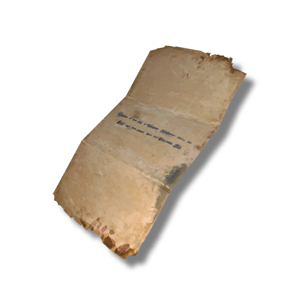

# Charcoal Note

<table class="infobox">
<caption>Charcoal Note</caption>
<colgroup>
<col style="width: 50%" />
<col style="width: 50%" />
</colgroup>
<tbody>
<tr>
<td colspan="2"><figure>

<figcaption>Charcoal_Note_icon.png</figcaption>
</figure></td>
</tr>
<tr>
<td>
Release
</td>
<td>
<a href="./The%20Long%20Dark%20%E2%80%94%20Early%20Access%20Changelog.md#1.00" class="wikilink" title="1 August 2017">1 August 2017</a>
</td>
</tr>
<tr>
<td>
Wintermute
</td>
<td>
<a href="./Episode%202%20-%20Luminance%20Fugue.md" class="wikilink" title="Episode 2">Episode 2</a> - <a href="./Mystery%20Lake%20Supply%20Caches.md" class="wikilink" title="Mystery Lake Supply Caches">Mystery Lake Supply Caches</a>
</td>
</tr>
<tr>
<td colspan="2" class="section">
<strong>Properties</strong>
</td>
</tr>
<tr>
<td>
Item type
</td>
<td>
<a href="./Collectibles.md" class="wikilink" title="Collectibles">Collectibles</a>|-
</td>
</tr>
<tr>
<td>
Stackable
</td>
<td>
No
</td>
</tr>
<tr>
<td>
Examine
</td>
<td>
A note describing a route to a hidden cache of supplies.
</td>
</tr>
<tr>
<td colspan="2" class="section">
<strong>Values</strong>
</td>
</tr>
<tr>
<td>
Weight
</td>
<td>
0.00 kg (0 lbs)
</td>
</tr>
<tr>
<td colspan="2" class="section">
<strong>Actions</strong>
</td>
</tr>
<tr>
<td>
Backpack
</td>
<td>
Examine
</td>
</tr>
<tr>
<td>
On ground
</td>
<td>
Take It, Leave It
</td>
</tr>
</tbody>
</table>

**Charcoal Note** is a <a href="./Collectibles.md" class="wikilink" title="Collectible">Collectible</a> item found in <a href="./Episode%202%20-%20Luminance%20Fugue.md" class="wikilink" title="Episode 2">Episode 2</a> of the <a href="./Wintermute.md" class="wikilink" title="Wintermute">Wintermute</a> story mode. It is found in a Breyerhouse <a href="./Truck.md" class="wikilink" title="Truck">Truck</a> near a <a href="./Train%20Shuttle.md" class="wikilink" title="Train Shuttle">Train Shuttle</a> next to the <a href="./Broken%20Bridge%20%28Broken%20Railroad%20location%29.md" class="wikilink" title="Broken Bridge (Broken Railroad location)">Broken Bridge (Broken Railroad location)</a>. Picking it up adds a cache location in <a href="./Forlorn%20Muskeg.md" class="wikilink" title="Forlorn Muskeg">Forlorn Muskeg</a> for the <a href="./Mystery%20Lake%20Supply%20Caches.md" class="wikilink" title="Mystery Lake Supply Caches">Mystery Lake Supply Caches</a> side mission.

## Transcript

The following text is transcribed from **Charcoal Note**

This letter appears to have been written in charcoal and is smeared with dirt.

"I've been stuck in this damn truck for eight hours while those wolves circle. Not sure I'll be able to get to the supply stash I left along the rail line in the marsh."

## Update history

- UPDATE **1 August 2017 (<a href="./The%20Long%20Dark%20%E2%80%94%20Changelog.md#1.00" class="wikilink" title="Update">Update</a>):**
  - Added to game.

**Lua execution error in Module:Navbox function navbox**

