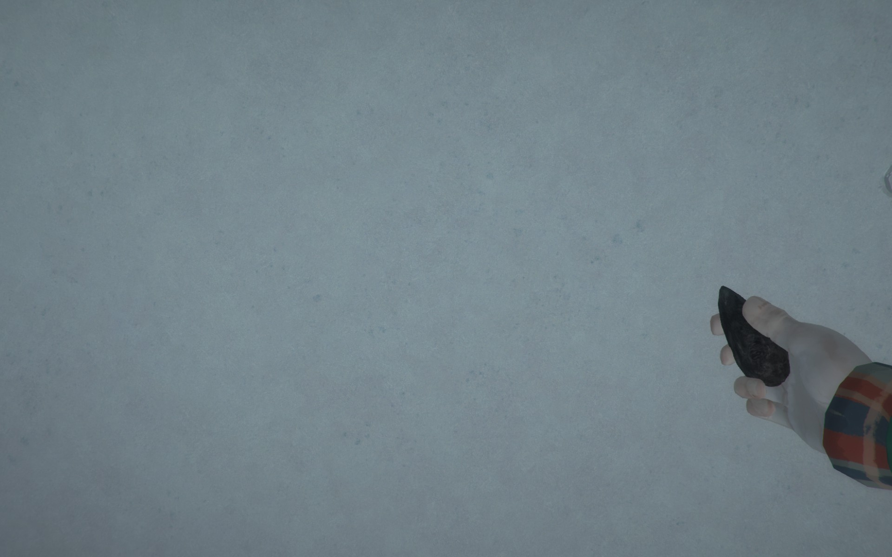

# Charcoal

**Categories:** Pages with update history, Tools · **Source:** [Fandom](https://thelongdark.fandom.com/wiki/Charcoal)

**Contents**

- [Overview](#overview)
- [Charcoal Surveying](#charcoal-surveying)
- [Polaroid Vistas](#polaroid-vistas)
- [Products](#products)
- [Gallery](#gallery)
- [Trivia](#trivia)
- [Update history](#update-history)

**Charcoal**

[Charcoal icon](../assets/Charcoal_icon.png)

**Release:** [8 June 2017](./The%20Long%20Dark%20%E2%80%94%20Early%20Access%20Changelog.md#0.423)

**Wintermute:** No

**Properties**

**Item type:** [Tools](./Tools.md)

**Stackable:** yes

**Examine:** A piece of charcoal typically found in burned out campfires. Useful for sketching.

**Values**

**Weight:** 0.10 kg (0.22 lbs)

**Actions**

**On ground:** Take It, Leave It

**Charcoal** is a tool in _[The Long Dark](./The%20Long%20Dark.md)._

## Overview

It can be acquired easily after [lighting a fire](./Fire%20Starting.md) and allowing it to burn out or by looting containers, either outdoors or in a [firebox](./Fire.md#Contained_fires). Once a fire has burned out, the charcoal can be looted from the remnants. Stoves and naturally-generated campfires normally already contain some charcoal.

A fire must burn for at least one hour before charcoal will generate after the fire burns out. Charcoal will continue to "pile up" as wood is burned in a firebox/campfire, and will not be destroyed even when new fires are started (Charcoal generated will always stay in that firebox until it is removed).

## Charcoal Surveying

The primary use of Charcoal is sketching Maps. The player must be outdoors, and only the area within the player's view can be sketched. Equip the Charcoal and an option will appear asking the player if they wish to survey the local area. The player can't survey when visibility is poor:

- Dark nights without full moon/[Aurora](./Aurora.md)
- Blizzard weather
- Light fog/heavy fog/[Glimmer Fog](./Glimmer%20Fog.md)

Surveying takes 15 minutes of in-game time, which will be sped up for the player and consume 1 Charcoal in the process. This will fill out the map with the player's immediate surroundings, including resources and carcasses that are directly visible to the character. The higher the player's current elevation, the more of the surrounding map is filled out.

Surveying can also be used to "ping" the area a player is in, even if it is already mapped. This can be useful if you find yourself lost.

There is no Charcoal in [Wintermute](./Wintermute.md), since maps are automatically given filled out to the player.

## Polaroid Vistas

If the player finds a [Polaroid](./Polaroids.md) and travels to the survey spot located on the map, the player can survey large swaths of the local region map instantly.

## Products

| Item | Skills | Materials |
| --- | --- | --- |
| [Can of Gunpowder](./Can%20of%20Gunpowder.md) | None | - 1 × [Stump Remover](./Stump%20Remover.md) - 1 × [Dusting Sulfur](./Dusting%20Sulfur.md) - 2 × [Charcoal](./Charcoal.md) |

## Gallery

## Trivia

- In real life, Charcoal does not form in significant quantities when wood is burned in a fire. This is because the draft produced by the burning charcoal tends to draw in enough air to keep itself alight. This is not the case in a camp fire, though, because some wood near the edges won't be fully consumed.

## Update history

- UPDATE **1 August 2017 ([Update](./The%20Long%20Dark%20%E2%80%94%20Changelog%20%E2%80%94%20Archive%201.md#1.00)):**
  - Inventory icon updated.
- UPDATE **8 June 2017 ([Update](./The%20Long%20Dark%20%E2%80%94%20Early%20Access%20Changelog.md#0.423)):**
  - Added to game.
