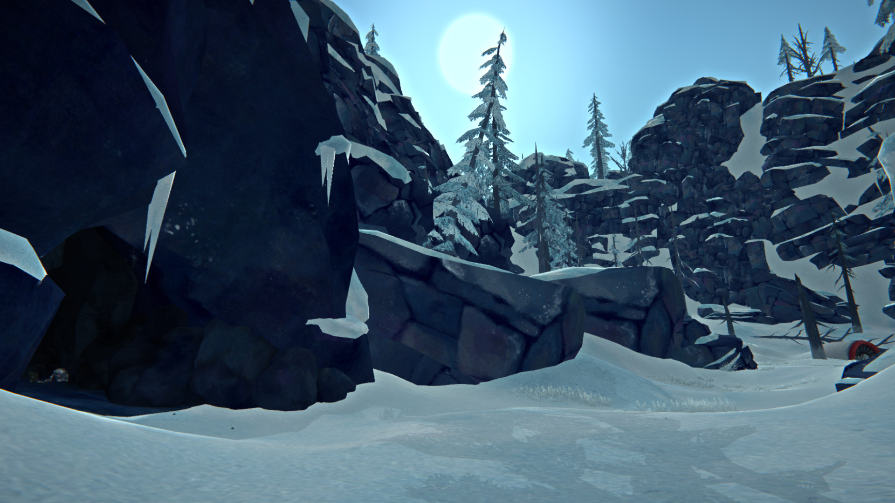
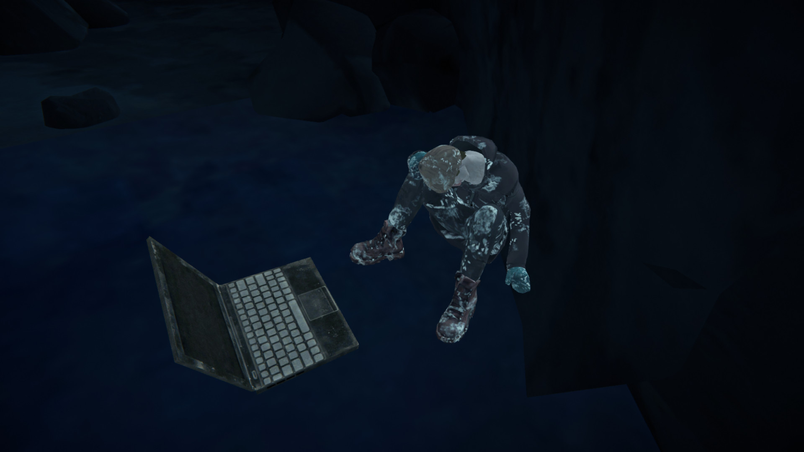

# Chasm Cave

**Categories:** Caves, Locations, Locations in Timberwolf Mountain, Sheltered locations · **Source:** [Fandom](https://thelongdark.fandom.com/wiki/Chasm_Cave)

**Chasm Cave**

[Chasm Cave](../assets/Chasm_Cave.jpg)

**Location**

[Chasm Cave Location](../assets/Chasm_Cave_Location.png)

**Region:** [Timberwolf Mountain](./Timberwolf%20Mountain.md)

**General**

**Type:** Cave

## Overview

A small cave located in [Echo Ravine](./Echo%20Ravine.md), somewhat nearby to [Engine (East)](./Engine%20%28East%29.md). This cave, like all caves, provides some protection from the cold and from the wind, and can contain a [Frozen Corpse](./Frozen%20Corpse.md), some firewood, and, oddly, a [laptop](./Computer.md).

The laptop can, during an [Aurora,](./Aurora.md) be used to gather one of the [Buffer Memories](./Buffer%20Memories.md) for the [Challenge](./Challenge.md) [Archivist](./Archivist.md), or just as a survival mode Buffer Memory.

## Gallery

_Entrance. In the background is the [engine](./Engine%20%28East%29.md)_

