# Cheat Death

**Contents**

- [Overview](#Overview)
- [Choice](#Choice)
- [Cheat Death Consequences](#Cheat_Death_Consequences)
- [Achievements](#Achievements)
- [Affliction](#Affliction)
- [Backpack](#Backpack)
- [Penalty](#Penalty)
- [Respawn](#Respawn)
- [Cheat Death Penalty](#Cheat_Death_Penalty)
- [Respawn](#Respawn_2)
- [Risky respawn locations](#Risky_respawn_locations)
- [Safe respawn locations](#Safe_respawn_locations)
- [Cheating Death](#Cheating_Death)
- [Achievements](#Achievements_2)
- [Game History](#Game_History)

\[Missing image: Cheat_Death.jpg\]{\| style="margin:auto" \| style="vertical-align:top; font-size:3em; color:#5d5980; padding-right:10px" \|“ \| You can cheat death, but you can’t cheat death for free. \| style="vertical-align:bottom; font-size:3em; color:#5d5980; padding-left:10px" \|” \|}

**Cheat Death** is a mechanic in <a href="./Survival%20Mode.md" class="wikilink" title="Survival Mode">Survival Mode</a> of *<a href="./The%20Long%20Dark.md" class="wikilink" title="The Long Dark">The Long Dark</a>*, allowing the player to escape a previously lethal situation at the cost of increased difficulty. Cheat Death was added for free in the Part 5 update of <a href="./Tales%20from%20the%20Far%20Territory.md" class="wikilink" title="Tales from the Far Territory">Tales from the Far Territory</a>.[^1]

This option is available for every difficulty Experience except <a href="./Misery.md" class="wikilink" title="Misery">Misery</a>, and is not present in <a href="./Challenge.md" class="wikilink" title="Challenges">Challenges</a>.[^2]

## Overview

Cheat Death is an optional change to The Long Dark's permadeath system which adds new gameplay to players who aren’t ready to lose their favorite survivor after dying. Cheat Death may be performed up to 3 times (for 4 total lives), with progressively harsher penalties each time. Each extra life is symbolized by a Campfire that can be seen upon quickly checking your status in the pause screen. If the player chooses to persist upon death, an extra life is used up, and the Campfires will become extinguished starting with the left, middle, right Campfire. Once a player dies a 4th time, the player will fade away into The Long Dark.

## Choice

Upon reaching 0% <a href="./Condition.md" class="wikilink" title="Condition">Condition</a> while playing Survival Mode, the player will be presented with two options.

- "End Game"
  - The save file is wiped (ending that sandbox world forever).
  - Survivor <a href="./Skills.md" class="wikilink" title="Skills">Skills</a>, inventory, collectibles, <a href="./Tales.md" class="wikilink" title="Tales">Tales</a> progress, <a href="./Surveyed%20Locations.md" class="wikilink" title="Survey">Survey</a> Progress, and <a href="./The%20Long%20Dark%20%E2%80%94%20Achievements.md" class="wikilink" title="Achievements">Achievements</a> progress are lost.
  - <a href="./Feats.md" class="wikilink" title="Feat">Feat</a> progress (unless playing on <a href="./Custom.md" class="wikilink" title="Custom">Custom</a>) and sandbox statistics are preserved (if the player chooses to record them).
- "Cheat Death"
  - Ability to keep some carried items from the time of death, and later recover missing items.
  - Retain <a href="./Skills.md" class="wikilink" title="Skills">Skills</a>, <a href="./Tales.md" class="wikilink" title="Tales">Tales</a>, <a href="./Surveyed%20Locations.md" class="wikilink" title="Survey">Survey</a>, <a href="./Collectibles.md" class="wikilink" title="Collectibles">Collectibles</a>, <a href="./Technical%20Backpack.md" class="wikilink" title="Technical Backpack">Technical Backpack</a>, and certain <a href="./The%20Long%20Dark%20%E2%80%94%20Achievements.md" class="wikilink" title="Achievements">Achievements</a> progress.
  - The world remains the same: explored/looted areas, stored gear, etc.
  - Increasing Penalties added each time Cheat Death is used (up to 3 times).

\[Missing image: Cheat_Death_Choice.jpg\] If the player closes the game at this point, the save file will be wiped by default. Choosing "Cheat Death" allows the player to continue playing in the same Survival Sandbox, but at a cost...

## Cheat Death Consequences

\[Missing image: Cheat_Death_Consequences.jpg\]If the player chooses to Cheat Death, they will be presented with a list of consequences for this option.

### Achievements

|  |  |  |
|----|----|----|
| “ | Progress for achievements that require completion within a single game will be reset. | ” |

Timers for <a href="./The%20Long%20Dark%20%E2%80%94%20Achievements.md" class="wikilink" title="Achievements">Achievements</a> that require cumulative play time will be reset, and must be started from the beginning:

<table>
<colgroup>
<col style="width: 33%" />
<col style="width: 33%" />
<col style="width: 33%" />
</colgroup>
<tbody>
<tr>
<td>
<strong>Image</strong>
</td>
<td>
<strong>Name</strong>
</td>
<td>
<strong>Description</strong>
</td>
</tr>
<tr>
<td><figure>
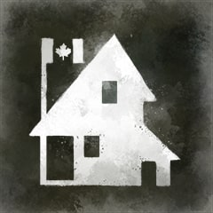
<figcaption>Exploration_Game_icon.png</figcaption>
</figure></td>
<td>
<strong><a href="./Exploration%20Game.md" class="wikilink" title="Exploration Game">Exploration Game</a></strong>
</td>
<td>
Visit every interior location in both <a href="./Mystery%20Lake%20%28region%29.md" class="wikilink" title="Mystery Lake">Mystery Lake</a> and <a href="./Coastal%20Highway.md" class="wikilink" title="Coastal Highway">Coastal Highway</a> (single game)
</td>
</tr>
<tr>
<td><figure>

<figcaption>Waste_Not,_Want_Not_icon.png</figcaption>
</figure></td>
<td>
<strong><a href="./Waste%20Not%2C%20Want%20Not.md" class="wikilink" title="Waste Not, Want Not">Waste Not, Want Not</a></strong>
</td>
<td>
Harvest 10 Complete <a href="./Deer%20Carcass.md" class="wikilink" title="Deer Carcasses">Deer Carcasses</a> (single game)
</td>
</tr>
<tr>
<td><figure>

<figcaption>Night_Walker_icon.png</figcaption>
</figure></td>
<td>
<strong><a href="./Night%20Walker.md" class="wikilink" title="Night Walker">Night Walker</a></strong>
</td>
<td>
Survive an entire Night outside (single game)
</td>
</tr>
<tr>
<td><figure>

<figcaption>Beneath_a_Starry_Sky_icon.png</figcaption>
</figure></td>
<td>
<strong><a href="./Beneath%20a%20Starry%20Sky.md" class="wikilink" title="Beneath a Starry Sky">Beneath a Starry Sky</a></strong>
</td>
<td>
Survive 3 consecutive Nights outside (single game)
</td>
</tr>
<tr>
<td><figure>
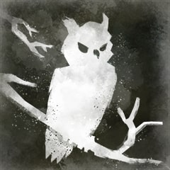
<figcaption>Silent_Hunter_icon.png</figcaption>
</figure></td>
<td>
<strong><a href="./Silent%20Hunter.md" class="wikilink" title="Silent Hunter">Silent Hunter</a></strong>
</td>
<td>
Survive the first 50 days without firing the <a href="./Hunting%20Rifle.md" class="wikilink" title="hunting rifle">hunting rifle</a>, <a href="./Revolver.md" class="wikilink" title="revolver">revolver</a> or the <a href="./Distress%20Pistol.md" class="wikilink" title="distress pistol">distress pistol</a> (single game)
</td>
</tr>
<tr>
<td><figure>

<figcaption>Pacifist_icon.png</figcaption>
</figure></td>
<td>
<strong><a href="./Pacifist.md" class="wikilink" title="Pacifist">Pacifist</a></strong>
</td>
<td>
Survive the first 25 days without killing anything (single game)
</td>
</tr>
<tr>
<td><figure>
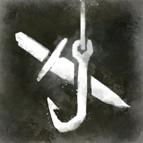
<figcaption>Living_Off_the_Land_icon.png</figcaption>
</figure></td>
<td>
<strong><a href="./Living%20Off%20the%20Land.md" class="wikilink" title="Living Off the Land">Living Off the Land</a></strong>
</td>
<td>
Survive 25 consecutive full days only consuming calories harvested from wild plants and animals (single game)
</td>
</tr>
<tr>
<td><figure>
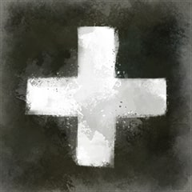
<figcaption>Natural_Healer_icon.png</figcaption>
</figure></td>
<td>
<strong><a href="./Natural%20Healer.md" class="wikilink" title="Natural Healer">Natural Healer</a></strong>
</td>
<td>
Heal yourself using all types of natural <a href="./First%20Aid.md" class="wikilink" title="medicines">medicines</a> (single game)
</td>
</tr>
<tr>
<td><figure>
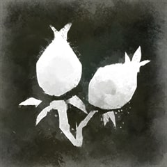
<figcaption>Happy_Harvester_icon.png</figcaption>
</figure></td>
<td>
<strong><a href="./Happy%20Harvester.md" class="wikilink" title="Happy Harvester">Happy Harvester</a></strong>
</td>
<td>
Harvest 25 of each kind of plant (single game)
</td>
</tr>
<tr>
<td><figure>
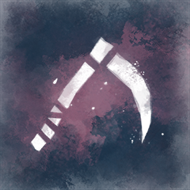
<figcaption>Something_Wicked_icon.png</figcaption>
</figure></td>
<td>
<strong><a href="./Something%20Wicked.md" class="wikilink" title="Something Wicked">Something Wicked</a></strong>
</td>
<td>
Survive 1000 days in a single Survival Mode game without <a href="./Cheat%20Death.md" class="wikilink" title="Cheating Death">Cheating Death</a>.
</td>
</tr>
<tr>
<td><figure>

<figcaption>Expert_Angler_icon.png</figcaption>
</figure></td>
<td>
<strong><a href="./Expert%20Angler.md" class="wikilink" title="Expert Angler">Expert Angler</a></strong>
</td>
<td>
Catch 4 different Rare Fish – <a href="./Burbot%20%28Raw%29.md" class="wikilink" title="Burbot">Burbot</a>, <a href="./Goldeye%20%28Raw%29.md" class="wikilink" title="Goldeye">Goldeye</a>, <a href="./Red%20Irish%20Lord%20%28Raw%29.md" class="wikilink" title="Red Irish Lord">Red Irish Lord</a>, and <a href="./Rockfish%20%28Raw%29.md" class="wikilink" title="Rockfish">Rockfish</a> (single game).
</td>
</tr>
<tr>
<td><figure>
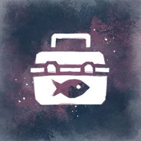
<figcaption>Tackle_Box_icon.png</figcaption>
</figure></td>
<td>
<strong><a href="./Tackle%20Box.md" class="wikilink" title="Tackle Box">Tackle Box</a></strong>
</td>
<td>
Craft a full set of 3 <a href="./Fishing%20Lure%20%28disambiguation%29.md" class="wikilink" title="Fishing Lures">Fishing Lures</a> (single game).
</td>
</tr>
<tr>
<td><figure>
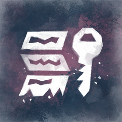
<figcaption>Thanks_for_the_Memories_icon.png</figcaption>
</figure></td>
<td>
<strong><a href="./Thanks%20for%20the%20Memories.md" class="wikilink" title="Thanks for the Memories">Thanks for the Memories</a></strong>
</td>
<td>
Collect 12 <a href="./Mementos.md" class="wikilink" title="Mementos">Mementos</a> – one from each Lower Great Bear Island Region (single game).
</td>
</tr>
<tr>
<td><figure>
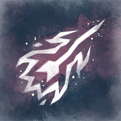
<figcaption>Hot_Shot_icon.png</figcaption>
</figure></td>
<td>
<strong><a href="./Hot%20Shot.md" class="wikilink" title="Hot Shot">Hot Shot</a></strong>
</td>
<td>
Kill 25 Rabbits with <a href="./Fire%20Hardened%20Arrow.md" class="wikilink" title="Fire Hardened Arrows">Fire Hardened Arrows</a> (single game).
</td>
</tr>
<tr>
<td><figure>
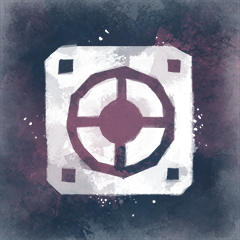
<figcaption>Down_Below_icon.png</figcaption>
</figure></td>
<td>
<strong><a href="./Down%20Below.md" class="wikilink" title="Down Below">Down Below</a></strong>
</td>
<td>
Enter all 9 <a href="./Prepper%20Cache.md" class="wikilink" title="Prepper Cache">Prepper Cache</a> locations (single game).
</td>
</tr>
<tr>
<td><figure>
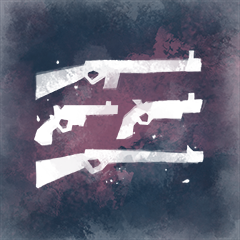
<figcaption>To_the_Teeth_icon.png</figcaption>
</figure></td>
<td>
<a href="./To%20the%20Teeth.md" class="wikilink" title="To the Teeth"><strong>To the Teeth</strong></a>
</td>
<td>
Collect 7 Expansion Firearm variants (single game).
</td>
</tr>
<tr>
<td><figure>

<figcaption>Rüdiger's_Dream_icon.png</figcaption>
</figure></td>
<td>
<a href="./R%C3%BCdiger%27s%20Dream.md" class="wikilink" title="Rüdiger&#39;s Dream"><strong>Rüdiger's Dream</strong></a>
</td>
<td>
Complete all 3 <a href="./Tales.md" class="wikilink" title="Tales">Tales</a> (single game)
</td>
</tr>
<tr>
<td><figure>
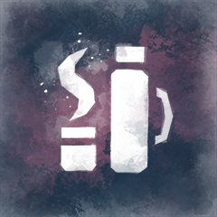
<figcaption>Something_Warm_to_Drink_icon.png</figcaption>
</figure></td>
<td>
<strong><a href="./Something%20Warm%20to%20Drink.md" class="wikilink" title="Something Warm to Drink">Something Warm to Drink</a></strong>
</td>
<td>
Collect 7 <a href="./Insulated%20Flask.md" class="wikilink" title="Insulated Flask">Insulated Flask</a> Variants (single game).
</td>
</tr>
<tr>
<td><figure>
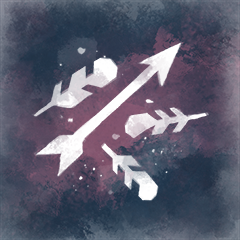
<figcaption>Quick_Draw_icon.png</figcaption>
</figure></td>
<td>
<strong><a href="./Quick%20Draw.md" class="wikilink" title="Quick Draw">Quick Draw</a></strong>
</td>
<td>
Kill 10 <a href="./Ptarmigan.md" class="wikilink" title="Ptarmigans">Ptarmigans</a> with Arrows (single game).
</td>
</tr>
<tr>
<td><figure>
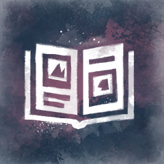
<figcaption>Exposure_icon.png</figcaption>
</figure></td>
<td>
<strong><a href="./Exposure.md" class="wikilink" title="Exposure">Exposure</a></strong>
</td>
<td>
Take a photo in each Great Bear Island Region for a total of 16 (single game).
</td>
</tr>
<tr>
<td><figure>
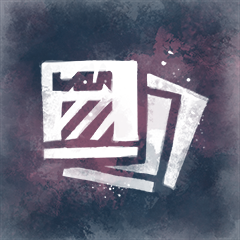
<figcaption>Shutterbug_icon.png</figcaption>
</figure></td>
<td>
<strong><a href="./Shutterbug.md" class="wikilink" title="Shutterbug">Shutterbug</a></strong>
</td>
<td>
Take 10 photos with each film type – Colour, B&amp;W, and Sepia (single game).
</td>
</tr>
<tr>
<td><figure>
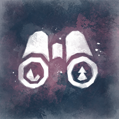
<figcaption>On_the_Lookout_icon.png</figcaption>
</figure></td>
<td>
<strong><a href="./On%20the%20Lookout.md" class="wikilink" title="On the Lookout">On the Lookout</a></strong>
</td>
<td>
Reach all 6 <a href="./Polaroids.md" class="wikilink" title="Vista">Vista</a> locations in the Far Territory (single game).
</td>
</tr>
<tr>
<td><figure>
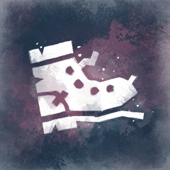
<figcaption>Ends_of_the_Earth_icon.png</figcaption>
</figure></td>
<td>
<strong><a href="./Ends%20of%20the%20Earth.md" class="wikilink" title="Ends of the Earth">Ends of the Earth</a></strong>
</td>
<td>
Travel from <a href="./Desolation%20Point.md" class="wikilink" title="Desolation Point">Desolation Point</a> to <a href="./Sundered%20Pass.md" class="wikilink" title="Sundered Pass">Sundered Pass</a> (single game).
</td>
</tr>
</tbody>
</table>

### Affliction

|  |  |  |
|----|----|----|
| “ | Cheating Death will weaken you, temporarily diminishing your condition and stamina recovery. | ” |

The player's <a href="./Condition.md" class="wikilink" title="Condition">Condition</a> and <a href="./Stamina.md" class="wikilink" title="Stamina">Stamina</a> recovery will be halved when they awaken (<a href="./Weakened%20State.md" class="wikilink" title="Weakened State">Weakened State</a>).

### Backpack

|  |  |  |
|----|----|----|
| “ | Your old pack is still in the world. Find it to recover what's left of your items. | ” |

Many items in the player's inventory will be missing when they wake up. Some items will be carried over to their new life, but many will be lost until they are recovered by finding the <a href="./Recovery%20Backpack.md" class="wikilink" title="Recovery Backpack">Recovery Backpack</a>.

### Penalty

|  |  |  |
|----|----|----|
| “ | You will choose between a painful short-term penalty, or a more forgiving but permanent one. | ” |

The player will be given the choice of the severity of a penalty for choosing to Cheat Death (see next section).

### Respawn

|  |  |  |
|----|----|----|
| “ | You will have to choose between the risk of a spawn close to where you died, or a safe but distant one. | ” |

The player cannot choose where to respawn, but how they will respawn (see later section).

## Cheat Death Penalty

<figure>
[Missing image: Cheat_Death_Penalty.jpg]
<figcaption>Cheat_Death_Penalty.jpg</figcaption>
</figure>

The player can choose their <a href="./Cheated%20Death%20Penalty.md" class="wikilink" title="Cheated Death Penalty">Cheated Death Penalty</a>. The player can mix the two penalty types per death as they please:

- Short Term Penalty:
  - A temporary, but harsh Recovery Time penalty (10-30 days depending on Experience).
  - Max <a href="./Condition.md" class="wikilink" title="Condition">Condition</a> reduced by 50% for the first death, 60% for the second, 75% for the third.
- Permanent Penalty:
  - No Recovery Time penalty, but...
  - Max Condition PERMANENTLY reduced by 25% for the first death, 35% for the second, 50% for the third.

## Respawn

\[Missing image: Cheat_Death_Respawn.jpg\] When you Cheat Death, you'll be given the option to respawn somewhere inside the region you just died, or in a safe but far away location:

- **Close, Risky Respawn** will always put the player outdoors near danger in the same region you died in, and most of the time the hike back to where you died will be halfway across the map, but sometimes it will be shorter.
- **Far, Safe Respawn** will always send the player in or near an indoor location that they may or may not have already discovered in another region. "Safe" is relative, since based on the condition of clothing and remaining inventory, survival may still be a challenge. It is possible to be sent to a region the player has not explored yet, may be a neighboring region or one quite distant (ex, from <a href="./Sundered%20Pass.md" class="wikilink" title="Sundered Pass">Sundered Pass</a> all the way to <a href="./Coastal%20Highway.md" class="wikilink" title="Coastal Highway">Coastal Highway</a>).

Once the respawn conditions are chosen, the player will be asked to confirm, allowing them to cancel Cheat Death or amend their previous choices.

### Risky respawn locations

*This section could use expansion.*

| Region | Location | Note |
|----|----|----|
| <a href="./Coastal%20Highway.md" class="wikilink" title="Coastal Highway">Coastal Highway</a> | Near <a href="./Coastal%20Townsite.md" class="wikilink" title="coastal townsite">coastal townsite</a> | Three way, T shaped intersection right above coastal townsite |

Close, Risky respawn locations

### Safe respawn locations

*This section is a work in progress. You can help by adding eligible locations found in the current version of the game.*

It is unknown if there are any eligible Safe respawn locations in <a href="./Forlorn%20Muskeg.md" class="wikilink" title="Forlorn Muskeg">Forlorn Muskeg</a>.[^3]

| Region | Location | Note |
|----|----|----|
| <a href="./Ash%20Canyon.md" class="wikilink" title="Ash Canyon">Ash Canyon</a> | <a href="./Angler%27s%20Den.md" class="wikilink" title="Angler&#39;s Den">Angler's Den</a> |  |
| Ash Canyon | <a href="./Foreman%27s%20Retreat.md" class="wikilink" title="Foreman&#39;s Retreat">Foreman's Retreat</a> | outdoors |
| Ash Canyon | <a href="./Homesteader%27s%20Respite.md" class="wikilink" title="Homesteader&#39;s Respite">Homesteader's Respite</a> |  |
| <a href="./Bleak%20Inlet.md" class="wikilink" title="Bleak Inlet">Bleak Inlet</a> | <a href="./Cannery%20Worker%20Residences.md" class="wikilink" title="Cannery Worker Residences">Cannery Worker Residences</a> | outdoors |
| Bleak Inlet | <a href="./Echo%20One%20Radio%20Tower.md" class="wikilink" title="Echo One Radio Tower">Echo One Radio Tower</a> |  |
| Bleak Inlet | <a href="./Last%20Resort%20Cannery.md" class="wikilink" title="Last Resort Cannery">Last Resort Cannery</a> | outdoors, near the rope, <a href="./Timberwolf.md" class="wikilink" title="Timberwolves">Timberwolves</a> may be active |
| Bleak Inlet | *<a href="./Workshop.md" class="wikilink" title="Workshop">Workshop</a>* | *<a href="./The%20Long%20Dark%20%E2%80%94%20Changelog.md#2.31_%28Steam%2C_Epic_Games%29" class="wikilink" title="removed in v2.31">removed in v2.31</a>*[^4] |
| <a href="./Blackrock.md" class="wikilink" title="Blackrock">Blackrock</a> | <a href="./Old%20Substation.md" class="wikilink" title="Old Substation">Old Substation</a> |  |
| Blackrock | <a href="./Power%20Plant.md" class="wikilink" title="Power Plant">Power Plant</a> |  |
| Blackrock | <a href="./Trailer%20%28Blackrock%20Region%29.md" class="wikilink" title="Trailer">Trailer</a> | west, near the river |
| <a href="./Broken%20Railroad.md" class="wikilink" title="Broken Railroad">Broken Railroad</a> | <a href="./Hunting%20Lodge.md" class="wikilink" title="Hunting Lodge">Hunting Lodge</a> |  |
| Broken Railroad | <a href="./Maintenance%20Yard.md" class="wikilink" title="Maintenance Yard">Maintenance Yard</a> | just inside the front door |
| Broken Railroad | <a href="./Maintenance%20Yard.md" class="wikilink" title="Maintenance Yard guard house">Maintenance Yard guard house</a> | outdoors |
| <a href="./Coastal%20Highway.md" class="wikilink" title="Coastal Highway">Coastal Highway</a> | <a href="./Jackrabbit%20Island.md" class="wikilink" title="Jackrabbit Island">Jackrabbit Island</a> | outdoors |
| Coastal Highway | <a href="./Misanthrope%27s%20Homestead.md" class="wikilink" title="Misanthrope&#39;s Homestead">Misanthrope's Homestead</a> | outdoors |
| Coastal Highway | <a href="./Quonset%20Garage.md" class="wikilink" title="Quonset Garage">Quonset Garage</a> |  |
| <a href="./Desolation%20Point.md" class="wikilink" title="Desolation Point">Desolation Point</a> | <a href="./Lonely%20Lighthouse.md" class="wikilink" title="Lonely Lighthouse">Lonely Lighthouse</a> |  |
| Desolation Point | <a href="./The%20Riken.md" class="wikilink" title="The Riken">The Riken</a> | kitchen, near the door |
| Desolation Point | Trailer | near <a href="./Hibernia%20Processing.md" class="wikilink" title="Hibernia Processing">Hibernia Processing</a> |
| <a href="./Hushed%20River%20Valley.md" class="wikilink" title="Hushed River Valley">Hushed River Valley</a> | <a href="./Cloudtop%20Falls.md" class="wikilink" title="Cloudtop Falls">Cloudtop Falls</a> | outdoors |
| <a href="./Mystery%20Lake%20%28region%29.md" class="wikilink" title="Mystery Lake">Mystery Lake</a> | <a href="./Camp%20Office.md" class="wikilink" title="Camp Office">Camp Office</a> |  |
| Mystery Lake | <a href="./Derailment.md" class="wikilink" title="Derailment">Derailment</a> | outdoors |
| Mystery Lake | <a href="./Trapper%27s%20Homestead.md" class="wikilink" title="Trapper&#39;s Homestead">Trapper's Homestead</a> |  |
| <a href="./Mountain%20Town.md" class="wikilink" title="Mountain Town">Mountain Town</a> | <a href="./Milton%20House%20%28Grey%20Mother%27s%29.md" class="wikilink" title="Milton House (Grey Mother&#39;s)">Milton House (Grey Mother's)</a> |  |
| Mountain Town | <a href="./Paradise%20Meadows%20Farm.md" class="wikilink" title="Paradise Meadows Farm">Paradise Meadows Farm</a> | <a href="./Paradise%20Meadows%20Farm%20Key.md" class="wikilink" title="key">key</a> is required to re-enter the house |
| Mountain Town | <a href="./St.%20Christopher%27s%20Church.md" class="wikilink" title="St. Christopher&#39;s Church">St. Christopher's Church</a> |  |
| <a href="./Pleasant%20Valley.md" class="wikilink" title="Pleasant Valley">Pleasant Valley</a> | <a href="./Community%20Hall.md" class="wikilink" title="Community Hall">Community Hall</a> |  |
| Pleasant Valley | <a href="./Signal%20Hill.md" class="wikilink" title="Signal Hill">Signal Hill</a> |  |
| Pleasant Valley | <a href="./Skeeter%27s%20Ridge.md" class="wikilink" title="Skeeter&#39;s Ridge">Skeeter's Ridge</a> |  |
| <a href="./Timberwolf%20Mountain.md" class="wikilink" title="Timberwolf Mountain">Timberwolf Mountain</a> | <a href="./Deer%20Clearing.md" class="wikilink" title="Deer Clearing">Deer Clearing</a> | inside the cave |
| Timberwolf Mountain | <a href="./Mountaineer%27s%20Hut.md" class="wikilink" title="Mountaineer&#39;s Hut">Mountaineer's Hut</a> | outdoors |
| (<a href="./Tales%20from%20the%20Far%20Territory.md" class="wikilink" title="TFTFT">TFTFT</a>) <a href="./Forsaken%20Airfield.md" class="wikilink" title="Forsaken Airfield">Forsaken Airfield</a> | repair bay | outdoors, between Terminal and Main Hangar |
| (TFTFT) <a href="./Sundered%20Pass.md" class="wikilink" title="Sundered Pass">Sundered Pass</a> | <a href="./Placid%20Notch.md" class="wikilink" title="Placid Notch">Placid Notch</a> | outdoors, near Refuge Cabin B |
| (TFTFT) <a href="./Zone%20of%20Contamination.md" class="wikilink" title="Zone of Contamination">Zone of Contamination</a> | *TBD* |  |

Far, Safe Respawn locations

## Cheating Death

If the player accepts the terms of Cheating Death, the survivor will wake up looking at their hands and commenting in their confusion if they really just died. Upon awakening, the following occurs:

- Approximately one in-game day will pass between their death and respawn, dependent on the safe/risky choice and time of day.
- All previous <a href="./Afflictions.md" class="wikilink" title="Afflictions">Afflictions</a> and Affliction Risks are cured (including the incurable <a href="./Frostbite.md" class="wikilink" title="Frostbite">Frostbite</a>).
- The player can respawn at varying levels of daylight, such as in the middle of the night or during the morning/evening.
- The player will be afflicted with their chosen <a href="./Cheated%20Death%20Penalty.md" class="wikilink" title="Cheated Death Penalty">Cheated Death Penalty</a>, along with <a href="./Weakened%20State.md" class="wikilink" title="Weakened State">Weakened State</a>. Weakened State gives the player very low Condition and <a href="./Stamina.md" class="wikilink" title="Stamina">Stamina</a> recovery, and will always give the player a <u>Black and White</u> screen. Always take this into consideration when choosing how to respawn, as this can make it difficult to see one's surroundings when you respawn in an already critical state, especially if the player happens to respawn at night.
- Your previously worn Clothing will be intact but will be heavily torn (in the 20% yellow range), resulting in the player easily freezing.
  - The player will also typically respawn with low <a href="./Warmth.md" class="wikilink" title="Warmth">Warmth</a>, or other low <a href="./Needs.md" class="wikilink" title="Needs">Needs</a>.
- Some items the player was carrying will still remain in their backpack, but most will be lost where they died in a <a href="./Recovery%20Backpack.md" class="wikilink" title="Recovery Backpack">Recovery Backpack</a>.
  - The Recovery Backpack will be somewhere in the region you last died in, and is represented by a Campfire icon on the region map. The backpack will also be located next to a recently burned out <a href="./Campfire.md" class="wikilink" title="Campfire">Campfire</a>, as if someone else found your remains. Many items you were carrying when you last died being lost upon opening it (Some of your items can also be around the campsite), suggesting that whomever found your remains took some of your belongings.
  - Recovery Campsites can appear in multiple locations with the same region, so do not expect your items to always be in the same location.
- Dying before reclaiming your Recovery Backpack and Cheating Death a second time will remove the first Backpack from the game world and generates a second one. The previous campsite will be removed from the Map and a second campsite will appear at a new location. This will result in the loss of all lost items tied to the Recovery Backpack from your first life if you did not recover them, **<u>including unique, one-of-a-kind items</u>** that can be found only once in the game world. The only exception to this is that any items around the first campsite rather than inside the Recovery Backpack will remain in the game world, but finding this camp can be troublesome without the icon on the Map.
  - Example: dying with <a href="./Barb%27s%20Rifle.md" class="wikilink" title="Barb&#39;s Rifle">Barb's Rifle</a> and not having it in your inventory when you awake, then dying and cheating death a second time before it was recovered will result in the permanent loss of the rifle on that playthrough.

## Achievements

-  <a href="./Something%20Wicked.md" class="wikilink" title="Something Wicked">Something Wicked</a>

## Game History

- UPDATE **24 June 2024 (<a href="./The%20Long%20Dark%20%E2%80%94%20Changelog.md#2.28" class="wikilink" title="Update">Update</a>):**
  - Added to game.

==References==

**Lua execution error in Module:Navbox function navbox** <a href="ru:%D0%9E%D0%B1%D0%BC%D0%B0%D0%BD_%D1%81%D0%BC%D0%B5%D1%80%D1%82%D0%B8" class="wikilink" title="ru:Обман смерти">ru:Обман смерти</a>

## Notes

[^1]: [TALES FROM THE FAR TERRITORY, PART FIVE, NOW LIVE!](https://www.thelongdark.com/news/tales-from-the-far-territory-part-five-now-live/), Hinterlands Studio, June 24, 2024

[^2]: [Dev Diary – May 2024](https://www.thelongdark.com/news/dev-diary-may-2024/), Hinterlands Studio, May 13, 2024

[^3]: TyrForged (November 22, 2025). "[Cheat death "safe" respawn scouting](https://www.youtube.com/watch?v=-XzPYavfHHA)" (video). YouTube.

[^4]: Hinterland Studios (July 4, 2024). "[THE LONG DARK Updated to v 2.31](https://hinterlandforums.com/forums/topic/45309-the-long-dark-updated-to-v-231/)"
