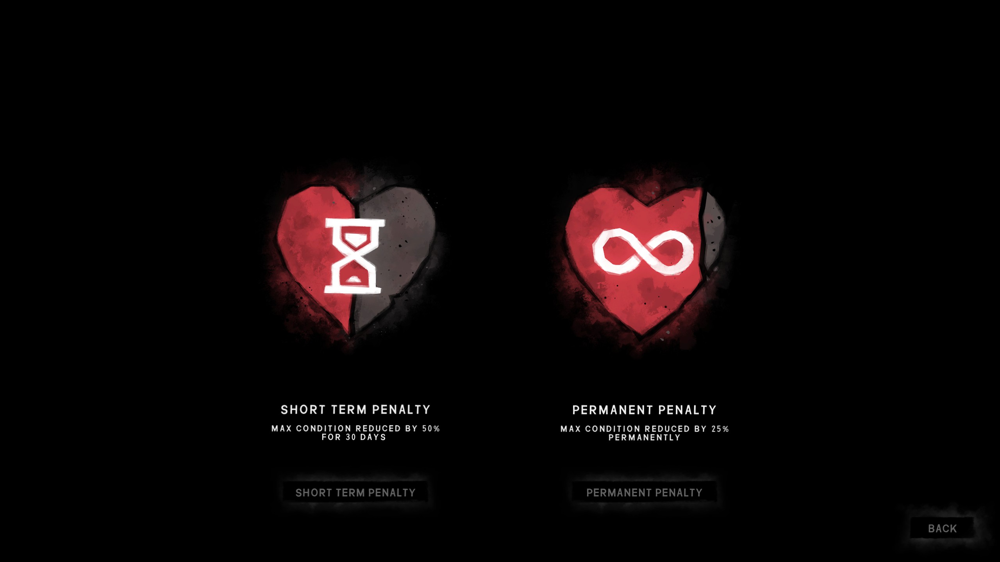

# Cheated Death Penalty

**Categories:** Afflictions, Pages with update history · **Source:** [Fandom](https://thelongdark.fandom.com/wiki/Cheated_Death_Penalty)

**Contents**

- [Overview](#overview)
- [Short Term Penalty](#short-term-penalty)
- [Permanent Penalty](#permanent-penalty)
- [Update history](#update-history)

**Cheated Death Penalty**

[Cheated Death Penalty icon](../assets/Cheated_Death_Penalty_icon.png)

**Release:** [24 June 2024](./The%20Long%20Dark%20%E2%80%94%20Changelog.md#2.28)

**Update:** 2.28

**Properties**

**Category:** [Afflictions](./Afflictions.md)

**Description:** You have Cheated Death. Your maximum Condition is reduced each time you respawn.

**Caused By:** [Cheat Death](./Cheat%20Death.md)

**Effect:** Negative

**Type:** Injury

**Affliction Duration:** Until Recovery Time passes or Permanent Affliction

**Treatment**

**Recovery Time:** See Charts

**Cheated Death Penalty** is an [Affliction](./Afflictions.md) acquired after choosing to [Cheat Death](./Cheat%20Death.md) in [Survival Mode](./Survival%20Mode.md).

<!-- #Overview -->
​

<!-- #overview -->
## Overview

> “**You have Cheated Death. Your maximum Condition is reduced each time you respawn.**”

 The punishment for cheating death and continuing your save file always involves choosing between a great penalty that is temporary, or a smaller penalty that is permanent. The player can choose a mix of the two choices and their consequences as they die. Both penalties impact the [Condition](./Condition.md) bar, and will always be paired with the [Weakened State](./Weakened%20State.md) Affliction upon awakening after cheating death.

<!-- #short_term_penalty -->
​

<!-- #Short_Term_Penalty -->
​

<!-- #Short_term_penalty -->
​

<!-- #short-term-penalty -->
## Short Term Penalty

Choosing "Short Term Penalty" will result in a massive reduction in max Condition and a lengthy Recovery Time, but it will eventually heal.

The Recovery Time is always the same for each death:

| Experience | 1st Death | 2nd Death | 3rd Death | Recovery Time |
| --- | --- | --- | --- | --- |
| [Pilgrim](./Pilgrim.md) | -50% Condition | -60% Condition | -75% Condition | 240 hours (10 days) |
| [Voyageur](./Voyageur.md) | -50% Condition | -60% Condition | -75% Condition | 480 hours (20 days) |
| [Stalker](./Stalker.md) | -50% Condition | -60% Condition | -75% Condition | 480 hours (20 days) |
| [Interloper](./Interloper.md) | -50% Condition | -60% Condition | -75% Condition | 720 hours (30 days) |
| [Misery](./Misery.md)[¹](#fn1) | N/A | N/A | N/A | N/A |

Dying multiple times and choosing the "Short Term Penalty" Cheat Death option does not cause the Recovery Times to stack if the previous penalty time had not yet elapsed.

<!-- #permanent_penalty -->
​

<!-- #Permanent_Penalty -->
​

<!-- #Permanent_penalty -->
​

<!-- #permanent-penalty -->
## Permanent Penalty

Choosing "Permanent Penalty" removes the lengthy Recovery Time, but will add a permanent reduction to max Condition for the rest of the game. The Condition loss is the same across all Experiences.

**Permanent Condition Loss**

| 1st Death | 2nd Death | 3rd Death |
| --- | --- | --- |
| -25% | -35% | -50% |

<!-- #update_history -->
​

<!-- #Update_history -->
​

<!-- #Update_History -->
​

<!-- #update-history -->
## Update history

- UPDATE **24 June 2024 ([Update](./The%20Long%20Dark%20%E2%80%94%20Changelog.md#2.28)):**
  - Added to game.

<!-- #footnotes -->
​

<!-- #notes -->
## Notes

---

1. Cheat Death is disabled on Misery[↩︎](#fnref1)
