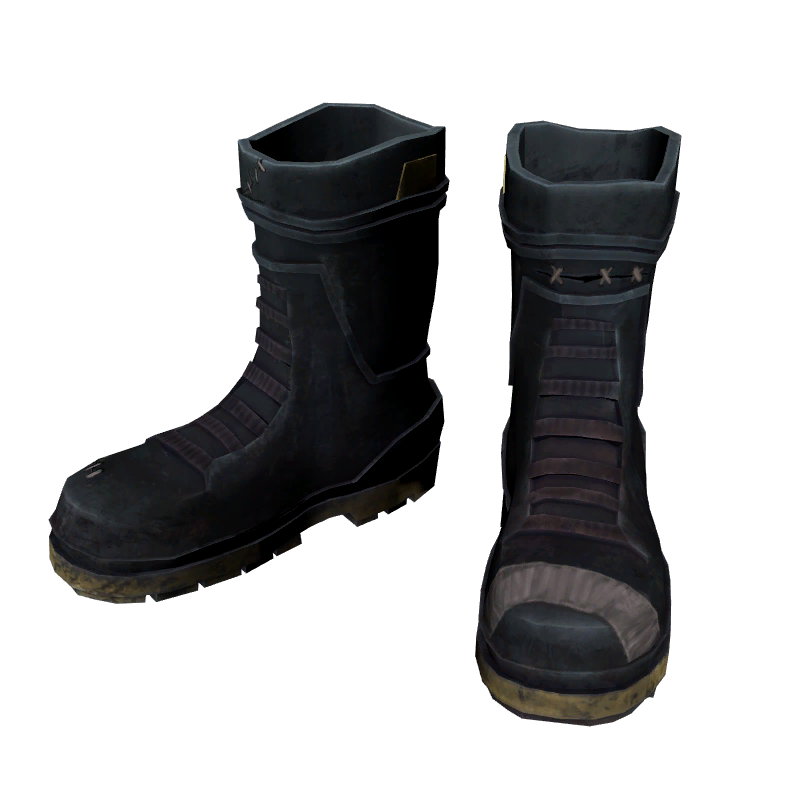

# Chemical Boots

**Categories:** Clothing, DLC Content, Pages with update history · **Source:** [Fandom](https://thelongdark.fandom.com/wiki/Chemical_Boots)

**Chemical Boots**

| Property | Details |
| --- | --- |
|  | [Chemical Boots icon](../assets/Chemical_Boots_icon.png) |
| **General** |  |
| Item Type | Clothing |
| Wintermute |  |
| Renewable | Yes ([Trader](./Trader.md)) |
| Clothing Slot |  |
| **Statistics** |  |
| Weight | [Weight icon](../assets/Weight_icon.png)2.00 kg(4.4 lbs) |
| Warmth bonus | [Temp icon](../assets/Temp_icon.png)2.0 °C(3.6 °F) |
| Windproof bonus | [Windproofness icon](../assets/Windproofness_icon.png)3.0 °C(5.4 °F) |
| Waterproof bonus | [Waterproofness icon](../assets/Waterproofness_icon.png)60% |
| Protection | [Protection icon](../assets/Protection_icon.png)5% |
| Mobility | [Mobility icon](../assets/Mobility_icon.png)-8% |
| Harvest | Cannot Harvest |
| Repair | Cannot Repair |

[Ptarmigan icon](../assets/Ptarmigan_icon.png)

**DLC-Exclusive content.**; This content requires the [Tales from the Far Territory](./Tales%20from%20the%20Far%20Territory.md) addon to be installed before it can be seen or used in regular gameplay.

 **Chemical Boots** are a footwear [Clothing](./Clothing.md) in _The Long Dark_. They are a tool for more safely crossing [Chemical Hazards](./Chemical%20Hazard.md) on the surface of [Zone of Contamination](./Zone%20of%20Contamination.md).

## Overview

Chemical Boots protect against [Chemical Poisoning](./Chemical%20Poisoning.md) when standing in Chemical Hazards on the surface of Zone of Contamination, but not against inhaled chemical fumes from these areas (which require a loaded [Respirator](./Respirator.md)). Chemical Boots are immune to the corrosive effect of Chemical Hazards; unlike other footwear, which rapidly decays when standing in these areas.

Chemical Boots provide no benefit towards [Suffocating Gas](./Suffocation.md).

Chemical Boots cannot be harvested or repaired, with 2-3 pairs found in The Zone: in [Langston Mine](./Langston%20Mine.md), [Concentrator](./Concentrator.md), [Conveyor Room](./Conveyor%20Room.md), [Headframe Building](./Headframe%20Building.md) or [Idle Camp](./Idle%20Camp.md).

Possible to acquire from the [Trader](./Trader.md) for 2.00 L [Lantern Fuel](./Lantern%20Fuel.md), 4 [Coal](./Coal.md) and 5 [Cloth](./Cloth.md)

## Update history

- UPDATE **5 December 2023 ([Update](./The%20Long%20Dark%20%E2%80%94%20Changelog.md#2.25)):**
  - Added to game.
- UPDATE **24 June 2024 ([Update](./The%20Long%20Dark%20%E2%80%94%20Changelog.md#2.28)):**
  - Added new icon.
