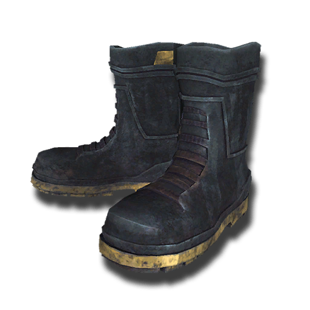
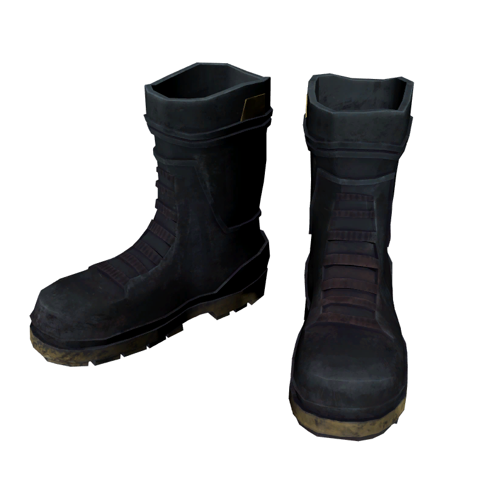
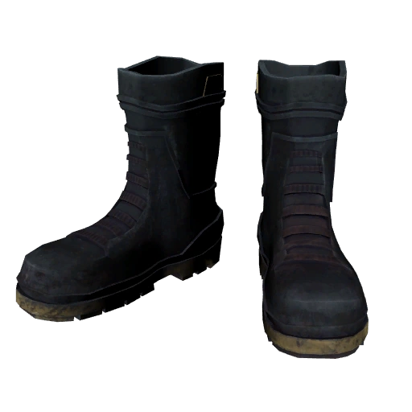

# Chemical Boots

**Chemical Boots**

| Property | Details |
| --- | --- |
|  |  / *Chemical\_Boots\_icon.png* |
| **General** |  |
| Item Type | Clothing\|- |
| Renewable | Yes ([Trader](./Trader.md)) |
| Clothing Slot |  |
| **Statistics** |  |
| Weight | 2.00 kg(4.4 lbs) |
| Warmth bonus | 2.0 °C(3.6 °F) |
| Windproof bonus | 3.0 °C(5.4 °F) |
| Waterproof bonus | 60% |
| Protection | 5% |
| Mobility | -8% |
| Harvest | Cannot Harvest |
| Repair | Cannot Repair |

| Column 1 | Column 2 | Column 3 |
| --- | --- | --- |
|  / *Ptarmigan\_icon.png* | **DLC-Exclusive content.** / This content requires the [Tales from the Far Territory](./Tales%20from%20the%20Far%20Territory.md) addon to be installed before it can be seen or used in regular gameplay. | \|}**Template:quote2** **Chemical Boots** are a footwear [Clothing](./Clothing.md) in *The Long Dark*. They are a tool for more safely crossing [Chemical Hazards](./Chemical%20Hazard.md) on the surface of [Zone of Contamination](./Zone%20of%20Contamination.md). / ## Overview / Chemical Boots protect against [Chemical Poisoning](./Chemical%20Poisoning.md) when standing in Chemical Hazards on the surface of Zone of Contamination, but not against inhaled chemical fumes from these areas (which require a loaded [Respirator](./Respirator.md)). Chemical Boots are immune to the corrosive effect of Chemical Hazards; unlike other footwear, which rapidly decays when standing in these areas. / Chemical Boots provide no benefit towards [Suffocating Gas](./Suffocation.md). / Chemical Boots cannot be harvested or repaired, with 2-3 pairs found in The Zone: in [Langston Mine](./Langston%20Mine.md), [Concentrator](./Concentrator.md), [Conveyor Room](./Conveyor%20Room.md), [Headframe Building](./Headframe%20Building.md) or [Idle Camp](./Idle%20Camp.md). / Possible to acquire from the [Trader](./Trader.md) for 2.00 L [Lantern Fuel](./Lantern%20Fuel.md), 4 [Coal](./Coal.md) and 5 [Cloth](./Cloth.md) / \| Column 1 \| Column 2 \| Column 3 \| / \| --- \| --- \| --- \| / \|  / *Clothing model icon* \|  / *Clothing model icon damaged* \|  / *Old gear icon* \| / ## Update history / - UPDATE **5 December 2023 ([Update](./The%20Long%20Dark%20%E2%80%94%20Changelog.md#2.25)):** / - Added to game. / - UPDATE **24 June 2024 ([Update](./The%20Long%20Dark%20%E2%80%94%20Changelog.md#2.28)):** / - Added new icon. / **Lua execution error in Module:Navbox function navbox** [ru:Сапоги химзащиты](ru:%D0%A1%D0%B0%D0%BF%D0%BE%D0%B3%D0%B8_%D1%85%D0%B8%D0%BC%D0%B7%D0%B0%D1%89%D0%B8%D1%82%D1%8B) |
|  / *Clothing model icon* |  / *Clothing model icon damaged* |  / *Old gear icon* |
