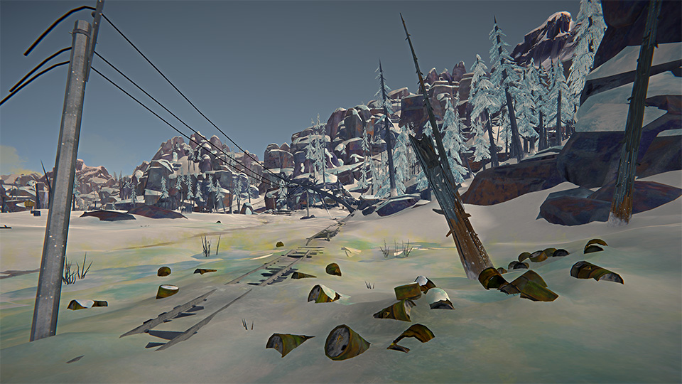

# Chemical Hazard

**Contents**

- [Overview](#Overview)
- [Navigating Chemical Hazards](#Navigating_Chemical_Hazards)
- [Lungs](#Lungs)
- [Footwear](#Footwear)
- [Wildlife](#Wildlife)
- [Gallery](#Gallery)

<table>
<colgroup>
<col style="width: 33%" />
<col style="width: 33%" />
<col style="width: 33%" />
</colgroup>
<tbody>
<tr>
<td width="40px"><figure>
[Missing image: Ptarmigan_icon.png]
<figcaption>Ptarmigan_icon.png</figcaption>
</figure></td>
<td>
<strong>DLC-Exclusive content.</strong> 

This content requires the <a href="./Tales%20from%20the%20Far%20Territory.md" class="wikilink" title="Tales from the Far Territory">Tales from the Far Territory</a> addon to be installed before it can be seen or used in regular gameplay.

</td>
<td>
|} 

A <strong>Chemical Hazard</strong> is an <a href="./Environmental%20Hazard.md" class="wikilink" title="Environmental Hazard">Environmental Hazard</a> located only in the industrial areas of the <a href="./Zone%20of%20Contamination.md" class="wikilink" title="Zone of Contamination">Zone of Contamination</a> <a href="./Region.md" class="wikilink" title="Region">Region</a> in <em><a href="./The%20Long%20Dark.md" class="wikilink" title="The Long Dark">The Long Dark</a></em> and is the reason for the Region's namesake. They are a result of past mismanaged waste disposal by the Langston Mining Corporation during the coal and uranium extraction operations of the <a href="./Langston%20Mine.md" class="wikilink" title="Langston Mine">Langston Mine</a>, with the company's negligence and lack of care for the environment being another example of negative Mainlander influence upon <a href="./Great%20Bear%20Island.md" class="wikilink" title="Great Bear Island">Great Bear Island</a>. The presence of these chemical spills has also contributed to the Region's lack of healthy <a href="./Wildlife.md" class="wikilink" title="Wildlife">Wildlife</a>, and have indirectly created the <a href="./Poisoned%20Wolf.md" class="wikilink" title="Poisoned Wolf">Poisoned Wolf</a>.

For players who have installed <a href="./The%20Long%20Development.md" class="wikilink" title="The Long Development">The Long Development</a>, a Chemical Hazard can also be found at <a href="./Forsaken%20Shore.md" class="wikilink" title="Forsaken Shore">Forsaken Shore</a>.

<h2 id="Overview">Overview</h2>

[Missing image: Chemical_Barrel.jpg] The Chemical Barrels found near Chemical Hazards, as viewed up close. Often found when traveling near manmade buildings and roads within the Zone, Chemical Hazards can be instantly recognized either as sickly phlegm-yellow colored patches of snow or as unnaturally orange colored of ice. Contaminated snow will often have ruptured chemical barrels with biohazard signs carelessly strewn in the snow, wherein contaminated ice will often be found in the frozen ponds located directly near the mining complex itself. Even from afar, signs that a Chemical Hazard are present are evident by the many dead/dying trees unfortunate enough to located in proximity to a chemical spill. Harvestable plants and healthy Wildlife will never be found near Chemical Hazards, forcing a survivor to look elsewhere for hunting and foraging opportunities.

<h2 id="Navigating_Chemical_Hazards">Navigating Chemical Hazards</h2>

Chemical Hazards damage the player in one of two ways; via their lungs and feet.

<h3 id="Lungs">Lungs</h3>

Walking into a Chemical Hazard will result in a survivor coughing and choking on the contaminated air, and the 4 corners of the screen will begin to slowly turn yellow, indicating that they are being poisoned by the air. Continued breathing of these fumes will begin adding to a player's <a href="./Chemical%20Poisoning%20Risk.md" class="wikilink" title="Chemical Poisoning Risk">Chemical Poisoning Risk</a>, with prolonged exposure resulting in the <a href="./Chemical%20Poisoning.md" class="wikilink" title="Chemical Poisoning">Chemical Poisoning</a> <a href="./Afflictions.md" class="wikilink" title="Affliction">Affliction</a>.

Equipping a <a href="./Respirator.md" class="wikilink" title="Respirator">Respirator</a> with plenty of fresh <a href="./Canister.md" class="wikilink" title="Canisters">Canisters</a> will instantly stop Chemical Poisoning Risk buildup and cause any yellowing in the corners of the screen to slowly dissipate. If a Respirator runs out of Canisters, then the corners of the screen will begin to flare up and warn the player that they are being poisoned by the air.

<h3 id="Footwear">Footwear</h3>

Simply walking through a Chemical Hazard will degrade all 3 Footwear <a href="./Clothing.md" class="wikilink" title="Clothing">Clothing</a> slots, rapidly destroying the Condition of a survivor's shoes and socks within seconds if a survivor does not leave a Hazard. The outermost Clothing layers will always Decay first, starting with the shoes slot, the right socks slot, and then the left socks slot. A visceral tearing sound will always play when a survivor's footwear rapidly decays and reaches red condition levels (less than 15% Condition)before being completely ruined.

If a player attempts to circumnavigate this issue by simply removing their footwear Clothing and walking through a Hazard, be aware that walking barefoot through a chemical patch will still result in Chemical Poisoning Risk buildup, as well as a potential <a href="./Warmth.md" class="wikilink" title="Warmth">Warmth</a> loss/<a href="./Frostbite.md" class="wikilink" title="Frostbite">Frostbite</a> Risk.

Walking through a Chemical Hazard with <a href="./Chemical%20Boots.md" class="wikilink" title="Chemical Boots">Chemical Boots</a> equipped is the only way to prevent footwear from being destroyed and prevent Chemical Poisoning buildup. As such, great care must be taken to preserve the overall Condition of any Chemical Boots acquired when traveling throughout the Zone, as they cannot be repaired via <a href="./Mending.md" class="wikilink" title="Mending">Mending</a> and hostile Wildlife <a href="./Struggle.md" class="wikilink" title="Struggles">Struggles</a> have a chance to greatly damage Chemical Boots.

<h3 id="Wildlife">Wildlife</h3>

Despite being contaminated with industrial chemicals themselves, Poisoned Wolves will refuse to enter Chemical Hazards, and will often go great lengths to run around them even if this costs them an opportunity to attack the player. Standing in a Hazard will cause a Poisoned Wolf to stop and growl at the player, and aiming a weapon at them will cause them to flee. This can be used as a possible exploit to drive Poisoned Wolves away if a survivor is properly equipped to stand within a hazard without being damaged, but is not advised. Any other Wildlife will also refuse to enter Chemical Hazards if they are driven near one.

<h2 id="Gallery">Gallery</h2>
<table class="gallery">
<colgroup>
<col style="width: 25%" />
<col style="width: 25%" />
<col style="width: 25%" />
<col style="width: 25%" />
</colgroup>
<tbody>
<tr>
<td><figure>
[Missing image: Chemical_Barrel.jpg]
<figcaption>A chemical barrel often found near hazards</figcaption>
</figure></td>
<td><figure>
[Missing image: Chemical_Spill.jpg]
<figcaption>A chemical spill in the distance. Notice the dying trees and sickly snow</figcaption>
</figure></td>
<td><figure>

<figcaption>All chemical spills in the Zone of Contamination</figcaption>
</figure></td>
<td><figure>
[Missing image: Chemical_Hazard_Hud.jpg]
<figcaption>The corners of the screen when inside a chemical spill unprotected</figcaption>
</figure></td>
</tr>
</tbody>
</table></td>
</tr>
</tbody>
</table>

