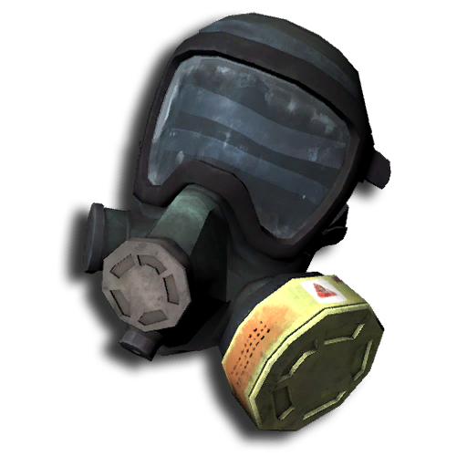
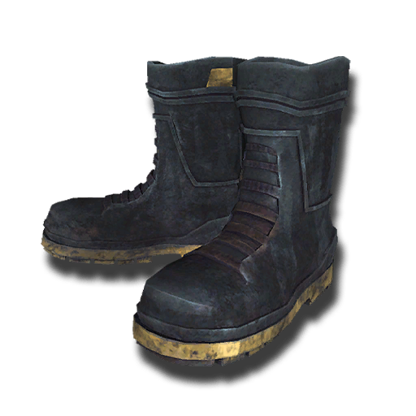

# Chemical Poisoning Risk

**Contents**

- [Risk](#Risk)
- [Avoiding Chemical Poisoning](#Avoiding_Chemical_Poisoning)
- [Treatment](#Treatment)
- [Update history](#Update_history)

<table class="infobox">
<caption>Chemical Poisoning Risk</caption>
<colgroup>
<col style="width: 50%" />
<col style="width: 50%" />
</colgroup>
<tbody>
<tr>
<td colspan="2"><figure>
[Missing image: Chemical_Poisoning_Risk_icon.png]
<figcaption>Chemical_Poisoning_Risk_icon.png</figcaption>
</figure></td>
</tr>
<tr>
<td>
Release
</td>
<td>
<a href="./The%20Long%20Dark%20%E2%80%94%20Changelog.md#2.25" class="wikilink" title="5 December 2023">5 December 2023</a>
</td>
</tr>
<tr>
<td colspan="2" class="section">
<strong>Treatment</strong>
</td>
</tr>
<tr>
<td>
Treatment
</td>
<td>
Avoid Chemical Hazards
</td>
</tr>
<tr>
<td>
Alternate Treatment
</td>
<td>
Equip  <a href="./Respirator.md" class="wikilink" title="Respirator">Respirator</a> w/  <a href="./Canister.md" class="wikilink" title="Canister">Canister</a> and  <a href="./Chemical%20Boots.md" class="wikilink" title="Chemical Boots">Chemical Boots</a> to reduce vulnerability.
</td>
</tr>
<tr>
<td colspan="2" class="section">
<strong>Advanced Data</strong>
</td>
</tr>
<tr>
<td>
Item Key
</td>
<td>
GAMEPLAY_ChemicalPoisoningRisk
</td>
</tr>
</tbody>
</table>

<table>
<colgroup>
<col style="width: 33%" />
<col style="width: 33%" />
<col style="width: 33%" />
</colgroup>
<tbody>
<tr>
<td width="40px"><figure>
[Missing image: Ptarmigan_icon.png]
<figcaption>Ptarmigan_icon.png</figcaption>
</figure></td>
<td>
<strong>DLC-Exclusive content.</strong> 

This content requires the <a href="./Tales%20from%20the%20Far%20Territory.md" class="wikilink" title="Tales from the Far Territory">Tales from the Far Territory</a> addon to be installed before it can be seen or used in regular gameplay.

</td>
<td>
|} A <strong>Chemical Poisoning Risk</strong> is an <a href="./Afflictions.md" class="wikilink" title="affliction">affliction</a> that can develop into <a href="./Chemical%20Poisoning.md" class="wikilink" title="Chemical Poisoning">Chemical Poisoning</a> if left untreated.

Proximity to <a href="./Chemical%20Hazard.md" class="wikilink" title="Chemical Hazards">Chemical Hazards</a> will add toxicity at a rate of 3% per minute for up to a maximum of 100% toxicity. The player will receive the <a href="./Chemical%20Poisoning%20Risk.md" class="wikilink" title="Chemical Poisoning Risk">Chemical Poisoning Risk</a> affliction once they reach 20% toxicity and the <a href="./Chemical%20Poisoning.md" class="wikilink" title="Chemical Poisoning">Chemical Poisoning</a> affliction at 100% toxicity. By remaining away from Chemical Hazards, 10% toxicity will be removed per hour after a half hour delay. If a treatment is applied, the Chemical Poisoning Risk is removed without developing further into <a href="./Chemical%20Poisoning.md" class="wikilink" title="Chemical Poisoning">Chemical Poisoning</a>.

<h2 id="Risk">Risk</h2>
<table>
<tbody>
<tr>
<td style="vertical-align: top; font-size: 3em; color: #5d5980; padding-right: 10px">
“
</td>
<td>
You risk Poisoning by spending time inside a Chemical Hazard.
</td>
<td style="vertical-align: bottom; font-size: 3em; color: #5d5980; padding-left: 10px">
”
</td>
</tr>
</tbody>
</table>

[Missing image: Chemical_Spill.jpg] An example of a Chemical Spill in the Zone. Notice the sickly phlegm-yellow fumes surrounding the nearby barrels and dying trees.The Zone of Contamination contains various spilled <a href="./Chemical%20Hazard.md" class="wikilink" title="chemical patches">chemical patches</a> on the surface. These patches are easy to identify from a distance from the fumes that hang around the surface. Dying/dead trees, toxic barrels strewn in the snow, and sickly orange ponds pumped full of chemicals good identifiers that chemical patches are in the area.

A Chemical Poisoning Risk alert will not immediately notify the player unlike other Risks, so situational awareness is a must when passing through a hazard. Simply walking near a Chemical Hazard will generate a buildup of a yellowish substance in each of the corners of the screen the longer one stays inside, and if a player stays inside a Hazard for too long, the survivor will begin to cough occasionally. If a player is inside a Hazard for too long, their footwear will degrade and begin to audibly generate a violent tearing sound. Chemical spills can be very hard to see during the night or during foggy weather, so it is best to stay away from roads/railroads/ponds when close to the mine.

Chemical Poisoning Risk is also acquired engaging in a struggle with a <a href="./Poisoned%20Wolf.md" class="wikilink" title="Poisoned Wolf">Poisoned Wolf</a>.

<h3 id="Avoiding_Chemical_Poisoning">Avoiding Chemical Poisoning</h3>

Chemical Poisoning builds up in one of 2 ways, lungs and skin. Equipping a <a href="./Respirator.md" class="wikilink" title="Respirator">Respirator</a> fitted with <a href="./Canister.md" class="wikilink" title="Canisters">Canisters</a> while passing though a Chemical Patch reduces the player's vulnerability to Chemical Poisoning. Wearing footwear while walking through Patches will also alleviate Poisoning, though wearing anything but <a href="./Chemical%20Boots.md" class="wikilink" title="Chemical Boots">Chemical Boots</a> results in footwear Condition rapidly corroding. <a href="./Poisoned%20Wolf.md" class="wikilink" title="Poisoned Wolf">Poisoned Wolf</a> <a href="./Struggle.md" class="wikilink" title="Struggles">Struggles</a> can also slowly generate a moderate amount of Chemical Poisoning buildup for however long a Struggle lasts.

If a player does build up Chemical Poisoning Risk, simply leaving the hazardous area and waiting several hours in a clean environment will cause the toxins to gradually dissipate from the survivor's body, similar to how you clear <a href="./Cabin%20Fever%20Risk.md" class="wikilink" title="Cabin Fever risk">Cabin Fever risk</a>.

<h2 id="Treatment">Treatment</h2>

The only treatment to Chemical Poisoning is to spend time away from contaminated areas; but additional buildup can be avoided by wearing  <a href="./Chemical%20Boots.md" class="wikilink" title="Chemical Boots">Chemical Boots</a> in toxic areas and wearing a  <a href="./Respirator.md" class="wikilink" title="Respirator">Respirator</a> (with a loaded <a href="./Canister.md" class="wikilink" title="Canister">Canister</a>) in toxic gases from the Chemical Hazards, and avoiding struggles with Poisoned Wolves.

If enough Chemical Poisoning Risk builds up, the player will be afflicted with <a href="./Chemical%20Poisoning.md" class="wikilink" title="Chemical Poisoning">Chemical Poisoning</a>.

<h2 id="Update_history">Update history</h2>

<ul>
<li>UPDATE <strong>5 December 2023 (<a href="./The%20Long%20Dark%20%E2%80%94%20Early%20Access%20Changelog.md#2.25" class="wikilink" title="Update">Update</a>):</strong>
<ul>
<li>Added to game.</li>
</ul></li>
</ul>

<strong>Lua execution error in Module:Navbox function navbox</strong><a href="ru:%D0%A0%D0%B8%D1%81%D0%BA_%D1%85%D0%B8%D0%BC%D0%B8%D1%87%D0%B5%D1%81%D0%BA%D0%BE%D0%B3%D0%BE_%D0%BE%D1%82%D1%80%D0%B0%D0%B2%D0%BB%D0%B5%D0%BD%D0%B8%D1%8F" class="wikilink" title="ru:Риск химического отравления">ru:Риск химического отравления</a>
</td>
</tr>
</tbody>
</table>

