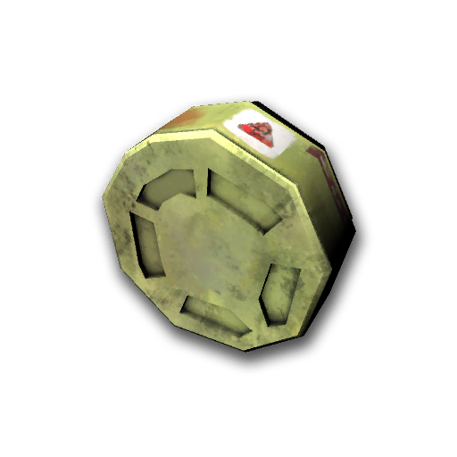

# Chemical Poisoning Risk

**Categories:** Afflictions, DLC Content, Pages with update history · **Source:** [Fandom](https://thelongdark.fandom.com/wiki/Chemical_Poisoning_Risk)

**Contents**

- [Risk](#risk)
- [Avoiding Chemical Poisoning](#avoiding-chemical-poisoning)
- [Treatment](#treatment)
- [Update history](#update-history)

**Chemical Poisoning Risk**

| Property | Details |
| --- | --- |
|  |  / _Chemical\_Poisoning\_Risk\_icon.png_ |
| Release | [5 December 2023](./The%20Long%20Dark%20%E2%80%94%20Changelog.md#2.25) |
| **Treatment** |  |
| Treatment | Avoid Chemical Hazards |
| Alternate Treatment | Equip  [Respirator](./Respirator.md) w/  [Canister](./Canister.md) and  [Chemical Boots](./Chemical%20Boots.md) to reduce vulnerability. |
| **Advanced Data** |  |
| Item Key | GAMEPLAY\_ChemicalPoisoningRisk |

| Column 1 | Column 2 | Column 3 |
| --- | --- | --- |

| “ | __You risk Poisoning by spending time inside a Chemical Hazard.__ | ” |
