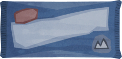
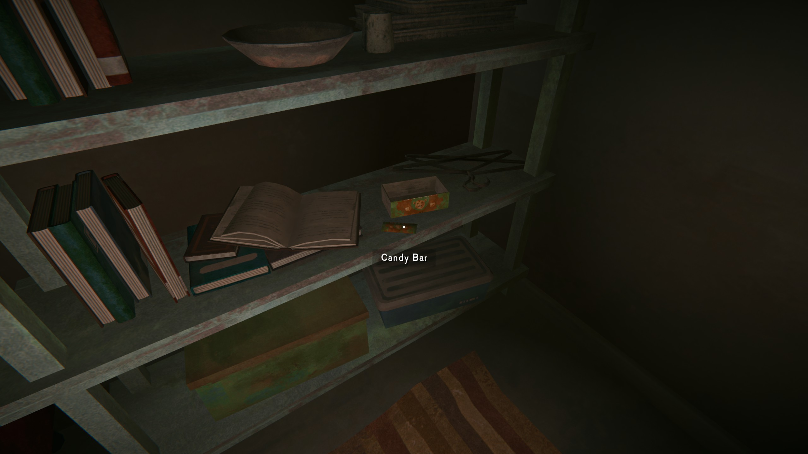

# Chocolate Bar

**Categories:** Food And Drink, Pages with update history · **Source:** [Fandom](https://thelongdark.fandom.com/wiki/Chocolate_Bar)

**Contents**

- [Overview](#overview)
- [Trivia](#trivia)
- [Gallery](#gallery)
- [Update history](#update-history)

**Chocolate Bar**

| Property | Details |
| --- | --- |
|  |  / _Chocolate\_Bar\_icon.png_ |
| Release | [22 September 2014](./The%20Long%20Dark%20%E2%80%94%20Changelog.md#0.117) |
| Wintermute | No |
| Renewable | Yes (rare [Beachcombing](./Beachcombing.md)) |
| **Properties** |  |
| Item type | [Food And Drink](./Food%20And%20Drink.md)\|- |
| Stackable | No |
| Examine | Chocolate and nuts! |
| **Values** |  |
| Calories | 250 kcal |
| Hydration | -3% |
| Weight | 0.10 kg (0.22 lbs) |
| **Advanced data** |  |
| Item key | GAMEPLAY\_CandyBar |

_For the version encountered during the event [4 Days of Night](./4%20Days%20of%20Night%20Event.md), see [Chocolate Bar (4 Days of Night)](./Chocolate%20Bar%20%284%20Days%20of%20Night%29.md)._

**Chocolate Bar**, sometimes labeled in game as **Candy Bar**, is a packaged [food](./Food%20And%20Drink.md) item in _[The Long Dark](./The%20Long%20Dark.md)_.

## Overview

Consuming a chocolate bar provides up to 250 calories of [energy](./Hunger.md), and [dehydrates](./Thirst.md) by a small amount. Like other packaged food and drink, it is most commonly found inside houses, shops, [vehicles](./Vehicle.md) and on [frozen corpses](./Frozen%20Corpse.md). The chocolate bar weights a mere 0.10 kg making its energy density high at 2,500 calories per kilogram.

Chocolate Bars can cause [Food Poisoning](./Food%20Poisoning.md) even when in relatively decent condition, but [decay](./Decay.md) very slowly, especially when outdoors.

## Trivia

The back of a Candy Bar lists "Ingredients: Chocolate, Almonds, Sugar, Salt, Natural Flavours."

## Gallery

_Old model called "Candy Bar"_

_Chocolate bar labeled as "Candy Bar" in game_

## Update history

- UPDATE **21 April 2016 ([Update](./The%20Long%20Dark%20%E2%80%94%20Early%20Access%20Changelog.md#0.321)):**
  - Updated the gear naming system to reflect item condition (applies to Food and Clothing items, currently).
  - Item name changed from 'Candy Bar' to 'Chocolate Bar'.
- UPDATE **22 September 2014 ([Update](./The%20Long%20Dark%20%E2%80%94%20Early%20Access%20Changelog.md#0.117)):**
  - Added to game.
