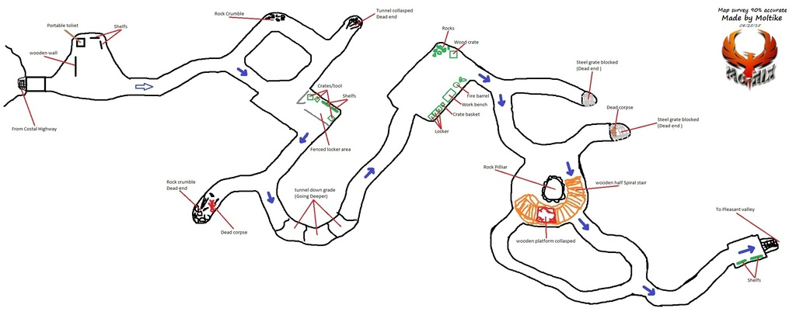
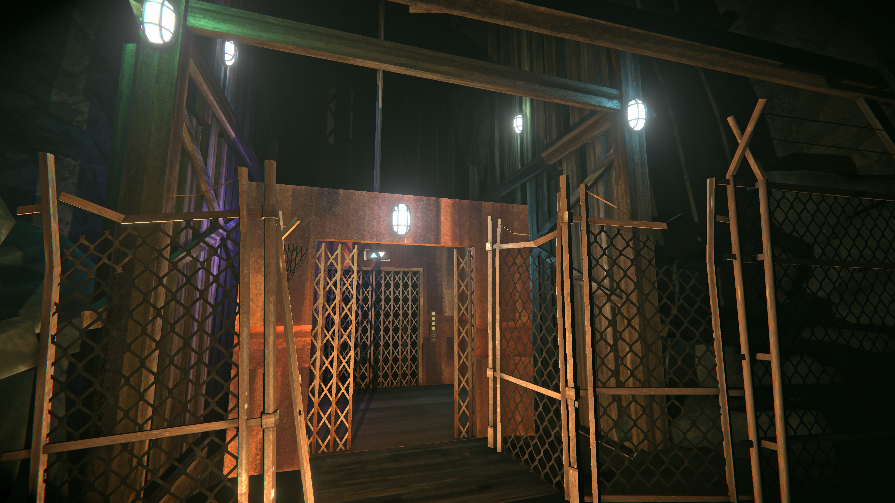
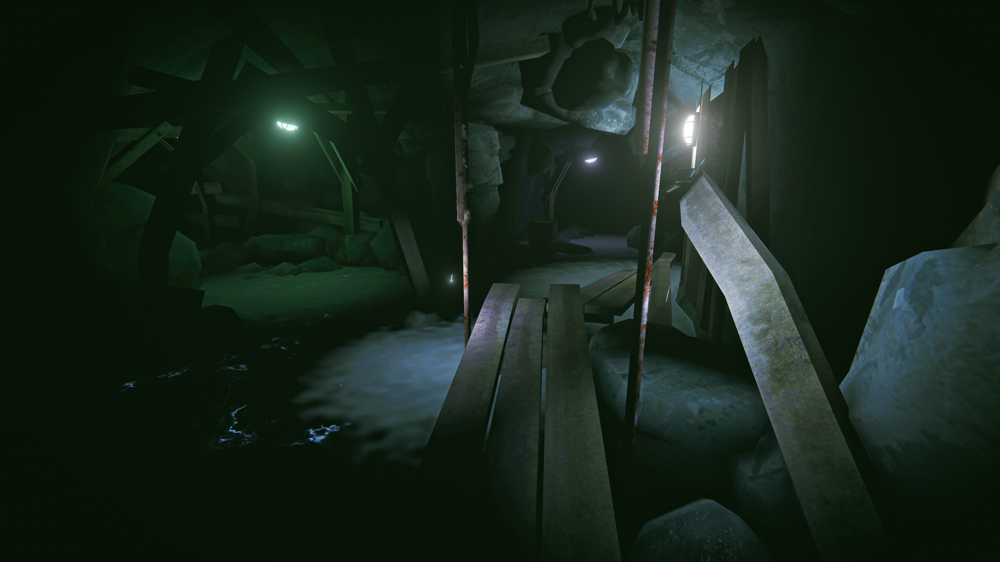

# Cinder Hills Coal Mine

**Categories:** Caves, Indoor locations, Locations, Locations in Coastal Highway, Locations in Pleasant Valley, Locations with a workbench, Transition zones · **Source:** [Fandom](https://thelongdark.fandom.com/wiki/Cinder_Hills_Coal_Mine)

**Contents**

- [Overview](#overview)
- [Supplies](#supplies)
- [Navigating](#navigating)
- [Trivia](#trivia)
- [Gallery](#gallery)

**Cinder Hills Coal Mine**

[RegionAtlas resources.assets 562 (4)](../assets/RegionAtlas-resources.assets-562_%284%29.png)

**Location**

[Cinder Hills Coal Mine map](../assets/Cinder_Hills_Coal_Mine_map.png)

**Region:** [Coastal Highway](./Coastal%20Highway.md)

**General**

**Type:** Cave

**Missions:** [Aftermath](./Aftermath.md)

**Cinder Hills Coal Mine,**also known as "Abandoned Mine", is a series of mine tunnels located in [Coastal Highway](./Coastal%20Highway.md), with one section that acts as a connection to [Pleasant Valley](./Pleasant%20Valley.md).

## Overview

This mine has three levels: in [Survival Mode](./Survival%20Mode.md) these levels are separate areas, and in [Wintermute](./Wintermute.md) all three mine sections are interconnected.

- The Upper Level of the mine connects northern [Coastal Highway](./Coastal%20Highway.md) (near [Abandoned Lookout](./Abandoned%20Lookout.md)) to southern [Pleasant Valley](./Pleasant%20Valley.md) (near [Thomson's Crossing](./Thomson%27s%20Crossing.md)).
- The Lower Level of the mine is in [Coastal Highway](./Coastal%20Highway.md) near the [Log Sort](./Log%20Sort.md) and is relatively small. An electric-powered elevator in its depths leads up to the Middle Level of the mine, which becomes useable only when powered at night during an active [Aurora](./Aurora.md).
- The Middle Level offers a series of interconnected tunnels with rich loot, but also [electrified hazards](./Burns.md). It can only be accessed via entering the Lower Level and using the elevator during an active [Aurora](./Aurora.md).

The Feels Like temperature inside of mines is very warm on all Game Modes, and since no animals spawn inside they can serve as dark but safe shelter.

Cinder Hills Coal Mine is similar to [Abandoned Mine No. 3](./No.%203%20Coal%20Mine.md). They both have long, dark tunnels that connect the two regions together.

Caution should be taken when exploring the Middle Level of the mine: electrified wires and electrified water can kill the reckless, and those who take too long will become trapped when the [Aurora](./Aurora.md) ends and the elevator becomes unpowered. This hazard can be partially offset by leaving a stockpile of food, water, and a [Bedroll](./Bedroll.md) inside the middle level beyond the elevator.

### Supplies

The Cinder Hills Coal Mine is an abundant and renewable source of [Coal](./Coal.md) fuel. Coal is highly valuable to heat a [Furnace](./Furnace.md) hot enough to forge [Arrowheads](./Arrowhead.md), [Improvised Hatchets](./Improvised%20Hatchet.md), and [Improvised Knives](./Improvised%20Knife.md). Coal is also useful on Stalker and Interloper in extremely cold survival situations, to increase Ambient Temperature hotter than wood fires. Coal respawns inside mines after several days.

[Tools](./Tools.md), First Aid supplies, and [Clothing](./Clothing.md) can be found on Corpses, in [Lockers](./Prybar.md), or scattered about. A [Work Bench](./Work%20Bench.md) can also be found in a room in the center of the mine, though it requires a light source to use.

[Firearms](./Revolver.md) and other high-quality loot can spawn in the Middle Level.

### Navigating

Mines are not large but are pitch black beyond their entrances at all hours of day, and feature numerous dead ends or circuits. They can make navigation extremely difficult without a light source. It is advised to bring a [Storm Lantern](./Storm%20Lantern.md), [Torch](./Torch.md), or [Flare](./Flare.md) while exploring them.

If you get trapped within the mine, there will always be another aurora scripted to start at 8:30pm the following night, allowing the player to escape.

### Trivia

- Ensure that any supplies you wish to transport between levels are on your person rather than the elevator floor; mechanically, the elevator does not physically 'travel' between levels, so items dropped onto it are not carried up or down, and will instead remain on the floor they were originally placed.

## Gallery

