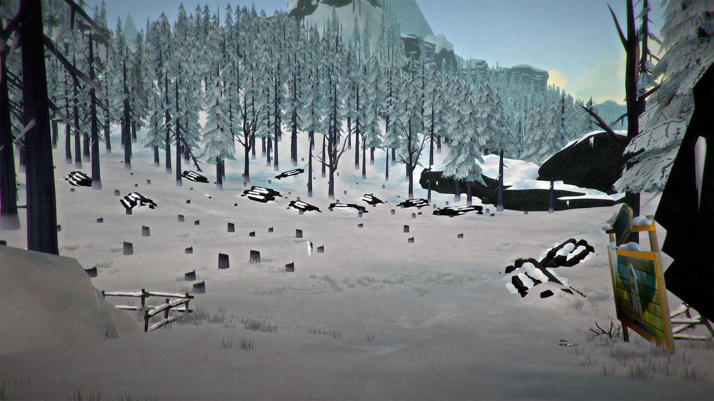
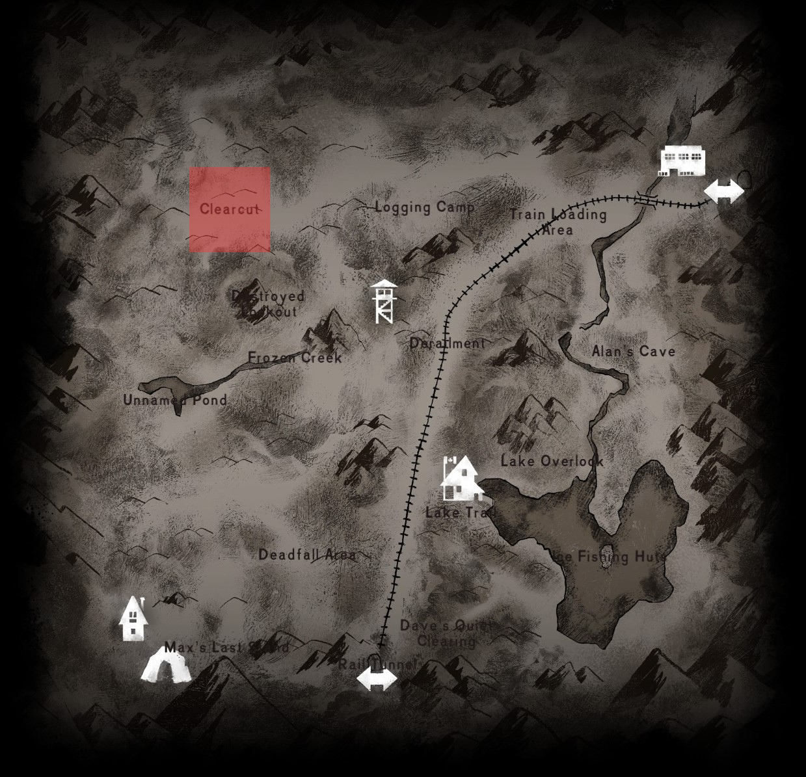

# Clearcut

**Clearcut**

| Property | Details |
| --- | --- |
|  |  / *Clearcut\_01.jpg* |
| **Location** |  |
|  |  / *Clearcut\_Location.png* |
| Region | [Mystery Lake](./Mystery%20Lake%20%28region%29.md)\|- |
| Description | A clear cut logging area. |
| **General** |  |
| Type | Outdoors\|- |
